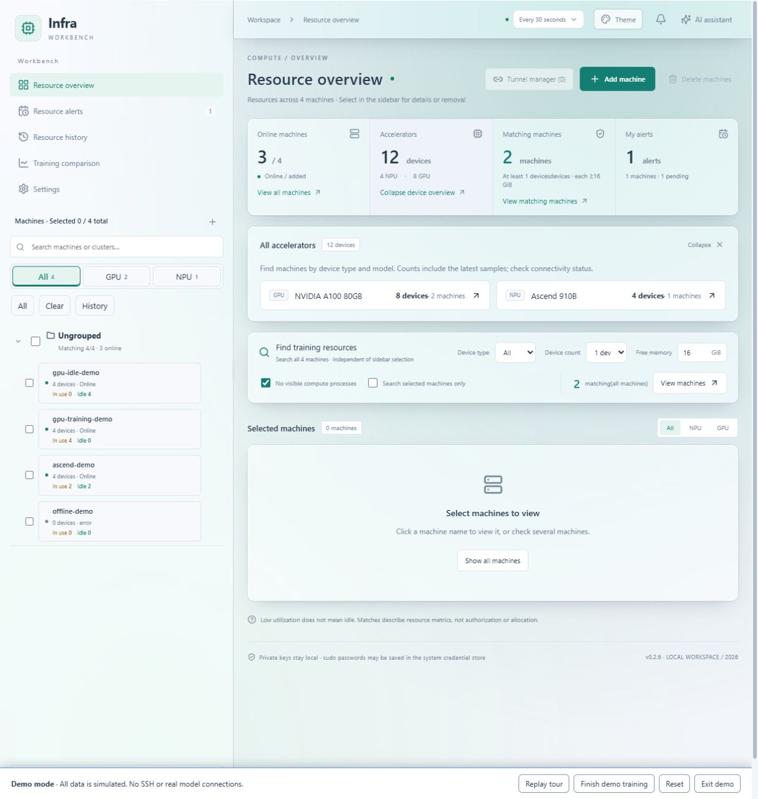

<p align="center">
  
</p>

<h1 align="center">Infra Workbench</h1>

<p align="center">
  <strong>An AI-native server workbench for AI engineers</strong><br>
  Unify GPU / Ascend NPU discovery, process inspection, terminals, files, and training logs across Linux servers over SSH
</p>

<p align="center">
  <a href="https://github.com/addsubmuldiv/infra-workbench/releases/latest">
    
  </a>
  
  <a href="LICENSE">
    
  </a>
</p>

<p align="center">
  <a href="README.md">简体中文</a> | <strong>English</strong>
</p>

<p align="center">
  <a href="https://github.com/addsubmuldiv/infra-workbench/releases/latest"><strong>Download</strong></a> ·
  <a href="#quick-start">Quick start</a> ·
  <a href="#browser-demo-no-server-required">Browser demo</a> ·
  <a href="docs/GUIDE.en.md">User guide</a> ·
  <a href="docs/README.md">Docs index</a>
</p>

<p align="center">
  
</p>

<p align="center">
  <sub>The screenshot uses fictional machines and sample data. See the <a href="docs/GUIDE.en.md">illustrated user guide</a>. Switch UI language under <b>Settings → General → Interface language</b>.</sub>
</p>

---

## What you get

- **Multi-host GPU / Ascend NPU visibility.** Aggregate accelerator models, free memory, utilization, and occupying processes across Linux servers over SSH. Failed, missing, or stale samples stay explicitly unknown instead of appearing idle.
- **Terminals, files, and remote services in one place.** Open web terminals (with tmux support), edit and transfer files, forward TensorBoard / Jupyter, or configure SSH tunnels and VS Code connections.
- **Availability alerts and usage history.** Wait for a target count or specific devices to stay free before triggering desktop or email alerts, review historical samples, and compare training metrics across experiments.
- **AI-native workflows.** The built-in assistant calls the workbench's real host, resource, process, file, and alert tools with full execution records. Supports Responses / tool-calling APIs as well as locally installed [Codex](docs/CODEX.md), [Claude Code, and OpenCode](docs/EXTERNAL-AGENTS.md).
- **MCP for external agents.** Expose the same server-validated workbench capabilities over [MCP](docs/MCP.md) so your existing agent can discover capacity and operate on authorized hosts.
- **Reusable Skills.** Turn verified inspection or troubleshooting steps into Markdown / ZIP skills with `@` selection, on-demand discovery, drafts, enable/disable controls, and version rollback (scripts in skills do not run automatically).
- **Local-first, no remote daemon required.** Desktop windows, the system tray, and the floating monitor share a single local backend; host scope checks and credential protections are enforced server-side.

---

## Why AI-native

When training, fine-tuning, or debugging across multiple machines, the model interprets goals and chooses tools while the backend provides live server state and enforces scope and argument validation.

**Use case: let your agent switch servers when all devices are busy**

1. Your agent has prepared the code and environment on server A, only to find every accelerator occupied when starting training.
2. In the same conversation, ask it to query MCP for an accessible host matching the required device model, count, and free memory.
3. Once it finds server B, the agent uses authorized SSH and file tools to sync code, configs, and checkpoints, recreate the environment, verify dependencies and devices, and launch training.

The execution host changes, while the agent stays in the same thread with your goals, troubleshooting history, and decisions intact. See the [unified MCP notes](docs/UNIFIED-MCP.md) (in Chinese).

> [!NOTE]
> - MCP provides discovery and server tools; the agent handles the move. The workbench does not automatically migrate jobs, lock devices, or schedule training.
> - The built-in assistant can access all added hosts by default. Enable **Only allow operations on selected machines** in the composer context settings to restrict scope (sidebar selection alone does not restrict it). Completed remote changes are not undone by cancellation.

---

## Install

| Option | Best for | Details |
| --- | --- | --- |
| **Windows installer (recommended)** | Daily use | Bundles the Python backend and frontend assets; no separate Python or Node.js required |
| **Run from source** | Developers / custom setups | Clone or extract the repo and run `安装.cmd` to prepare Python and dependencies |
| **Browser demo** | Quick exploration | Browser-only simulated data; no servers or model API keys required |

### Windows installer (recommended)

Download the Windows x64 installer from the [latest Release](https://github.com/addsubmuldiv/infra-workbench/releases/latest) and follow the setup wizard. Verify download integrity with `SHA256SUMS.txt` on the same page.

- Desktop windows, the system tray, and the floating monitor share one local backend. **Closing the window or browser does not stop the backend**—use the tray menu to exit.
- This README describes the current repository; check the Release notes for features included in a specific installer.

### Run from source

Extract or clone the full repository and run `安装.cmd`. First-time setup requires internet access to prepare Python (via WinGet for Python 3.12 if missing) and dependencies, and requires keeping the entire project directory. See [Windows instructions](docs/WINDOWS.md).

### Browser demo (no server required)

After starting the workbench locally, append `?demo=1` to its URL (for example `http://127.0.0.1:8765/?demo=1`) to explore sample hosts, resource filters, terminals, files, and a highlighted walkthrough. You can also run a standalone frontend demo:

```bash
cd frontend
npm ci
npm run demo        # Start local demo server
npm run build:demo  # Build static demo bundle
```

The demo isolates all requests to the real backend—it never connects to servers, calls model providers, or modifies your real workspace. See [demo isolation and limitations](docs/DEMO.md).

<details>
<summary>Signing, updates, and macOS limitations</summary>

- **Code signing & acceptance**: The Windows installer has no Authenticode signature (updater packages carry a separate update signature). Clean Windows install, upgrade, and uninstall acceptance is still pending.
- **In-app updates**: Windows installers support startup update checks and user-initiated download/install starting from `v0.1.1`. Existing `v0.1.0` users must manually install once; save work, close active terminals, and exit the old tray backend first. See [updater operation and limits](docs/UPDATES.md).
- **Source updates**: Exit from the tray menu, pull the latest code, and re-run `安装.cmd`; existing machine configurations are preserved.
- **macOS**: Must be built on a Mac; experimental Apple Silicon packages are included only when explicitly listed on a Release, and physical Mac verification is still pending. See [macOS notes](docs/MACOS.md) (in Chinese).

</details>

---

## Quick start

Manual resource views, terminals, and files **require no model key**. Follow these 3 steps (see [Connect your first server](docs/GUIDE.en.md#connect-your-first-server) for expected results and recovery steps):

1. **Add a server**: Click **Add machine** to pick an alias from `~/.ssh/config` or enter address, port, and account manually—with existing keys, password login, or automatic passwordless setup. For many hosts, use [Excel batch import](docs/IMPORT.md).
2. **Inspect resources & processes**: Select hosts on the left, click any device for memory, utilization, and occupying processes, or select devices to run pre-flight checks, add monitoring rules, or create availability alerts.
3. **Open terminals, files, or enable AI**: Launch terminals and file browsers directly; when ready for AI workflows or skills, follow [Choose how to use AI](docs/GUIDE.en.md#choose-how-to-use-ai) to configure a model API, local CLI engine, or MCP.

> [!TIP]
> A new empty workspace opens a six-step getting-started guide on first load. Upgrading an existing workspace will not interrupt you; replay it anytime under **Settings → About and help → Replay getting-started guide**.

---

## Documentation

| Task | Guide |
| --- | --- |
| Connect your first server and check results | [First connection](docs/GUIDE.en.md#connect-your-first-server) |
| Import hosts or organize clusters | [Import](docs/IMPORT.md) · [Clusters](docs/CLUSTERS.md) |
| Wait for devices or inspect usage history | [Alerts](docs/RESERVATIONS.md) · [History](docs/RESOURCE-HISTORY.md) |
| Use terminals and server files | [Terminals](docs/TERMINAL.md) · [Files](docs/FILES.md) |
| Open TensorBoard / Jupyter or VS Code | [Services](docs/PORT-FORWARDING.md#english) · [SSH tunnels](docs/SSH-TUNNELS.md#english) |
| Configure AI or reuse workflows | [Choose AI](docs/GUIDE.en.md#choose-how-to-use-ai) · [Skills](docs/USER-SKILLS.md) |
| Connect another AI client | [MCP](docs/MCP.md) |
| Install Workbench skills for external agents | [Agent Skills](docs/AGENT-SKILLS.md#english) |
| Receive notifications or use the monitor | [Email](docs/MAIL.md) · [Monitor](docs/FLOATING-MONITOR.en.md) |
| Compare training metrics | [Precision](docs/PRECISION.md) |
| Diagnose problems | [Troubleshooting](docs/TROUBLESHOOTING.md) |

The [full index](docs/README.md) and some detailed guides are currently in Chinese.

---

## Requirements & security

| Component | Requirement |
| --- | --- |
| **Local machine** | Windows 10 / 11 + OpenSSH client (for source installs without Python or WinGet, [install Python manually](https://www.python.org/downloads/windows/)) |
| **Monitored hosts** | Linux + Python 3 + `nvidia-smi` or `npu-smi` |
| **Jump hosts (optional)** | Windows or Linux with SSH TCP forwarding enabled; uses local `ProxyJump` / `ProxyCommand` directly without running collectors on the jump host |

> [!IMPORTANT]
> The backend runs locally. **Do not share the `data` directory, SSH private keys, or logs containing secrets.** Optional saved SSH / sudo passwords are stored in Windows Credential Manager and can be removed anytime. Assistant conversations and server content actually read by tools are sent to your configured model provider; do not ask it to read confidential files. See [data and credentials](SECURITY.md) (in Chinese).

---

## Development & license

- See [CONTRIBUTING.md](CONTRIBUTING.md) and the [developer guide](docs/DEVELOPERS.en.md) to build, test, and contribute.
- Licensed under the [MIT License](LICENSE), which permits use, modification, distribution, and commercial or closed-source use provided copyright and license notices are retained. Software is provided as is, without warranty; third-party dependencies remain subject to their own licenses.
