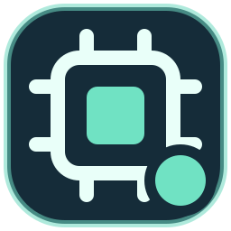
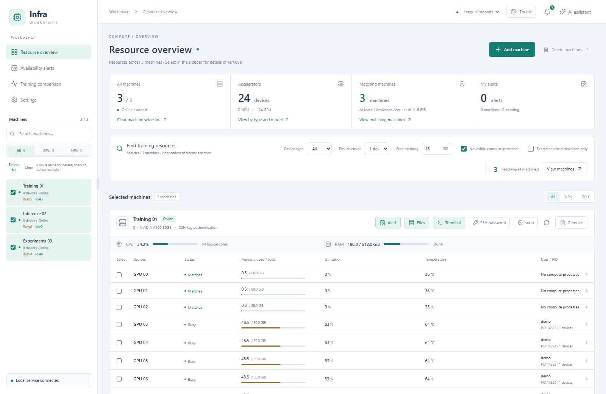
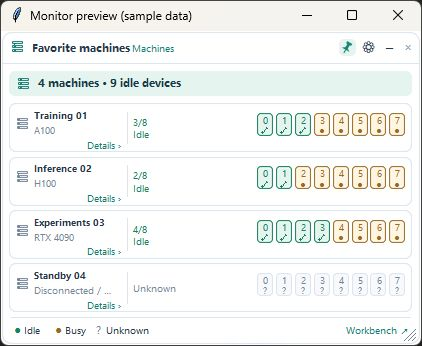

  

<h1 align="center">Infra Workbench</h1>

  <a href="README.md">简体中文</a> | <a href="README.en.md">English</a>

**An AI-native server workbench for AI engineers.** Connect to multiple Linux servers over SSH and bring GPU / Ascend NPU discovery, process inspection, training logs, terminals, and file management into one workspace. Use the interface directly, ask the built-in AI assistant to call workbench tools, or connect your own agent through MCP.

Built for engineers training, fine-tuning, deploying, and debugging models across multiple machines: find enough free accelerators, identify the processes using them, open the right directory and terminal, get notified when resources become available, and compare training metrics across experiments. Windows is the primary platform; macOS support is available but has not been verified on physical Mac hardware.

*Screenshots use fictional machines and sample data. See the [illustrated user guide](docs/GUIDE.en.md). The interface supports Simplified Chinese and English. Switch under Settings → Interface language. The screenshots below show the English interface.*

## What makes it AI-native

The assistant works with the workbench's actual machine, resource, process, file, and reservation tools. It can carry out multi-step tasks and expose tool results for review: find free devices, inspect processes, read a specified log, or create an availability alert using the conditions you confirmed. External agents can also access workbench capabilities through MCP.

Turn repeatable workflows into **Skills**. Create a skill in Settings, import Markdown or ZIP, or ask the assistant: “Turn the inspection workflow we just confirmed into a skill and install it.” Select skills with `@` in the composer, or let the assistant discover them as needed. Skills support persistent drafts, enable/disable controls, copying, export, and version rollback. Changes take effect on the next turn; scripts stored in skills do not run automatically.

The model interprets goals, selects tools, and explains results. The backend validates machine scope, arguments, and permissions. Execution records show target machines, parameters, results, and failures; uncertain resource states remain unknown. Resource searches and availability alerts do not lock devices or schedule training jobs.

## Desktop installation on Windows

Current version: **v0.1.2**. Download the Windows x64 installer from the [v0.1.2 Release](https://github.com/addsubmuldiv/infra-workbench/releases/tag/v0.1.2), then follow its setup wizard. The installer bundles the Python backend and frontend assets; Python and Node.js do not need to be installed separately. Check download integrity using the attached `SHA256SUMS.txt`.

The Windows installer has no Authenticode code signature; updater packages carry a separate update signature. Clean Windows install, upgrade and uninstall acceptance is still pending. GitHub macOS runners build separate experimental Apple Silicon and Intel packages for the same Release. See [macOS installation and limitations](docs/MACOS.md), currently in Chinese; native Mac acceptance is still pending.

Developers can also extract the complete repository and run **`安装.cmd`** from source. This prepares Python and dependencies over the internet and requires keeping the whole project directory. See [Windows instructions](docs/WINDOWS.md).

Add your own SSH machines after launch. Desktop windows, the tray, and the floating monitor share the local backend. Use the tray menu to exit the backend.

Windows installers support startup update checks and user-initiated download/installation from v0.1.1. Existing v0.1.0 users must manually install this bootstrap version once; save work and exit the old tray/backend first. See [updater operation and limits](docs/UPDATES.md).

## Browser demo

After starting the frontend or workbench locally, append `?demo=1` to its address, for example `http://127.0.0.1:8765/?demo=1`. Explore sample resources, terminals, files, and a highlighted walkthrough. The demo uses browser-only simulated data and isolates requests to the real backend. It does not connect to servers or model providers, and does not validate SSH, credentials, notifications, or installation. Simulated actions do not change the real workbench.

For a frontend-only demo, run `npm ci` and `npm run demo` in `frontend`; `npm run build:demo` creates a static artifact. See [demo isolation and limitations](docs/DEMO.md).

## Features

Version 0.1.2 adds local Codex, Claude Code and OpenCode engines alongside existing API profiles, explicit terminal attachments, chat branches and Codex run steering. It also adds loopback SSH service forwarding, inspectable automation workflows, keyword highlights, opt-in SIXEL/iTerm images and archive command fill without automatic execution. External CLIs must be installed and authenticated separately. Codex and Claude Code have real synthetic-tool validation; OpenCode's authenticated model path remains unverified after a timeout. See [Codex](docs/CODEX.md), [other agents](docs/EXTERNAL-AGENTS.md), [services](docs/PORT-FORWARDING.md), [automation](docs/AUTOMATION.md) and [terminal images](docs/TERMINAL-IMAGES-ARCHIVES.md).

| Feature | What you can do |
| --- | --- |
| Resource overview | Inspect GPU / NPU utilization, memory, temperature, CPU, and system RAM; find machines by device count and free accelerator memory. |
| Process inspection | View users, PIDs, working directories, executables, and commands where permissions allow. Configure optional sudo collection per machine. |
| Monitoring and readiness checks | Follow resource changes and check selected devices and training ports before launching a job. |
| Availability alerts | Wait for a device count or specific device IDs, with a default two-minute idle period; edit, repeat, and inspect notification status. These alerts do not reserve hardware exclusively. |
| Notifications | Receive Windows notifications; optionally configure SMTP and enable email separately for each availability alert. |
| SSH terminals | Use multiple sessions, command history suggestions, output search, command templates, task completion alerts, and recoverable tmux sessions. Move, resize, minimize, or maximize the terminal. |
| Server files | Browse and search directories, edit text, create, copy, cut, move, rename, upload, and download files or folders. Use alongside a terminal. |
| Training comparison | Align supported training JSON logs by actual step and compare metrics, curves, and errors with links to source lines. |
| Desktop resource monitor | Keep resource status visible on Windows; filter machines, inspect devices, collapse, resize, pin, or adjust opacity. Right-click a machine to open a standalone terminal or file window. |
| AI assistant and Skills | Query resources, processes, tmux, and logs; manage reservations, monitoring, and files as requested. Review tool traces, create or import skills, and reuse confirmed workflows with `@`. |
| Model profiles | Save multiple API URLs, keys, and models; switch compatible providers, fetch model lists, and test text connections. Supports OpenAI Responses and Chat Completions. |
| MCP access | Let external agents discover machines, filter resources, and access workbench tools. Authorized external clients can retrieve SSH configuration or saved credentials to connect independently. |
| Interface language | Switch between Simplified Chinese and English in Settings → Interface language. The choice is saved and synced across workbench windows, the Windows monitor, and tray menus. |
| Appearance | Choose light and dark themes, resize the sidebar, and restore machine selections. |

## Desktop resource monitor

Toggle it from startup settings or the tray menu. Click a machine for details, hover over a device for process information, or right-click to open a standalone terminal or file window. Monitoring continues after the main workbench is closed.

*The OS title bar belongs to the screenshot preview host; the production monitor is borderless. See the [monitor guide](docs/FLOATING-MONITOR.en.md) for filtering, layout, appearance, and status rules.*

## Connect machines

Click **添加机器** to select an entry from your local SSH config or enter an address and account manually. Existing SSH keys, agents, and jump-host configuration can be reused. Password authentication and optional automatic key setup are also supported.

For multiple machines, use **Excel bulk import (Excel 批量导入)** and review progress and failures. The IP column can contain an SSH alias; the account column overrides the alias user, while an empty port inherits the alias port. A numeric port overrides it. Supplied passwords are saved after successful verification. See the [import guide in Chinese](docs/IMPORT.md).

Select machines in the sidebar, click devices for process details, and select devices to add monitoring, request availability alerts, or run readiness checks.

## AI assistant and custom skills

Configure a compatible model service under **Settings → Agent model API (设置 → Agent 模型接口)**. A successful text connection test does not prove tool-call support; the provider must support function tools for multi-step assistant tasks.

Ask questions or request actions such as:

- “Find four free GPUs with at least 40 GiB of memory available on each.”
- “Who is using the accelerators on this machine, and what are the process working directories?”
- “Read this training log and separate confirmed findings from unknowns.”
- “Create an availability alert using the conditions we just confirmed.”
- “Create and install a skill from this inspection workflow.”

The assistant docks on the right and can be dragged into a floating window. Resize or collapse it while preserving the conversation and input draft. Expand execution records to inspect targets, parameters, and raw results. Use **Cancel turn (取消本轮)** to stop further work; hiding the assistant does not cancel a running turn or undo completed actions.

Under **Settings → Skills (设置 → 技能)**, create a draft or import Markdown / ZIP, review and validate it, then install it. Manage versions, disable skills, copy or export them, and roll back updates. Type `@` in the composer to select a skill explicitly. See the [English user guide](docs/GUIDE.en.md#ai-assistant-and-skills) for the workflow and the [Chinese skill reference](docs/USER-SKILLS.md) for package details.

## Requirements, updates, and data

The local machine needs **Windows 10 / 11 and the OpenSSH client**. For source installation, if Python is missing, `安装.cmd` attempts to install Python 3.12 with WinGet; without WinGet, [install Python manually](https://www.python.org/downloads/windows/). Remote machines need Linux, Python 3, and `nvidia-smi` or `npu-smi`.

Before updating, save edited files, handle terminal tasks, and exit through the tray menu. Pull the latest code and run `安装.cmd` again; existing machine configuration is retained and shortcuts are regenerated. Refreshing a page does not restart the backend.

The backend runs locally. **Do not share the `data` directory or SSH private keys.** Optional saved sudo passwords use Windows Credential Manager and can be removed. The assistant can write server files, execute authorized remote Shell commands, manage processes, and explicitly request sudo subject to server policy. It has no independent per-operation approval layer. Assistant conversations and server content actually read by its tools are sent to the configured model provider; do not ask it to read confidential files. Machine scope and credential protections remain enforced by the backend. See [data and credentials](SECURITY.md) in Chinese.

## Documentation

- [User guide — English](docs/GUIDE.en.md) / [简体中文](docs/GUIDE.md)
- [Desktop monitor — English](docs/FLOATING-MONITOR.en.md) / [简体中文](docs/FLOATING-MONITOR.md)
- Detailed references in Chinese: [model configuration](docs/AGENT.md), [skills](docs/USER-SKILLS.md), [MCP](docs/MCP.md), [terminals](docs/TERMINAL.md), [files](docs/FILES.md), [availability alerts](docs/RESERVATIONS.md), [email](docs/MAIL.md), and [training comparison](docs/PRECISION.md).
- [Development](CONTRIBUTING.md) · [Desktop build](docs/DESKTOP.md) · [macOS verification scope](docs/MACOS.md) (Chinese).

The MCP endpoint is `http://127.0.0.1:8765/mcp`.

## License

This project is licensed under the [MIT License](LICENSE), which permits use, modification, distribution, and commercial and closed-source use, provided the copyright and license notices are retained when distributing the software. The software is provided as is, without warranty. Third-party dependencies remain subject to their own licenses.
