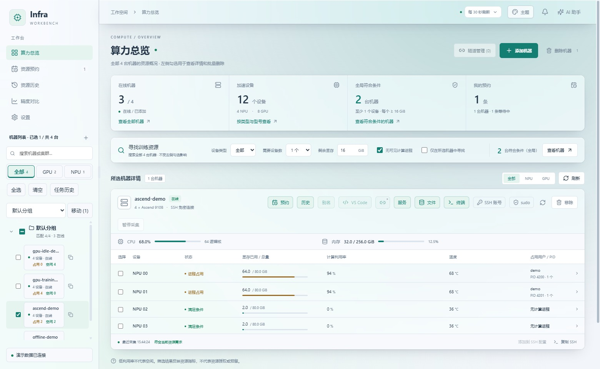

<p align="center">
  
</p>

<h1 align="center">Infra Workbench</h1>

<p align="center">
  <strong>面向 AI 工程师的 AI 原生服务器工作台</strong><br>
  通过 SSH 统一管理多台 Linux 服务器的 GPU / Ascend NPU、进程、终端、文件与训练日志
</p>

<p align="center">
  <a href="https://github.com/addsubmuldiv/infra-workbench/releases/latest">
    
  </a>
  
  <a href="LICENSE">
    
  </a>
</p>

<p align="center">
  <a href="https://github.com/addsubmuldiv/infra-workbench/releases/latest"><strong>下载安装包</strong></a> ·
  <a href="#快速开始">快速开始</a> ·
  <a href="#浏览器演示无需服务器">浏览器演示</a> ·
  <a href="docs/GUIDE.md">图文指南</a> ·
  <a href="docs/README.md">文档目录</a> ·
  <a href="README.en.md">English</a>
</p>

<p align="center">
  
</p>

<p align="center">
  <sub>图中为演示数据。完整界面与操作见 <a href="docs/GUIDE.md">图文使用指南</a>。</sub>
</p>

---

## 核心能力

- **多机 GPU / Ascend NPU 一屏看清。** 通过 SSH 聚合多台 Linux 服务器的卡型、显存、利用率与占卡进程；采样失败、缺失或过期时保持未知状态，不拿旧数据冒充空闲。
- **终端、文件与远程服务一体。** 在目标机器上直接打开网页终端（支持 tmux）、编辑和传输文件、转发 TensorBoard / Jupyter，或配置 SSH 隧道与 VS Code 连接。
- **空闲预约与资源历史。** 按数量或指定卡号等待连续空闲并触发桌面/邮件提醒，也可回看资源历史采样，或对比不同实验的训练日志精度。
- **AI 原生工作流。** 内置助手直接调用机器、资源、进程、文件与预约工具并展示执行记录；支持 Responses / 工具调用接口，以及已安装登录的 [Codex](docs/CODEX.md)、[Claude Code 与 OpenCode](docs/EXTERNAL-AGENTS.md)。
- **MCP 接入外部 Agent。** 通过统一 [MCP](docs/MCP.md) 暴露工作台能力，让外部 Agent 在同一套服务端校验下发现算力并操作授权机器。
- **可复用的 Skill（技能）。** 将确认过的巡检、排障流程沉淀为 Markdown / ZIP 技能，支持 `@` 指定、按需发现、草稿、启停与版本回退（脚本不会自动执行）。
- **本地运行，无需远端常驻 Agent。** 桌面端、系统托盘与资源浮窗共用本机后台；机器范围校验与凭据保护由服务端统一执行。

---

## 为什么是 AI 原生工作台

在多机训练、微调与调试中，模型负责理解目标、选择工具与整理结果，工作台负责提供真实的服务器状态与服务端权限校验。

**典型场景：卡被占满，让 Agent 换台机器继续干**

1. 你让 Agent 在服务器 A 上配好代码和环境，准备启动训练时发现卡全被占了。
2. 在原对话里让它通过 MCP 按卡型、数量和剩余显存，在有权限的机器中查找替代服务器。
3. 找到服务器 B 后，Agent 调用获授权的 SSH 与文件工具同步代码、配置和所需检查点，复现环境并校验设备后启动训练。

换的是执行任务的服务器，Agent 仍在原对话里，完整保留既有目标、排查记录和配置决定。详见 [统一 MCP 说明](docs/UNIFIED-MCP.md)。

> [!NOTE]
> - MCP 提供机器发现与操作入口，迁移由 Agent 执行；工作台不会自动搬迁任务、锁定设备或调度训练。
> - 内置助手默认可操作全部已添加机器；如需限定范围，请在输入区上下文设置中勾选「仅允许操作所选的机器」（左侧选中机器本身不限制范围）。远端命令与文件修改不会因取消而回滚。

---

## 安装与运行

| 方式 | 适用人群 | 说明 |
| --- | --- | --- |
| **Windows 安装包（推荐）** | 日常使用 | 内置 Python 后台与前端资源，无需额外安装 Python 或 Node.js |
| **源码运行** | 开发者 / 自定义环境 | 拉取仓库后双击 `安装.cmd`，自动准备 Python 与依赖 |
| **浏览器演示** | 快速体验 | 纯前端模拟数据，无需真实服务器与模型密钥 |

### Windows 安装包（推荐）

从 [最新 Release](https://github.com/addsubmuldiv/infra-workbench/releases/latest) 下载 Windows x64 安装包并按向导安装；校验值见同页 `SHA256SUMS.txt`。

- 独立桌面窗口、系统托盘与资源浮窗共用本机后台；**关闭主窗口或浏览器不会停止后台**，完整退出请使用托盘右键菜单。
- 本文描述当前仓库功能，已发布安装包支持范围以对应 Release 说明为准。

### 源码运行

完整下载或克隆仓库后，双击根目录的 `安装.cmd`。首次运行需联网准备 Python（缺失时尝试通过 WinGet 安装 Python 3.12）和依赖，并需保留整个项目目录。详见 [Windows 安装、更新与排障](docs/WINDOWS.md)。

### 浏览器演示（无需服务器）

本地启动工作台后，在地址后追加 `?demo=1`（例如 `http://127.0.0.1:8765/?demo=1`），即可体验示例机器、资源筛选、终端、文件与高亮导览。也可仅启动前端体验：

```bash
cd frontend
npm ci
npm run demo        # 启动本地演示服务
npm run build:demo  # 构建静态演示包
```

演示模式在浏览器内隔离所有真实后台请求，不连接服务器、不调用模型，也不会写入真实工作台数据。详见 [演示说明](docs/DEMO.md)。

<details>
<summary>安装签名、版本更新与 macOS 限制说明</summary>

- **签名与验收状态**：Windows 安装包尚未做 Authenticode 代码签名（更新包另有独立更新签名）；干净 Windows 系统的安装、升级和卸载仍待验收。
- **应用内更新**：Windows 安装版从 `v0.1.1` 起支持启动检查及手动下载安装更新。`v0.1.0` 用户需先手动安装一次；更新前请保存文件、关闭活动终端，并从托盘菜单退出旧后台。详见 [应用更新](docs/UPDATES.md)。
- **源码更新**：托盘退出后拉取新代码并重新运行 `安装.cmd`，已有机器配置会保留。详见 [更新与修复](docs/WINDOWS.md#更新与修复)。
- **macOS**：需要在 Mac 上自行构建；仅当对应 Release 明确提供时才包含 Apple Silicon 实验性安装包，且 Mac 尚待实机验证。详见 [Mac 说明](docs/MACOS.md)。

</details>

---

## 快速开始

手工使用资源视图、终端和文件**不需要模型密钥**，按以下 3 步即可开始（完整预期结果与排障见 [连接第一台服务器](docs/GUIDE.md#连接第一台服务器)）：

1. **添加机器**：点击「添加机器」，从本机 `~/.ssh/config` 选择别名，或手动填写地址、端口与账号；支持已有免密、密码登录及自动配置免密。多台机器可用 [Excel 批量导入](docs/IMPORT.md)（支持填写 SSH 别名与端口覆盖）。
2. **查看资源与进程**：在左侧选择机器，点击设备查看显存、利用率与占卡进程；勾选设备后可执行训练前检查、添加监控或创建空闲提醒（在左侧「卡预约」中管理）。
3. **打开终端、文件或启用 AI**：直接进入对应机器的终端与文件窗口；需要自然语言操作或沉淀技能时，再按 [AI 使用方式选择](docs/GUIDE.md#选择-ai-使用方式) 配置模型接口、本机 CLI 或 MCP。

> [!TIP]
> 全新空工作空间首次加载会自动弹出六步新手引导；已有机器升级时不会打断，可随时在「设置 → 关于与帮助 → 重播新手引导」重新打开。

---

## 按任务查找文档

| 我想做什么 | 阅读入口 |
| --- | --- |
| 熟悉界面、连接第一台服务器 | [首次连接流程](docs/GUIDE.md#连接第一台服务器) |
| 批量添加服务器、组织机器 | [Excel 导入](docs/IMPORT.md) · [集群](docs/CLUSTERS.md) |
| 找空闲卡、查看占卡进程 | [资源与进程](docs/GUIDE.md#查看资源与占卡进程) |
| 等设备空闲、回看使用情况 | [资源预约](docs/RESERVATIONS.md) · [资源历史](docs/RESOURCE-HISTORY.md) |
| 运行命令、管理文件 | [终端](docs/TERMINAL.md) · [文件](docs/FILES.md) |
| 打开 TensorBoard / Jupyter、连接 VS Code | [远程服务](docs/PORT-FORWARDING.md) · [SSH 隧道与 VS Code](docs/SSH-TUNNELS.md) |
| 配置 AI、复用固定流程 | [选择 AI 使用方式](docs/GUIDE.md#选择-ai-使用方式) · [用户技能](docs/USER-SKILLS.md) |
| 将其他 AI 客户端接入工作台 | [MCP](docs/MCP.md) |
| 给外部 Agent 安装工作台 Skill | [Agent Skills](docs/AGENT-SKILLS.md) |
| 接收提醒、查看桌面浮窗 | [邮件](docs/MAIL.md) · [浮窗](docs/FLOATING-MONITOR.md) |
| 对比训练日志 | [精度对比](docs/PRECISION.md) |
| 解决连接、采集、模型或通知问题 | [故障排查](docs/TROUBLESHOOTING.md) |

完整分类见 [文档目录](docs/README.md)。

---

## 运行要求与安全

| 角色 | 要求 |
| --- | --- |
| **本机** | Windows 10 / 11 + OpenSSH 客户端（源码安装缺失 Python 且无 WinGet 时需[手动安装 Python](https://www.python.org/downloads/windows/)） |
| **被监控远端** | Linux + Python 3 + `nvidia-smi` 或 `npu-smi` |
| **跳板机（可选）** | Windows 或 Linux 均可，只需 SSH 允许 TCP 转发；直接沿用本机 `ProxyJump` / `ProxyCommand`，不在跳板机运行采集脚本 |

> [!IMPORTANT]
> 软件仅在本机运行。**请勿分享 `data` 目录、SSH 私钥或包含凭据的日志。** 可选保存的 SSH / sudo 密码存放在 Windows 凭据管理器中并可随时清除。使用 AI 时，对话内容及工具实际读取的服务器信息会发送到所选模型服务，详见 [数据与凭据说明](SECURITY.md)。

---

## 开发与开源许可证

- 参与开发、目录结构与测试方式见 [贡献指南](CONTRIBUTING.md) 和 [开发者导览](docs/DEVELOPERS.md)。
- 本项目采用 [MIT 许可证](LICENSE)，允许使用、修改、分发、商用及闭源使用，分发时须保留版权声明与许可声明。软件按原样提供，不提供担保；第三方依赖遵循各自许可证。
