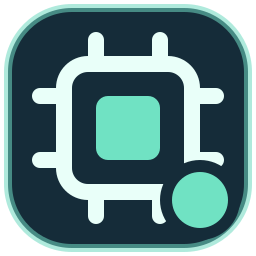
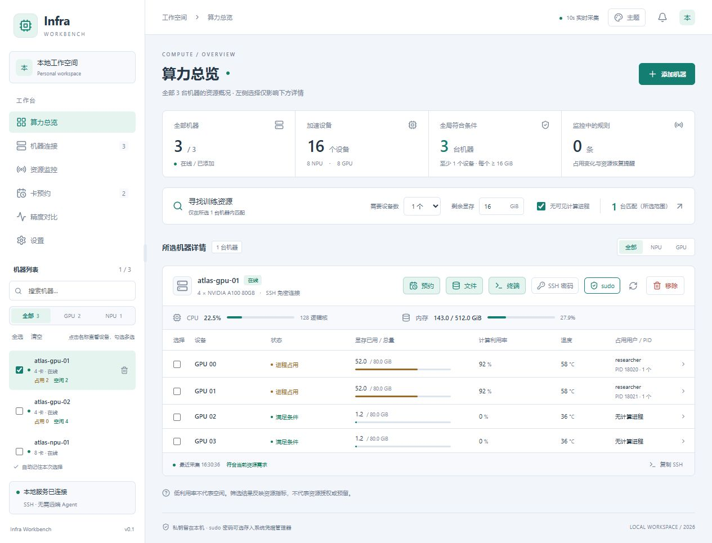

  

<h1 align="center">Infra Workbench</h1>

  <a href="README.md">简体中文</a> | <a href="README.en.md">English</a>

**面向 AI 工程师的 AI 原生服务器工作台。** 通过 SSH 连接多台 Linux 服务器，把 GPU / Ascend NPU 资源查找、进程排查、训练日志、终端和文件管理放在一起。既可以直接操作界面，也可以用自然语言让内置 AI 助手调用工作台工具，或通过 MCP 接入自己的 Agent。

适合需要在多台机器之间训练、微调、部署和调试模型的工程师：找够用的空闲卡，确认谁在占用资源，打开对应目录和终端，等设备空闲时收到提醒，再核对不同实验的训练指标。提供 Windows 启动入口和 macOS 适配入口，Mac 尚待实机验证。

*图中为演示数据。完整操作见[图文使用指南](docs/GUIDE.md)。*

## 桌面安装（Windows）

从 [最新 Release](https://github.com/addsubmuldiv/infra-workbench/releases/latest) 下载 Windows x64 安装包，双击后按向导安装。安装包包含 Python 后台与前端资源，不需要另外准备 Python 或 Node.js；校验值见同一页面的 `SHA256SUMS.txt`。本文描述当前仓库的功能，已发布安装包支持哪些功能以对应 Release 说明为准。

Windows 安装包尚未做 Authenticode 代码签名；更新包另有更新签名。干净 Windows 系统的安装、升级和卸载仍待验收。macOS 需要在 Mac 上构建；只有对应 Release 明确提供时，才包含 Apple Silicon 实验性安装包，限制见 [Mac 说明](docs/MACOS.md)。

开发者也可完整解压仓库后双击 `安装.cmd` 从源码运行。源码方式首次需要联网准备 Python 和依赖，必须保留整个项目目录，详见 [Windows 安装与排障](docs/WINDOWS.md)。

全新工作空间在首次成功加载后显示六步新手引导：连接机器、查看资源、使用终端与文件、配置 AI 助手、资源预约与历史、设置入口。完成或跳过后记住状态；已有机器的工作空间升级时不强制弹出，可在「设置 → 关于与帮助 → 重播新手引导」重新打开。详见[首次使用](docs/GUIDE.md#首次使用与新手引导)。

独立桌面窗口、系统托盘和资源浮窗共用本机后台；关闭主窗口不等于停止后台，退出请使用托盘菜单。

Windows 安装版从 v0.1.1 起支持启动检查及手动下载、安装更新。已有 v0.1.0 用户需先手动安装一次；安装前请保存文件、关闭活动终端，并退出旧托盘后台。更新机制及限制见 [应用更新](docs/UPDATES.md)。

## 第一次使用

按「添加机器 → 查看采样 → 打开终端或文件」完成第一次操作，见 [连接第一台服务器](docs/GUIDE.md#连接第一台服务器)。每一步都列有预期结果及失败后的检查入口。手工使用资源视图、终端和文件不需要模型密钥；需要 AI 时再看 [使用方式选择](docs/GUIDE.md#选择-ai-使用方式)。

点击「添加机器」，从本机 SSH 配置选择，或手动填写地址和账号。已有免密配置可直接连接，也可输入密码，并勾选自动配置免密。

多台机器可用「Excel 批量导入」，查看实时进度和失败原因，并在后台配置免密。密码验证成功后自动保存；详细步骤见 [批量导入图文说明](docs/IMPORT.md)。

Excel 中也可填写本机 SSH 别名，沿用地址和跳板配置；账号以表格为准，端口留空时沿用别名配置，填写数字则覆盖配置。

连接后在左侧选择要查看的机器，点击设备查看进程详情。勾选设备后可预约空闲提醒、添加监控或执行训练前检查；预约可在左侧「卡预约」中管理。

软件仅在本机运行。**不要分享 `data` 文件夹或 SSH 私钥**；sudo 密码可选保存在 Windows 凭据管理器，并可随时删除。资源筛选和检查不会预留设备。

## 浏览器演示

启动本地前端或工作台后，在地址后添加 `?demo=1`（例如 `http://127.0.0.1:8765/?demo=1`），体验示例机器、资源、终端和文件流程，以及高亮操作导览。演示在浏览器内使用模拟数据并隔离真实后台网络请求，不连接服务器，不调用模型，也不会验证真实 SSH、凭据、通知或安装流程。刷新或退出演示后，模拟操作不会写入真实工作台。

前端独立运行：在 `frontend` 中执行 `npm ci`、`npm run demo`；静态演示包使用 `npm run build:demo` 构建。具体入口、隔离范围和限制见 [演示说明](docs/DEMO.md)。

## 按任务查找文档

| 我想做什么 | 阅读入口 |
| --- | --- |
| 熟悉界面、连接第一台服务器 | [首次连接流程](docs/GUIDE.md#连接第一台服务器) |
| 批量添加服务器、组织机器 | [Excel 导入](docs/IMPORT.md) · [集群](docs/CLUSTERS.md) |
| 找空闲卡、查看占卡进程 | [资源与进程](docs/GUIDE.md#查看资源与占卡进程) |
| 等设备空闲、回看使用情况 | [资源预约](docs/RESERVATIONS.md) · [资源历史](docs/RESOURCE-HISTORY.md) |
| 运行命令、管理文件 | [终端](docs/TERMINAL.md) · [文件](docs/FILES.md) |
| 打开 TensorBoard / Jupyter、连接 VS Code | [远程服务](docs/PORT-FORWARDING.md) · [SSH 隧道与 VS Code](docs/SSH-TUNNELS.md) |
| 配置 AI、复用固定流程 | [选择 AI 使用方式](docs/GUIDE.md#选择-ai-使用方式) · [用户技能](docs/USER-SKILLS.md) |
| 将其他 AI 客户端接入工作台 | [MCP](docs/MCP.md) |
| 给外部 Agent 安装工作台 Skill | [Agent Skills](docs/AGENT-SKILLS.md) |
| 接收提醒、查看桌面浮窗 | [邮件](docs/MAIL.md) · [浮窗](docs/FLOATING-MONITOR.md) |
| 对比训练日志 | [精度对比](docs/PRECISION.md) |
| 解决连接、采集、模型或通知问题 | [故障排查](docs/TROUBLESHOOTING.md) |

完整分类见 [文档目录](docs/README.md)。

## 运行要求与更新

本机需要 **Windows 10 / 11 和 OpenSSH 客户端**。源码安装缺少 Python 时，`安装.cmd` 会尝试通过 WinGet 安装 Python 3.12；没有 WinGet 时需先[手动安装 Python](https://www.python.org/downloads/windows/)。远端机器需要 Linux、Python 3，以及 `nvidia-smi` 或 `npu-smi`。Mac 适配尚未实机验证。

跳板机可以使用 Windows 或 Linux，只需提供允许 TCP 转发的 SSH 服务。软件沿用本机 SSH 配置中的 `ProxyJump` / `ProxyCommand`，无需选择跳板系统，也不会在跳板上运行采集脚本；上述 Linux 和 Python 3 要求针对最终被监控的机器。自定义 `ProxyCommand` 中的程序在本机运行，需能在本机执行。

更新前保存文件、处理好终端任务，并从托盘右键菜单退出软件。源码用户拉取新代码后，再双击 `安装.cmd`；已有机器配置会保留，桌面快捷方式也会重新生成。ZIP 更新及修复步骤见 [更新说明](docs/WINDOWS.md#更新与修复)。

关闭浏览器后后台监控仍会继续；退出软件请使用托盘右键菜单。只刷新网页不会重启后台。

## 为什么是 AI 原生工作台

AI 助手直接使用工作台的机器、资源、进程、文件和预约工具，能围绕实际服务器状态完成多步任务，并展示工具返回供你核对。比如先查找空闲设备，再查看占卡进程、读取指定日志，或按确认的条件创建空闲提醒。外部 Agent 也可通过 MCP 使用工作台能力。

重复流程可以沉淀为 **Skill（技能）**。在设置中创建技能或导入 Markdown / ZIP，也可以对助手说「把刚才确认的巡检流程生成并安装成一个技能」。之后在输入框用 `@` 指定技能，或由助手按需发现，让常用检查步骤和报告要求可以复用。技能支持草稿、启停、复制、导出和历史版本回退；更新从下一轮生效，技能中的脚本不会自动执行。

模型负责理解目标、选择工具和整理结果，后台负责校验机器范围、参数和权限。执行记录会展示目标机器、调用参数、返回结果及失败信息；无法确认的资源状态仍保留为未知。资源筛选和预约提醒不会锁定设备，也不会自动调度训练。

模型接口要求服务支持 Responses 和工具调用；也可选择单独安装并登录的 [Codex](docs/CODEX.md)、[Claude Code 或 OpenCode](docs/EXTERNAL-AGENTS.md)。助手默认可操作全部已添加机器；需要限定时，在输入区上下文设置勾选「仅允许操作所选的机器」，左侧选中机器本身不会限制范围。远端命令和文件工具可产生实际修改，取消不会撤销已完成的操作。

## 数据与开发

不要分享 `data`、SSH 私钥或包含秘密的日志。使用 AI 时，问题及实际读取的服务器内容会发送到所选模型服务；详见 [数据与凭据](SECURITY.md)。

参与开发见 [贡献指南](CONTRIBUTING.md) 和 [开发者导览](docs/DEVELOPERS.md)。

## 开源许可证

本项目采用 [MIT 许可证](LICENSE)，允许使用、修改、分发和商用，也允许闭源使用；分发时须保留版权声明和许可声明。软件按原样提供，不提供担保。第三方依赖仍遵循各自的许可证。
