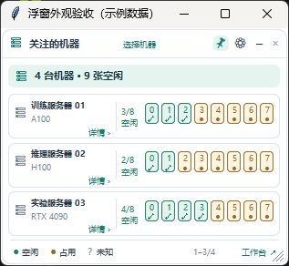

# 桌面入口（Windows / macOS）

桌面端使用 Tauri，在独立窗口中加载同一套 React 页面。原来的浏览器入口继续保留；HTTP 和终端 WebSocket 仍连接 `http://127.0.0.1:8765/`，没有放宽同源检查。

本次已完成的检查和待验收项见 [桌面版验证记录](DESKTOP-VALIDATION.md)。

桌面端会包含一个托盘/后台进程、一个桌面窗口进程和 WebView 子进程；Python 虚拟环境还可能显示启动转发进程。进程数量不等于独立的软件实例。关闭主窗口保持驻留；从托盘选择退出时，后台、浮窗、主窗口、独立终端和助手窗口一起退出。Windows 使用应用专属的退出信号直接通知驻留窗口，不依赖重新选择某个版本的可执行文件。后台停止监听或后台实例更换时，桌面端会退出旧窗口；HTTP 响应缓慢不会被当成后台退出。后台自身异常停止时，托盘也会退出并清理浮窗。

启动时桌面端最多等待后台 60 秒，短暂超时会重试，且不会并行启动第二个后台。新联动逻辑涉及后台和桌面程序，升级后需从托盘完整退出一次再启动，单独刷新页面不能替换旧进程。

## 使用方式

安装版：Windows 运行 NSIS 安装包，macOS 打开对应芯片架构的 DMG，将应用拖入 Applications。安装包随附 Python 后台，使用者不需要安装 Node.js、Rust 或 Python。

升级安装前，先在托盘或菜单栏退出后台。不要只复制主程序：打包后的 Python 后台必须随应用一起保留。

源码构建完成后，也可以Windows 双击项目根目录的 `Infra Workbench.exe`，启动界面在设置中选择。macOS 继续使用原有 `.command` 入口。

桌面端先检查现有后台；如果后台已运行，就直接复用。没有后台时才启动托盘或菜单栏进程。Windows 托盘在自己的进程中运行后台服务，退出托盘时一并停止后台；再次启动会加载当前代码。如果 8765 端口已被独立后台占用，启动托盘会提示先退出该后台，不会挂接到一个无法随托盘退出的服务。重复启动托盘只保留已有的托盘实例。关闭桌面窗口后监控继续运行；彻底退出后台请使用系统托盘或 macOS 菜单栏。点击关闭按钮会隐藏桌面窗口并保留页面、编辑器和 SSH 会话；从浮窗或托盘再次打开会复用原窗口。Windows 恢复隐藏窗口时使用约 300 毫秒的淡入动画，保留位置和大小；窗口已经显示时只切换焦点。关闭系统动画效果时直接显示。彻底退出托盘才结束常驻桌面进程。

浏览器和桌面端共享后台机器、预约和文件操作数据。两者的主题、机器选择和窗口布局偏好保存在各自的浏览器/WebView 存储中，不自动相互同步。

## 跨平台边界

| 内容 | Windows | macOS |
|---|---|---|
| 页面渲染 | 系统 WebView2 | 系统 WKWebView |
| 后台入口 | Python 系统托盘 | Python/rumps 菜单栏 |
| 安装包 | 当前用户 NSIS 安装包 | .app / DMG，分别构建 Apple Silicon 和 Intel |
| 默认安装版数据 | `%LOCALAPPDATA%\InfraWorkbench` | `~/Library/Application Support/InfraWorkbench` |
| 开发模式数据 | 项目 `data` | 项目 `data` |
| 凭据存储 | 沿用 Windows 凭据管理器 | 沿用 macOS 钥匙串 |

可用 `IWB_DATA` 显式选择既有数据目录。数据、SSH 私钥及凭据不进入安装包。已有源码版与安装版采用不同的默认目录：首次切换时先退出已有后台，再选择所需目录；不会自动复制私人数据。后台已运行时，两个前端都使用该后台当前的数据目录。

两端使用不同的 WebView，需要分别验证字体、文件夹选择、下载、中文输入、剪贴板以及快捷键。窗口宽度变化沿用现有 CSS、resize 和 ResizeObserver 逻辑，不需要手动刷新。

macOS 必须在 Mac 上构建；本机 Windows 测试不能证明 Mac 实机通过。公开分发 Mac 安装包之前，需要用所有者提供的 Apple Developer 身份完成签名和公证。此仓库不包含签名证书或密钥。

## 开发与构建

先按原来的入口准备项目 `.venv` 和 Python 依赖。开发机另外需要 Node.js 24、Rust stable；Windows 需要 MSVC C++ Build Tools、Windows SDK 和 WebView2，Mac 需要 Xcode Command Line Tools。具体前置条件见 [Tauri 官方文档](https://v2.tauri.app/start/prerequisites/)。

安装前端依赖：

```sh
cd frontend
npm ci
cd ../desktop
npm ci
```

开发运行（两个系统相同）：

```sh
cd desktop
npm run dev
```

Windows 构建：

```powershell
.\.venv\Scripts\python.exe -m pip install -r desktop/requirements-build.txt
cd desktop
npm run build
```

macOS 构建：

```sh
.venv/bin/python -m pip install -r desktop/requirements-build.txt
cd desktop
npm run build
```

构建脚本先构建共享前端，再用 PyInstaller 打包 Python 后台，运行独立后台自检，最后构建桌面应用。自检使用临时数据目录和随机本机端口，验证真实 API、前端 HTML 和资源文件，不读取已有机器数据。

输出位置：`desktop/src-tauri/target/release/bundle/nsis`（Windows），`bundle/macos` 与 `bundle/dmg`（Mac）。开发和打包依赖已分别锁定在 npm/Cargo lockfile 中。

`.github/workflows/desktop.yml` 配置 Windows、macOS Apple Silicon、macOS Intel 三种构建。工作流配置不等于已完成远端构建或 Mac 实机验收；需要查看实际运行结果。

## 性能验证

优化后网页版与桌面版的启动、进程树内存和多终端持续输出对照见 [实测报告](DESKTOP-PERFORMANCE.md)。

后续共享前端优化、优化前后实测和跨平台检查见 [第二轮优化记录](PERFORMANCE-FOLLOWUP.md)。

`scripts/measure-ui.cjs` 是 Playwright CLI 测量脚本，拦截该测试浏览器的全部 API 请求，注入 48 台模拟机器、每台 8 个设备。测试不会修改后台配置。运行时请使用独立测试浏览器会话：

```sh
npx --yes --package @playwright/cli playwright-cli -s=desktop-perf open http://127.0.0.1:8765/
npx --yes --package @playwright/cli playwright-cli -s=desktop-perf --raw run-code --filename scripts/measure-ui.cjs
```

脚本测量静置刷新和往返拖动侧栏。应使用相同视口（1440×900）、数据和操作比较，不把浏览器模拟测试当成 WebView2 或 WKWebView 实测。

本次优化使用 `content-visibility:auto` 暂缓屏幕外机器卡片的布局/绘制，并缓存已显示卡片的高度。所有机器数据仍然正常更新；不支持该 CSS 特性的 WebView 会沿用普通布局。

后续验收还需覆盖：多终端连续输出、文件上传下载、编辑保存、窗口最大化/缩放、滚动到列表末尾、主题切换、中文输入、关闭后后台继续运行以及多次启动不重复创建窗口或后台。


Windows 托盘收到资源管理器重启通知时会恢复图标，并每 5 秒检查一次图标是否仍存在；重新注册失败会记录日志并继续重试。此检查只恢复图标，不会另起后台进程。启动、就绪和退出事件记录到本机轮转日志，便于核对托盘与后台生命周期。

Windows 托盘启动后台时，最多等待 60 秒，以容纳首次导入依赖和应用初始化；`background.ps1` 最多等待 90 秒，包含旧托盘退出、新后台就绪和图标注册。就绪后立即继续，不会固定等待整个时限。后台线程提前退出时立即报错，日志保留 `SystemExit`、导入异常、端口绑定错误和完整堆栈；超时与线程退出使用不同提示。`data/desktop.log` 包含时间戳、线程名及启动耗时。启动失败不会终止其他后台实例。

## GPU / NPU 桌面浮窗（Windows）

面向日常使用的配图与操作步骤见 [桌面浮窗图文说明](FLOATING-MONITOR.md)。



右键 Windows 托盘图标，勾选「显示浮窗」即可显示，取消勾选即可隐藏。关闭浮窗也会取消勾选。软件记住这个选择，下次启动时自动恢复。浮窗是后台进程内部的一项界面，不需要单独启动程序。更新后需要重新启动托盘后台，正在运行的旧进程不会自动加载新菜单。

浮窗使用 Python 标准库 Tkinter，不启动 WebView，也不增加服务器采集。默认多机总览，可点击机器卡片切换单机详情，或收起为较窄的机器列表。悬停设备格查看设备与进程详情；收起视图仍支持机器筛选、滚动和右键工具菜单。拖动边缘或右下角可调整大小。

齿轮设置支持 30%–100% 不透明度、始终置顶、总览机器筛选。调节时实时预览，平时鼠标移入浮窗临时恢复清晰，移出恢复设定值。拖动标题栏移动；位置、形态、机器和设置保存在当前数据目录的 `floating-monitor.json`。关闭浮窗只隐藏界面并暂停读取状态，不会停止后台；退出托盘时一并关闭浮窗。

状态同时使用颜色和符号：✓ 空闲、● 占用、? 未知、! 异常。没有进程且进程信息完整才判为空闲；过期数据或后台连接失败显示未知。浮窗按后台配置的 5/10/20/30 秒周期读取缓存状态；失败时逐步延长重试间隔，无持续动画，数据未变化时不重画。

验证命令：`.venv\Scripts\python.exe -m pytest tests/test_floating_monitor.py -q`；真实 Tk 检查和短时资源测量：`.venv\Scripts\python.exe scripts/check-floating-monitor.py`。测量使用 4 台示例机器、32 张卡，不含后台服务开销，不代表长时间运行或大量机器下的占用。

浮窗主视图使用 Canvas 绘制圆角外框、机器卡片、顶部汇总和双行设备格；没有加载浏览器。Windows 包装窗口明确设置 `WS_EX_TOOLWINDOW` 并清除 `WS_EX_APPWINDOW`，浮窗与设置窗口均不应在任务栏或 Alt+Tab 中占独立位置。圆角区域按原生窗口的物理像素尺寸设置，避免 DPI 缩放后切错边界。可运行 `scripts/check-floating-monitor.py` 检查原生样式和圆角区域；`scripts/preview-floating-monitor.py` 仅为截图验收提供带标题栏的临时宿主，不是产品启动入口。

浮窗默认尺寸为 315×260 个 Tk 布局单位，支持在 220×190 至 520×480 范围内调整；根据宽高切换较窄的机器列表或设备总览，窗口高度决定可见机器数量，滚轮切换可见机器。8 卡与 16 卡保持相同的机器行高度；超过 16 个设备时明确提示进入详情查看全部。顶部「选择机器」可搜索、全选或勾选关注机器，应用后保存；机器卡片的「详情 ›」及悬停高亮提示可点击，单机页顶部「返回总览」或右侧返回箭头返回。底栏分页只绘制一次，避免页码与滚动提示重叠。

浮窗自动跟随共享工作空间的主题设置，支持晴空、暖纸、午夜、石墨、花语旅途。颜色直接读取网页版 `themes.css` 与 `journey.css` 的变量；同一后台保存主题后，浮窗在下一次 500ms 界面检查时同步，无额外网络轮询。后台首次启动也会读取已保存主题。

机器选择窗口使用与浮窗相同的无边框圆角标题区和圆角按钮。底部「取消 / 确定」先占据固定区域，列表只使用剩余高度；点击确定才保存，取消、关闭和 Esc 均不保存。滚轮绑定在该弹窗范围内，因此在机器复选框或文字上滚动也会同步列表滚动条，不影响其他窗口。

Windows 浮窗 UI 线程使用每显示器 DPI 感知，按当前 DPI 生成实际像素大小。圆角形状由 Pillow 四倍采样后缩小并缓存，文字保留 Tk 原生字体渲染。只在状态或主题变化时绘制，无持续动画。

Windows 日常统一使用根目录或桌面上的 Infra Workbench 图标。设置页的「启动与桌面浮窗」控制浏览器 / 桌面窗口二选一，以及独立的浮窗显示。源代码版 Windows 图形入口由 `scripts/build-launcher.ps1` 编译生成，无依赖更新时不创建控制台；首次依赖安装仍显示安装进度。已有明确关闭浮窗的设置会保留，新用户默认开启。

### 从浮窗打开机器工具

在机器卡片、机器名称或设备格上右键，选择「打开终端」或「打开文件」，可单独打开该机器的工具窗口，不进入完整工作台。总览、窄条和单机视图均支持此菜单；「打开工作台」仍进入完整界面。Windows 使用桌面程序的无边框工具窗口，复用当前后台和 SSH 配置；界面挂载完成后才显示窗口。终端默认 760 × 480，文件默认 900 × 560（逻辑像素，实际大小随系统 DPI 缩放）。终端目录链接会另开独立文件窗口；文件工具栏的「在当前目录打开终端」会另开独立终端并进入该目录，原文件窗口继续保留。关闭窗口会断开其中的普通 SSH 会话，前台任务可能结束；长任务请使用持久会话。更新后需重启托盘后台，才能加载新的浮窗右键菜单。
