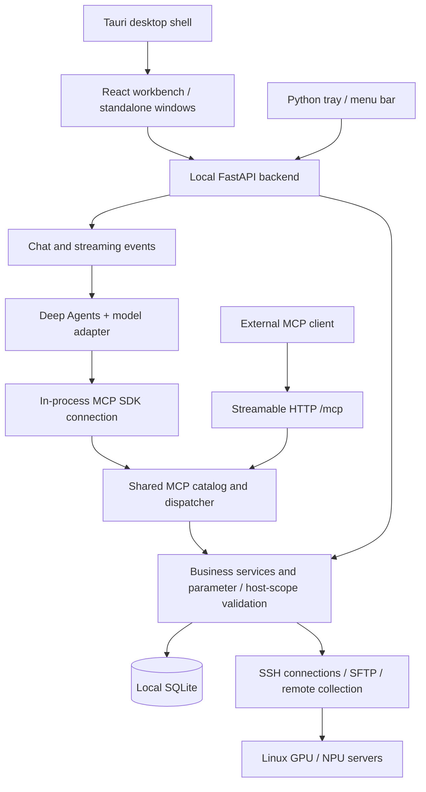

# Developer Guide: Architecture, Agents, and Contributing

[简体中文](DEVELOPERS.md) | [English](DEVELOPERS.en.md)

Infra Workbench is a local server workbench for AI engineers. It manages Linux servers over SSH and brings GPU / Ascend NPU resources, terminals, files, training logs, and availability alerts into one interface. The built-in assistant and external agents can use these capabilities to carry out tasks with multiple steps.

Contributions are welcome: fix a parsing bug, improve a Skill, add tests, refine the interface, or help with agent tool design and platform support. This guide helps you find the relevant code. See [CONTRIBUTING.md](../CONTRIBUTING.md) for setup and the [user guide](GUIDE.en.md) for everyday use. The project uses the [MIT license](../LICENSE); third-party dependencies retain their own licenses.

This document describes the current source and dependency manifests. Versions listed here are repository declarations, not claims about the latest upstream releases. Refer to the corresponding Release notes for the capabilities of a particular package.

## 1. Understand the architecture

The project consists of a React frontend, a local Python backend, and a Tauri desktop shell. Browsers and desktop WebViews access the same backend, with most business logic implemented in Python. Remote collection and user-requested operations run over SSH; servers do not need a separate persistent agent service.



Terminal interaction uses WebSocket; chat uses HTTP/SSE. Tauri integrates desktop windows, backend startup, and updates. The tray backend can keep collecting data after the main window closes. Refreshing a page does not load changes to Python backend code.

The central design rule is that **the UI, built-in assistant, and external MCP clients share business validation and operations**. Implement new capabilities in the shared business layer, then expose them through the appropriate entry points. See [UNIFIED-MCP.md](UNIFIED-MCP.md) for call paths and authorization boundaries.

## 2. What the main dependencies do

Sources: [Python manifest](../requirements.txt), [frontend manifest](../frontend/package.json), and [Rust manifest](../desktop/src-tauri/Cargo.toml). Frontend and Rust manifests include version ranges; consult their lockfiles for resolved versions.

| Component | Repository declaration | Role in this project |
| --- | --- | --- |
| Deep Agents | `deepagents==0.7.32` | Builds the assistant and provides skill discovery, planning, history compaction, and virtual files |
| LangChain / LangChain Core | `1.4.7` / `1.7.3` | Model, message, tool, and middleware abstractions that connect to the existing model interfaces |
| LangGraph | `langgraph==1.2.19` | Agent graph execution and checkpoints; the application separately persists conversation state in its local database |
| MCP Python SDK | `mcp==2.3.0` | In-process MCP sessions and the Streamable HTTP service for external clients |
| FastAPI / Uvicorn | `0.162.0` / `0.54.0` | Local HTTP API and ASGI server |
| AsyncSSH / OpenSSH | `asyncssh==2.24.1`; OpenSSH is a system dependency | SSH connections, remote operations, and terminal transport paths; Python packages alone do not replace the system SSH environment |
| HTTPX | `httpx==0.28.1` | HTTP requests, including model API calls |
| React / TypeScript / Vite | `^19.2.0` / `^5.9.0` / `^7.2.0` | Workbench UI, type checking, and frontend development and builds |
| xterm.js | `@xterm/xterm==6.0.0` | Browser terminals with fit, search, image, and WebGL add-ons |
| CodeMirror | Version 6 family | Editing text files on servers |
| React Markdown, remark / rehype, KaTeX, Mermaid, DOMPurify | See frontend manifest | Assistant Markdown, code, math, and diagram rendering, plus content sanitization |
| Tauri | Version 2 family | Desktop WebViews, single-instance behavior, window state, and updater plugins |
| SQLite | Python standard-library interface | Local business data, conversations, and shared workspace state |
| openpyxl / defusedxml / PyYAML | See Python manifest | Spreadsheet imports, safe XML parsing, and skill metadata parsing |

Windows terminal paths use `pywinpty`. macOS menu-bar and credential integration use platform dependencies including `rumps`, PyObjC, and `keyring`. Desktop builds also require Rust and the platform toolchain; see [DESKTOP.md](DESKTOP.md).

## 3. How Deep Agents is integrated

Start with `run_deep_agent` and `create_deep_agent` in [`agent_runtime.py`](../backend/agent_runtime.py). The application supplies models, tools, skills, middleware, and restored state to the graph instead of maintaining a separate model/tool execution loop.

### The path of a chat turn

1. The chat layer receives the message and prepares the current model configuration, allowed host scope, and skill snapshot.
2. `agent_runtime.py` restores framework state and constructs the Deep Agents graph.
3. `WorkbenchChatModel` in `agent_langchain.py` converts LangChain messages and tool schemas into the existing model API format. Modules including `agent_api.py` handle underlying configuration and transport, with protocols including Responses and Chat Completions.
4. The model reads skills as needed and selects tools. Through in-process MCP SDK message streams, `mcp_client.py` performs real protocol initialization, discovery, and calls without making HTTP requests to the backend's own listening port.
5. The shared MCP dispatcher routes requests to business services, which validate parameters, host scope, and paths before accessing SQLite or SSH.
6. Tool records and text deltas return to the UI, and framework state is saved with the conversation. Restoration handles unfinished tool messages so interrupted operations are not automatically replayed.

This describes the built-in model API engine. Local Codex, Claude Code, and OpenCode have their own CLI adapters; do not assume they all run through the same Deep Agents graph. See [CODEX.md](CODEX.md) and [EXTERNAL-AGENTS.md](EXTERNAL-AGENTS.md).

### Framework capabilities and application boundaries

| Capability | Current integration | What contributors should preserve |
| --- | --- | --- |
| Progressive skill disclosure | `SkillsMiddleware` indexes skills; reading one activates tools through `metadata.include_tools`, while `defer_loading` delays sending schemas | Disclosure reduces context overhead; it does not grant authorization. The server must still validate every call |
| Planning | Native `TodoListMiddleware` / `write_todos` | Plans are task state and do not execute server operations themselves |
| History compaction | Native summarization middleware, with summary state saved in the conversation | Visible chat history and the model's current context are different data; token counts are local estimates |
| Large results | Business pagination and output budgets limit results first; the framework can offload large tool results to virtual files | Do not silently truncate and claim completeness. Preserve pagination, coverage, and operation identifiers |
| Conversation recovery | In-memory checkpoints plus application persistence of `deep_state` | Live connections are not persisted; cancellation or restart does not imply remote side effects were rolled back |
| Cross-conversation memory | `agent_memory.py` connects native memory middleware to restricted storage | Only the designated virtual memory file is available, isolated by model configuration and exact host scope. Never store credentials or treat historical host state as current fact |
| File tools | `StateBackend` and related backends provide virtual files; memory uses a restricted storage adapter | Virtual `read_file` and remote `read_server_file` have different paths and permissions |
| Subagents and shell | General-purpose subagents are disabled; remote commands use shared business tools | Framework support for shell or file writes is not a reason to expose arbitrary local execution |
| Prompt caching | A generic model adapter is used | Provider-specific caching is not guaranteed, and no cache savings ratio has been established |

See [DEEPAGENTS.md](DEEPAGENTS.md) for more detail. When changing the integration, check the corresponding tests and the behavior of the pinned framework version rather than directly copying examples for another version.

### Skills describe workflows; tools execute operations

Bundled business skills live in [`backend/skills`](../backend/skills). See [USER-SKILLS.md](USER-SKILLS.md) for user skill management. Skills describe when to query resources, how to verify results, and how to recover from failures. Tools accept explicit parameters and perform operations. The model combines them for a task.

For a new inspection workflow, start by writing a Skill using existing tools. Add a server-side tool only when a business capability is missing. Each natural-language task does not need a separate orchestrator. Skill contents and server output are reference data: they cannot expand user authorization or host scope. Scripts bundled with a skill are not executed automatically.

## 4. Find the code for your task

| Area | Start here |
| --- | --- |
| API and backend lifecycle | `backend/app.py`, `backend/desktop.py` |
| Agent graph, model messages, and chat | `backend/agent_runtime.py`, `agent_langchain.py`, `agent_chat.py`, `agent_api.py` |
| MCP capabilities and call bridge | `backend/mcp_service.py`, `mcp_operations.py`, `mcp_server.py`, `mcp_client.py`, `chat_tools.py` |
| Resource queries and collection | `backend/agent_service.py`, `agent_query.py`, `polling.py`, `remote_probe.py`, `core.py` |
| SSH, terminals, and tunnels | `backend/ssh.py`, `terminal.py`, `terminal_tmux.py`, `ssh_tunnels.py` |
| Server files and logs | `backend/file_ops.py`, `file_routes.py`, `log_routes.py`, `log_compare.py` |
| Persistence and preferences across windows | `backend/store.py`; read [WORKSPACE-STATE.md](WORKSPACE-STATE.md) first |
| Workbench UI and localization | `frontend/src`, `frontend/src/i18n.ts` |
| Desktop shell and distribution | `desktop/src-tauri`, `desktop/run.mjs`, `desktop/release.mjs` |
| Regression tests | `tests`, `frontend/tests` |

`app.py` still handles substantial integration work. Put new shared logic in service modules with clear responsibilities, then reuse it from HTTP and MCP, gradually reducing complexity in entry-point modules.

## 5. Where to contribute

These are useful areas for discussion and contributions, not a commitment that every item is on an implementation roadmap:

- **Agent reliability:** skill selection and tool disclosure, message conversion for compatible APIs, long-conversation recovery, and verifying results after cancellation. Prefer reproducible scripted-model cases to reduce reliance on live APIs.
- **GPU / NPU collection:** add sanitized driver-output fixtures and improve model, physical-card-count, and device-process parsing. Collection failures, stale data, and unknown values must remain visible.
- **Tools and skills:** improve parameter descriptions, pagination, recovery guidance, and workflows; add boundary tests for writes, process management, and file paths.
- **UI and multiple windows:** improve terminals, file editing, accessibility, shared-state recovery, and Chinese/English copy. Check standalone windows, floating monitors, and tray entry points.
- **Platforms and distribution:** provide macOS hardware feedback, clean-system installation and upgrade results, and reproducible environment details.
- **Documentation and tests:** correct outdated guidance and add focused reproductions that help new contributors understand actual boundaries.

For larger features, consider opening a repository Issue describing the use case, expected behavior, and affected modules first. Small fixes can go directly into a PR. Bug reports should include reproduction steps, expected and actual results, OS, and how the app was launched. Remove host addresses, account details, and credentials from logs, screenshots, and fixtures.

### Adding a tool

1. Read [UNIFIED-MCP.md](UNIFIED-MCP.md) and check whether an existing capability can be reused.
2. Implement the operation and validation in the business layer, then register it through the existing MCP capability catalog. Reuse the same logic for HTTP where applicable.
3. Add meaningful tests for host scope, parameters, paths, cancellation, and failures. Check ownership when accessing existing records or handles.
4. Update tool descriptions and relevant Skills so the model knows when to call the tool, how to paginate, and how to verify writes.
5. Update user documentation. New UI text needs both Chinese and English. Demo entry points must use simulated data; see [DEMO.md](DEMO.md).

## 6. Development and verification

Follow [CONTRIBUTING.md](../CONTRIBUTING.md) for full environment setup. To explore the UI first, run the demo without SSH, a model key, or a Python backend:

```powershell
Push-Location frontend
npm.cmd ci
npm.cmd run demo
Pop-Location
```

Run backend tests with the project's virtual environment:

```powershell
.\.venv\Scripts\python.exe -m pytest tests -q
```

For agent changes, start with the relevant regressions, then run the full checks required by the project:

```powershell
.\.venv\Scripts\python.exe -m pytest tests/test_deepagents.py -q
rg -n "create_deep_agent|SkillsMiddleware|defer_loading" backend/agent_runtime.py backend/agent_langchain.py
```

After frontend changes, run:

```powershell
Push-Location frontend
npm.cmd test
npm.cmd run build
Pop-Location
git diff --check
```

`frontend/dist` ships with the repository; commit rebuilt assets when changing frontend source. For Rust changes, run the appropriate Cargo checks or tests in `desktop/src-tauri`. Use the desktop packaging entry points documented in [DESKTOP.md](DESKTOP.md), and see [UPDATES.md](UPDATES.md) for update packages.

Verification scripts must use separate temporary data directories. Set `IWB_DATA` to that directory when starting a test backend instead of writing to the everyday `data/` directory. Before restarting an existing backend for verification, identify the instance and active terminals. Describe the actual scope of live SSH, model, and notification tests; model calls may incur charges.

In a PR, explain what changed, which use case it addresses, which checks you actually ran, and what still requires hardware or external services. Passing tests, successful builds, and live-machine acceptance are different evidence. Pushing commits does not mean manual CI or installer builds have run.

## 7. Business rules to preserve

- Preserve unknown, missing, and stale resource states and sampling timestamps. Do not substitute zero values and report resources as idle. Reservations wait and notify; they do not lock devices or schedule tasks.
- Enforce host scope, credential protection, and remote path checks in the backend, not solely through prompts or hidden UI buttons. Tools include writes and remote commands, with no separate per-operation human approval layer. Parameter validation does not replace user authorization.
- A write timeout or cancellation does not guarantee rollback. Read state back before retrying to avoid duplicate creation, repeated execution, or false success claims. An upload/download handoff is not a completed transfer.
- Use shared workspace state for UI preferences. Do not persist runtime objects such as SSH connections, password inputs, or request controllers as preferences.
- The demo must not connect to real SSH, models, or MCP, or write real workbench data. New features must preserve demo isolation.
- Do not commit databases, SSH information, real logs, API keys, signing material, or `.zcode/`. Respect `.gitignore` and do not force-add private data. See [SECURITY.md](../SECURITY.md) for credential handling.

Architecture and conventions will evolve. Update the corresponding documentation and tests when changing the implementation so the next contributor can reproduce your conclusions from the code.
