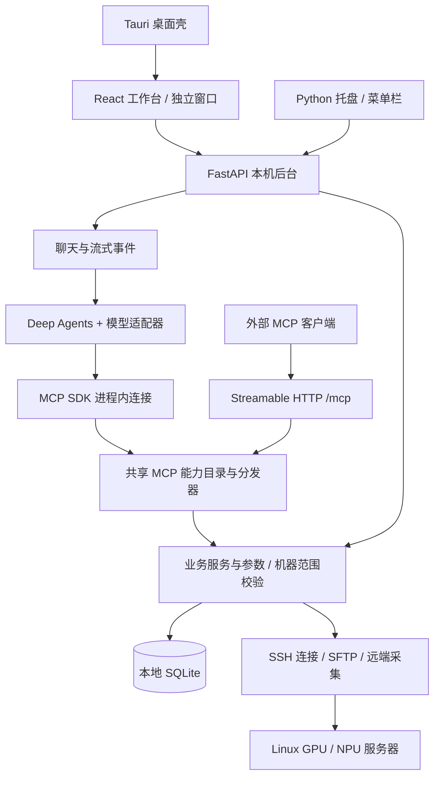

# 开发者导览：架构、Agent 与参与贡献

Infra Workbench 是面向 AI 工程师的本地服务器工作台：通过 SSH 管理 Linux 服务器，把 GPU / Ascend NPU 资源、终端、文件、训练日志和空闲提醒放在同一个界面。内置助手和外部 Agent 可以调用这些业务能力，帮助用户完成多步操作。

欢迎一起改进项目。你可以修复一个解析错误、完善一个 Skill、增加测试、改善界面，也可以参与 Agent 工具设计和跨平台适配。本文帮助你找到合适的代码入口；安装步骤见 [CONTRIBUTING.md](../CONTRIBUTING.md)，用户操作见[使用指南](GUIDE.md)。项目采用 [MIT 许可证](../LICENSE)，第三方依赖按各自许可证使用。

本文依据当前源码和依赖清单编写。版本号是仓库声明，不代表上游最新版本；具体发布包的能力以对应 Release 为准。

## 1. 先理解整体架构

项目由 React 前端、Python 本机后台和 Tauri 桌面壳组成。浏览器和桌面 WebView 访问同一套后台，业务逻辑主要由 Python 承担。远端通过 SSH 执行采集和用户要求的操作，无须部署独立常驻 Agent 服务。



终端交互使用 WebSocket，聊天使用 HTTP/SSE。Tauri 负责桌面窗口、后台入口与更新等集成；关闭主窗口后，托盘后台仍可继续采集。修改后台后，仅刷新网页不会加载新的 Python 代码。

最重要的设计约定是：**界面、内置助手和外部 MCP 复用业务校验与操作**。新增能力应进入共享业务层，再接入需要的入口。详细调用关系和权限边界见 [UNIFIED-MCP.md](UNIFIED-MCP.md)。

## 2. 主要依赖各自做什么

依赖依据：[Python 清单](../requirements.txt)、[前端清单](../frontend/package.json)、[Rust 清单](../desktop/src-tauri/Cargo.toml)。前端和 Rust 清单中有版本范围，实际解析版本应查看各自锁文件。

| 组件 | 仓库声明 | 项目中的职责 |
| --- | --- | --- |
| Deep Agents | `deepagents==0.7.32` | 构建内置助手，提供技能发现、计划、历史压缩和虚拟文件等框架能力 |
| LangChain / LangChain Core | `1.4.7` / `1.7.3` | 模型、消息、工具和 middleware 抽象，连接现有模型接口 |
| LangGraph | `langgraph==1.2.19` | Agent 图执行与 checkpoint；应用另负责将会话状态保存到本地数据库 |
| MCP Python SDK | `mcp==2.3.0` | 内置进程内 MCP 会话，以及供外部客户端访问的 Streamable HTTP 服务 |
| FastAPI / Uvicorn | `0.162.0` / `0.54.0` | 本机 HTTP API 与 ASGI 服务 |
| AsyncSSH / OpenSSH | `asyncssh==2.24.1`；OpenSSH 是系统依赖 | SSH 连接、远程操作与终端等传输路径；不能仅安装 Python 包就省去系统 SSH 环境 |
| HTTPX | `httpx==0.28.1` | 模型接口等 HTTP 调用 |
| React / TypeScript / Vite | `^19.2.0` / `^5.9.0` / `^7.2.0` | 工作台界面、类型检查与前端开发构建 |
| xterm.js | `@xterm/xterm==6.0.0` | 浏览器终端；配合尺寸适配、搜索、图片和 WebGL 插件 |
| CodeMirror | 6 系列 | 服务器文本文件编辑 |
| React Markdown、remark / rehype、KaTeX、Mermaid、DOMPurify | 见前端清单 | 助手 Markdown、代码、公式和图表渲染及内容净化 |
| Tauri | 2 系列 | 桌面 WebView、单实例、窗口状态和更新插件 |
| SQLite | Python 标准库接口 | 本地业务数据、聊天和共享工作空间状态 |
| openpyxl / defusedxml / PyYAML | 见 Python 清单 | 表格导入、XML 安全解析和技能元数据解析 |

Windows 终端路径使用 `pywinpty`；macOS 菜单栏和凭据集成使用 `rumps`、PyObjC、`keyring` 等平台依赖。桌面构建还需要 Rust 和对应系统工具链，见 [DESKTOP.md](DESKTOP.md)。

## 3. Deep Agents 如何接入

阅读入口是 [`agent_runtime.py`](../backend/agent_runtime.py) 中的 `run_deep_agent` 和 `create_deep_agent`。应用把模型、工具、技能、middleware 和状态恢复交给图执行，不另写一套模型与工具循环。

### 一轮聊天的路径

1. 聊天层接收用户消息，准备当前模型配置、机器范围和技能快照。
2. `agent_runtime.py` 恢复框架状态，构建 Deep Agents 图。
3. `agent_langchain.py` 的 `WorkbenchChatModel` 将 LangChain 消息与工具 schema 转换为现有模型接口格式。底层接口配置及传输由 `agent_api.py` 等模块承担，支持的协议包括 Responses 和 Chat Completions。
4. 模型按需读取技能，再选择工具。`mcp_client.py` 经 MCP SDK 的进程内消息流执行真实的初始化、发现和调用协议，无须向后台自己的 HTTP 端口绕行。
5. 共享 MCP 分发器将请求交给业务服务，执行参数、机器范围和路径检查，再访问数据库或 SSH。
6. 工具记录和文本增量回到界面，框架状态随会话保存。下一轮恢复时会处理未完成的工具消息，避免自动重放中断操作。

这条路径针对内置模型接口引擎。本机 Codex、Claude Code、OpenCode 有各自的 CLI 适配路径，不应假定它们全部通过同一张 Deep Agents 图。参见 [CODEX.md](CODEX.md)、[EXTERNAL-AGENTS.md](EXTERNAL-AGENTS.md)。

### 框架能力与应用边界

| 能力 | 当前接入方式 | 贡献时需要注意 |
| --- | --- | --- |
| 技能按需披露 | `SkillsMiddleware` 索引技能；读取技能后由 `metadata.include_tools` 激活工具，配合 `defer_loading` 延后发送 schema | 技能披露减少上下文开销，不构成授权；服务端仍需校验每次调用 |
| 多步计划 | 原生 `TodoListMiddleware` / `write_todos` | 计划只是任务状态，不会自行执行服务器操作 |
| 历史压缩 | 原生 summarization middleware，摘要状态随会话保存 | 不要把可见聊天记录与模型当前上下文当成同一份数据；token 数是本地估算 |
| 大结果处理 | 业务分页和输出预算先限制结果；框架可将大工具结果卸载到虚拟文件 | 不要静默截断后宣称结果完整；保留分页、覆盖范围和操作标识 |
| 会话恢复 | 内存 checkpoint 加应用层 `deep_state` 持久化 | 不保存活跃连接；取消或重启也不代表远端副作用已回滚 |
| 跨会话记忆 | `agent_memory.py` 将原生 Memory middleware 接到受限存储 | 当前只允许指定虚拟记忆文件，按模型配置和机器范围隔离；不能存凭据或把历史机器状态当成实时事实 |
| 文件工具 | `StateBackend` 等提供虚拟文件；记忆使用受限的存储适配 | 虚拟 `read_file` 与远端 `read_server_file` 不同，不能混淆路径和权限 |
| 子代理与 Shell | 通用子代理关闭；远端命令走共享业务工具 | 不要因为框架支持 Shell 或文件写入就直接开放本机任意执行能力 |
| 提示缓存 | 使用通用模型适配器 | 不能据此承诺供应商专用缓存生效，也没有缓存节省比例的结论 |

更细的能力说明见 [DEEPAGENTS.md](DEEPAGENTS.md)。修改框架接入时，应同时检查对应测试和锁定版本的行为，避免直接套用其他版本的示例。

### Skills 是工作流程，工具是执行能力

内置业务技能在 [`backend/skills`](../backend/skills)，用户技能管理见 [USER-SKILLS.md](USER-SKILLS.md)。技能描述何时查资源、如何核对结果、失败后怎样恢复；工具负责接受明确参数并执行操作。模型根据任务组合它们。

例如新增一种巡检流程，可以先用现有工具写 Skill；确实缺少业务能力时，再补服务端工具。无需为每个自然语言任务写一个独立调度器。技能内容和服务器返回都是参考数据，不能扩大用户授权或机器范围；技能附带脚本也不会自动执行。

## 4. 按任务找到代码

| 想改什么 | 先看这些位置 |
| --- | --- |
| API 与后台生命周期 | `backend/app.py`、`backend/desktop.py` |
| Agent 图、模型消息、聊天 | `backend/agent_runtime.py`、`agent_langchain.py`、`agent_chat.py`、`agent_api.py` |
| MCP 能力与调用桥 | `backend/mcp_service.py`、`mcp_operations.py`、`mcp_server.py`、`mcp_client.py`、`chat_tools.py` |
| 资源查询与采集 | `backend/agent_service.py`、`agent_query.py`、`polling.py`、`remote_probe.py`、`core.py` |
| SSH、终端和隧道 | `backend/ssh.py`、`terminal.py`、`terminal_tmux.py`、`ssh_tunnels.py` |
| 服务器文件与日志 | `backend/file_ops.py`、`file_routes.py`、`log_routes.py`、`log_compare.py` |
| 持久化与多窗口偏好 | `backend/store.py`；先读 [WORKSPACE-STATE.md](WORKSPACE-STATE.md) |
| 工作台界面与国际化 | `frontend/src`、`frontend/src/i18n.ts` |
| 桌面壳与分发 | `desktop/src-tauri`、`desktop/run.mjs`、`desktop/release.mjs` |
| 回归测试 | `tests`、`frontend/tests` |

`app.py` 仍承担较多集成职责。新增共享逻辑时，应优先放入有明确职责的服务模块，再由 HTTP 和 MCP 复用，逐步降低入口模块的复杂度。

## 5. 从哪里开始贡献

以下是适合讨论和提交改进的方向，不表示它们都已有实现计划：

- **Agent 可靠性**：技能选择与工具披露、兼容接口的消息转换、长对话恢复、取消后的结果核对。优先提供脚本化模型复现，减少对真实 API 的依赖。
- **GPU / NPU 采集**：补充脱敏的驱动输出样例，修复型号、物理卡数和占卡进程解析。采集失败、过期和未知值必须继续可见。
- **工具与技能**：完善参数说明、分页、错误恢复和业务技能；对写入、进程管理、文件路径增加边界测试。
- **界面与多窗口**：改善终端、文件编辑、无障碍、共享状态恢复和中英文文案；检查独立窗口、浮窗及托盘入口。
- **跨平台与分发**：提供 macOS 实机反馈、干净系统安装与升级结果，以及可复现的环境信息。
- **文档与测试**：修正过时说明，增加小而准确的复现案例，帮助新贡献者理解真实边界。

提交较大功能前，建议先在仓库 Issue 说明使用场景、预期行为和涉及模块。小修复可以直接提交 PR。问题报告请附操作步骤、预期与实际结果、系统及运行方式；日志、截图和样例要去除主机地址、账号和凭据。

### 新增工具的基本流程

1. 阅读 [UNIFIED-MCP.md](UNIFIED-MCP.md)，确认是否已有可复用能力。
2. 在业务层实现操作及服务端校验，再按现有能力目录接入 MCP；涉及 HTTP 时复用相同逻辑。
3. 为机器范围、参数、路径、取消和失败结果增加有意义的测试。涉及既有记录或句柄时，还要检查归属。
4. 补充工具说明和适用 Skill，让模型知道何时调用、如何分页和如何核对写入结果。
5. 更新用户文档；新增界面文案同时提供中英文。演示入口必须使用模拟数据，参见 [DEMO.md](DEMO.md)。

## 6. 开发和验证

完整环境准备按 [CONTRIBUTING.md](../CONTRIBUTING.md) 操作。只想熟悉界面时，可先运行无需 SSH、模型密钥或 Python 后台的演示：

```powershell
Push-Location frontend
npm.cmd ci
npm.cmd run demo
Pop-Location
```

后端测试使用项目虚拟环境：

```powershell
.\.venv\Scripts\python.exe -m pytest tests -q
```

修改 Agent 时，可先定位相关回归，再运行项目要求的完整检查：

```powershell
.\.venv\Scripts\python.exe -m pytest tests/test_deepagents.py -q
rg -n "create_deep_agent|SkillsMiddleware|defer_loading" backend/agent_runtime.py backend/agent_langchain.py
```

前端修改后执行：

```powershell
Push-Location frontend
npm.cmd test
npm.cmd run build
Pop-Location
git diff --check
```

`frontend/dist` 随仓库分发，修改前端后需一并提交重新构建的产物。Rust 修改在 `desktop/src-tauri` 运行相应 Cargo 检查或测试；桌面打包沿用 [DESKTOP.md](DESKTOP.md) 的入口，更新包另见 [UPDATES.md](UPDATES.md)。

验证脚本必须使用独立临时数据目录；启动测试后台时用 `IWB_DATA` 指向该目录，不要写入日常使用的 `data/`。不要为验证直接重启用户正在运行的后台：先确认实例及活动终端。真实 SSH、模型和通知测试应明确列出实际操作范围；模型调用可能产生费用。

PR 中说明改了什么、解决什么场景、实际运行了哪些检查，以及哪些依赖实机或外部服务的部分尚未验证。测试通过、构建成功和真实机器验收是不同的证据；推送也不表示手动 CI 或安装包构建已经运行。

## 7. 必须保留的业务约定

- 资源未知、缺失或过期时保留状态和采样时间，不用零值冒充空闲。预约只等待和通知，不锁卡、不调度任务。
- 机器范围、凭据保护和远端路径检查由后台执行，不能只依赖提示词或前端隐藏按钮。当前工具包含写入和远端命令能力，没有独立的逐操作人工审批层，参数校验也不能代替用户授权。
- 写入超时或取消不保证回滚。先读回状态，避免重复创建、重复执行或误报成功；上传下载交接不等于传输完成。
- 界面偏好沿用共享工作空间状态；SSH 连接、密码输入和请求控制器等运行时对象不持久化为偏好。
- 演示不连接真实 SSH、模型或 MCP，不写真实工作台数据；新增功能不能绕开演示隔离。
- 不提交数据库、SSH 信息、真实日志、API Key、签名材料或 `.zcode/`。遵守 `.gitignore`，不强制加入私人数据。凭据说明见 [SECURITY.md](../SECURITY.md)。

架构和约定会随项目演进。修改实现时，请同步对应文档和测试，让下一位贡献者能够依据代码复现你的结论。
