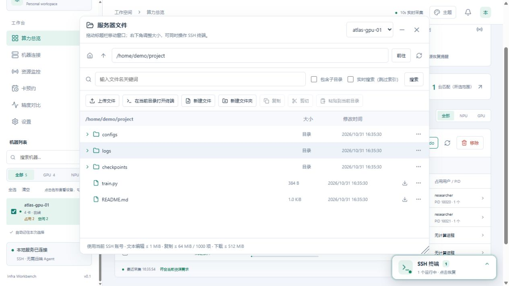
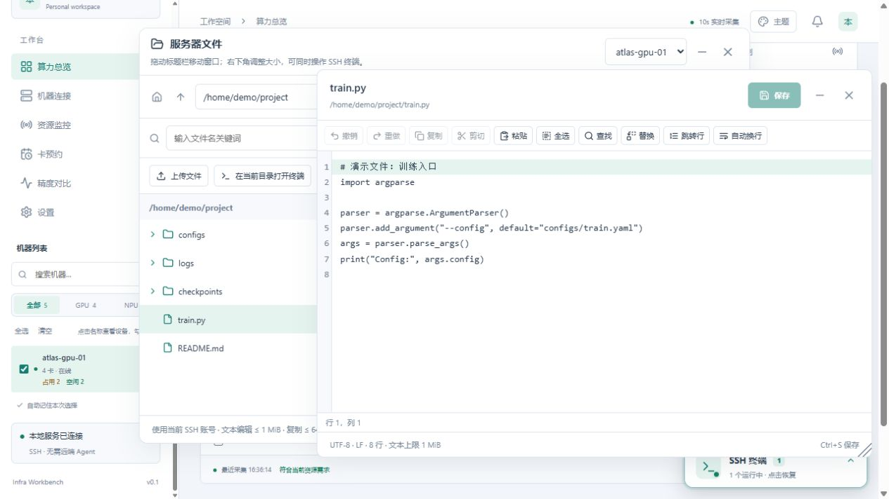

# 服务器文件

终端执行 `pwd` 后，可用 **Ctrl+鼠标左键**点击输出的绝对路径，直接在同一台机器的文件树中打开对应目录。无需手动复制路径；未保存的编辑仍会先提示处理。

在机器右侧点击 **文件**，打开该机器的文件浏览面板；面板上方也可以切换到其他已添加的机器。

*目录和文件内容为演示数据。*

文件面板是浮动窗口，不会遮罩整页或锁定焦点。拖动标题栏可移动位置，拖动右下角可调整大小；右上角的最小化按钮可收起窗口，恢复后保留当前目录和大小。也可将焦点放在标题文字或右下角调整手柄上，使用方向键移动或调整大小。浮窗打开时可以点击窗外的 SSH 终端继续输入命令，无需关闭文件面板。窗口状态在本次打开期间保留，关闭后重新打开不保证恢复位置。

- 默认打开 SSH 账号的主目录，包含隐藏文件。点击文件夹展开或收起目录树，同时将该文件夹设为当前目录，并同步到顶部路径栏。“在当前目录打开终端”、上传、新建、粘贴和搜索都使用这个目录；仅在路径栏输入文字、尚未点击“前往”时，不会改变操作目标。
- 路径栏可输入 `~`、`/data` 等目录，按回车跳转；旁边可返回主目录、上级目录或刷新。
- 单击文件仅选中，方便复制、剪切等操作；双击文本文件、选中文件后按 **Enter**，或右键选择“打开并编辑”，即可打开网页编辑器。修改后点击 **保存** 或按 **Ctrl+S**，通过 SSH 写回服务器，不需要手动下载和上传。关闭编辑器、关闭文件面板或切换机器时，未保存内容会提示“保存并关闭 / 不保存 / 取消”。
- 文本编辑器也是独立浮窗：拖动标题栏移动，拖动右下角缩放，点击右上角“−”最小化，恢复后保留草稿。打开时不会自动抢走键盘焦点，也不遮罩页面；文件窗口最小化后，仍可单独操作编辑器和 SSH 终端。
- 编辑工具支持复制、剪切、粘贴、全选、撤销/重做、当前文件内查找替换、行号、跳转行和自动换行。常用快捷键为 **Ctrl+C/X/V/A**、**Ctrl+Z/Y**、**Ctrl+F/H**（查找/替换）及 **Ctrl+Alt+G**（跳转行）。查找可区分大小写、全字匹配或使用正则表达式，并显示匹配数量。剪贴板按钮被浏览器拦截时，可直接在编辑区使用快捷键。
- 支持 UTF-8 文本（含 BOM），上限 1 MiB；保存时保留原来的换行格式和文件权限。保存前校验原始版本，发现远端已变化时不覆盖，并保留当前编辑内容。符号链接、硬链接及其他用户拥有的文件请使用终端编辑。
- 文件和目录的右键菜单支持复制、剪切、移动、重命名、复制路径；点击右侧“…”也能打开菜单。复制或剪切后，在目标目录点击“粘贴到当前目录”，或右键目录选择“粘贴到此目录”。目标路径可修改，已有同名文件不会覆盖。
- 工具栏支持新建文本文件和文件夹。复制仅限同一台机器，单次上限 64 MiB、1000 项、64 层；移动和重命名仅支持同一文件系统，不会默默转成大文件复制。
- 右键普通文件选择 **下载文件**，或点击文件右侧下载图标，原有下载功能保留。
- 较大的目录按每页 500 项加载，点击“加载更多”继续查看。超过 10000 项时，请直接输入更具体的子目录路径。
- 文件名搜索优先使用远程机器的 `plocate` / `locate`，无匹配时自动改用 `find`；“实时搜索”可跳过索引。未检测到索引工具时，结果下方会提供可复制的安装及首次建索引命令，供用户在远程终端手动执行。安装后重新搜索即可自动检测；新文件、索引未覆盖的目录仍可用实时搜索查找。

## 上传文件

1. 先在目录树选中目标目录，确认顶部路径；仅在路径栏输入但未点击「前往」不会改变上传目录。
2. 点击 **上传文件**，选择本地文件；单个文件上限 512 MiB。
3. 等待传输与远端确认全部完成，再查看结果；进行中可取消。不要把浏览器已传完当成远端已保存成功。

## 权限与传输限制

文件管理沿用当前机器的 SSH 连接及账号权限，不使用 sudo。浏览和下载只读；编辑、新建、复制和移动仅在用户主动操作后执行。编辑内容不写入本地数据库或日志，保存时通过 SSH 标准输入传给远端 Python，使用同目录临时文件写完后替换，避免中途保存留下半个文件。文件冲突或失败会显示错误，不会提示成功；若连接中断导致结果不确定，请先刷新确认再重试。

单个文件下载上限为 512 MiB，不支持目录打包。下载会先完整接收到本地临时文件，校验长度和远端退出状态后再交给浏览器；失败不会作为成功下载返回。下载临时文件在响应完成或失败后关闭。请只下载自己有权访问的文件。

更新代码后，需要重新启动本地服务才能注册文件接口；刷新页面不会自动重启后端。
