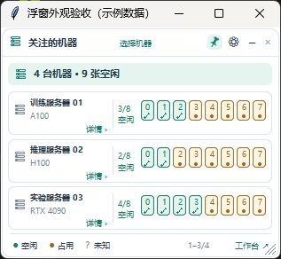
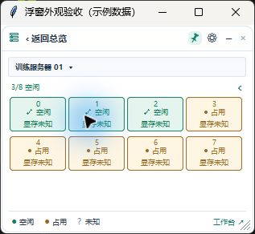
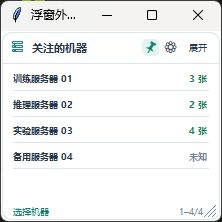

# Desktop resource monitor (Windows)

[简体中文](FLOATING-MONITOR.md) | [English](FLOATING-MONITOR.en.md)

Keep GPU / NPU status visible while coding or reading logs without leaving the full workbench open. The monitor reuses backend samples and does not perform additional SSH collection. It works alongside either the browser or desktop interface and currently requires Windows. UI labels in the screenshots are Chinese.

## Show, hide, and exit

In **设置 → 启动与桌面浮窗**, enable **显示桌面浮窗** and save with **保存启动设置**, or toggle **显示浮窗** from the tray menu. Visibility changes immediately. New users have the monitor enabled by default; existing explicit choices are preserved.

The **×** button hides only the monitor. Collection, reservations, and notifications continue. Show it again from the tray; exit the entire application through the tray menu. After updating, restart the tray backend—refreshing the browser does not update the monitor.

## Overview, details, and compact view

*All machines are fictional. The OS title bar is part of a temporary screenshot host; the production monitor is borderless.*

The overview summarizes followed machines and idle devices. Each machine card shows its name, model, idle count, and numbered device cells. The default layout shows three machines; scroll for more and check the position indicator at the bottom. Up to 16 devices per machine are shown in the overview; open details for additional devices.

Click the machine name, card background, or **详情 ›** for details. The device grid shows status and used / total memory. Use the machine selector to switch machines and the back arrow to return. Hover over a device for memory, utilization, and collected process user, PID, working directory, and executable. Unavailable values remain unknown.

*The sample omits memory values, so the cells say “显存未知” (memory unknown). Actual values depend on collection results.*

Click **−** to collapse to a narrow list of machine names and idle counts; click **展开** to restore the overview. Scrolling, machine selection, and context menus remain available.

## Selection and appearance

- **选择机器** opens a searchable machine picker. Select individual machines or all, then click **确定** to save. Cancel, close, or Esc discards changes. Display filtering does not remove machines or stop monitoring.
- Drag the header to move; drag an edge or the lower-right corner to resize. Position, size, view, and selections are saved.
- Toggle the pin for always-on-top. The gear opens settings, including 30%–100% opacity with a live preview. Hovering temporarily restores clarity; moving away restores your setting.
- The monitor follows the theme saved in the workbench.

## Open machine tools directly

Right-click a machine card, name, or device and select **打开终端** (open terminal) or **打开文件** (open files). Overview, detail, and compact views all support this. Separate desktop tool windows reuse the machine's SSH configuration and the current backend.

A directory link in the terminal can open a separate file window. **在当前目录打开终端** in the file toolbar opens another terminal in that directory while leaving the file window open. Use **工作台 ↗** or **打开工作台** to open the full workbench.

Closing a standalone terminal disconnects its ordinary SSH sessions and may end foreground tasks. Use persistent tmux sessions for long-running jobs. See the [English user guide](GUIDE.en.md#ssh-terminals-and-server-files) for terminal and file operations.

## Understand status

| Status | Meaning |
| --- | --- |
| ✓ Idle / 空闲 | Fresh data, complete process information, no visible compute process, and no Alarm. |
| ● Busy / 占用 | A visible compute process exists, even if utilization is low. |
| ? Unknown / 未知 | Data is stale, the backend is unavailable, or process information is incomplete. |
| ! Alarm / 异常 | No visible process is present and device health reports Alarm. A visible process takes display priority as busy. |

The monitor does not lock or allocate devices. Availability alerts additionally check utilization, free memory, and continuous-idle duration, so an idle cell does not guarantee an alert has qualified.

Updates follow the backend's 5 / 10 / 20 / 30-second interval. Stale or disconnected data is shown as unknown; hover details may retain the last sample with a stale-data notice. A shorter interval cannot guarantee immediate completion of remote collection.

If visibility controls do not work, check that the tray backend is running. If menus are missing after an update, exit the tray and restart. Build and implementation details remain in the [Chinese desktop reference](DESKTOP.md).
