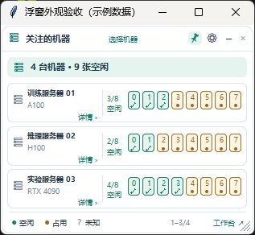
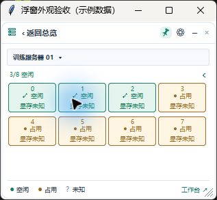
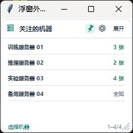

# 桌面资源浮窗（Windows）

[简体中文](FLOATING-MONITOR.md) | [English](FLOATING-MONITOR.en.md)

桌面浮窗适合在写代码、查看日志时持续关注 GPU / NPU，不必一直打开完整工作台。它复用后台已有的采集结果，不会额外连接服务器采集资源。浏览器和独立桌面界面都可以配合使用，目前仅支持 Windows。

## 打开、隐藏与退出

在「设置 → 启动与桌面浮窗」勾选 **显示桌面浮窗**，点击 **保存启动设置**；也可右键系统托盘图标，切换 **显示浮窗**。浮窗显示设置立即生效，浏览器 / 桌面窗口的启动方式在下次打开时生效。新用户默认开启浮窗，已有的关闭选择会保留。

点击浮窗右上角的 × 只隐藏浮窗，后台采集、预约和通知继续运行。需要再次显示时使用托盘菜单；需要退出整个软件时，在托盘菜单中退出。更新软件后应重启托盘后台，单纯刷新网页不会更新浮窗。

## 多机总览、单机详情与收起

*配图使用当前浮窗组件和虚构机器。截图顶部的「浮窗外观验收（示例数据）」是截图宿主的系统标题栏，日常使用的浮窗没有这条标题栏。*

总览顶部汇总关注机器的数量和空闲设备数。每张机器卡片显示名称、设备型号、空闲数量及设备格；格内数字是设备编号。默认一次显示三台机器，机器较多时在浮窗中滚动，底部显示当前位置。总览每台最多展示前 16 个设备，更多设备可进入详情滚动查看。

点击机器名称、卡片空白处或 **详情 ›** 进入单机视图。单机视图显示每张卡的状态和已用 / 总显存，顶部机器名称可切换机器，点击返回箭头回到总览。鼠标悬停在设备格上，可查看显存、利用率以及已采集到的进程用户、PID、工作目录和可执行文件；未采集到的字段显示未知，不会据此补全结论。

*示例数据未提供显存，因此图中显示「显存未知」。实际显示内容取决于服务器采集结果。*

点击顶部 **−** 收起为较窄的机器列表，只保留机器名称和空闲数量；点击 **展开** 恢复总览。收起后仍可滚动、筛选关注机器和使用机器右键菜单。

## 选择机器、移动与外观

- **选择机器**：点击顶部或底部的「选择机器」，搜索名称，逐台勾选或全选；点击「确定」保存，取消或按 Esc 放弃本次修改。筛选只控制浮窗展示，不删除机器，也不停止后台监控。
- **移动与大小**：拖动标题区移动，拖动窗口边缘或右下角调整大小。位置、尺寸、视图形态和关注机器会自动保存。
- **置顶与透明度**：顶部图钉切换始终置顶，齿轮打开设置；支持 30%–100% 不透明度和实时预览。鼠标移入时暂时恢复清晰，移出后恢复设定值。
- **主题**：浮窗跟随工作台保存的主题，支持晴空、暖纸、午夜、石墨和花语旅途。

## 从浮窗直接打开终端或文件

在机器卡片、名称或设备格上右键，选择 **打开终端** 或 **打开文件**。总览、单机详情和收起视图都支持，不需要先打开完整工作台。工具窗口使用该机器已有的 SSH 配置与当前后台。

终端和文件会以独立桌面工具窗口打开。终端里的目录链接可以另开文件窗口；文件工具栏的「在当前目录打开终端」会另开终端并进入该目录，原文件窗口继续保留。要进入完整界面，可点击浮窗底部的 **工作台 ↗** 或右键菜单中的 **打开工作台**。

关闭独立终端会断开其中的普通 SSH 会话，前台任务可能结束；长任务请使用 tmux 持久会话。终端操作见 [SSH 终端](TERMINAL.md)，文件浏览、搜索、编辑和传输见 [服务器文件](FILES.md)。

## 怎样理解设备状态

| 状态 | 含义 |
| --- | --- |
| ✓ 空闲 | 本次数据有效、进程信息完整、无可见计算进程且未报告 Alarm。 |
| ● 占用 | 有可见计算进程；即使利用率很低也仍显示占用。 |
| ? 未知 | 数据过期、后台不可用，或进程信息不完整。不能据此判断设备空闲。 |
| ! 异常 | 无可见进程时，设备健康状态报告 Alarm；有进程时仍优先显示占用。 |

浮窗用于快速观察，不会锁定或预留设备。预约还会检查利用率、剩余显存和连续空闲时长，条件更严格，因此浮窗显示空闲不代表预约一定已经满足。完整规则见 [卡预约](RESERVATIONS.md)。

刷新间隔沿用后台的 5 / 10 / 20 / 30 秒设置。连接中断或采样过期时，浮窗会显示未知；悬停可能仍能看到上次数据，并注明过期。浮窗没有额外的独立采集周期，缩短间隔也不能保证远端采集立即完成。

若开关无效，先确认托盘后台仍在运行；若更新后缺少菜单，退出托盘再重新启动。桌面入口和实现说明见 [桌面端文档](DESKTOP.md)。
