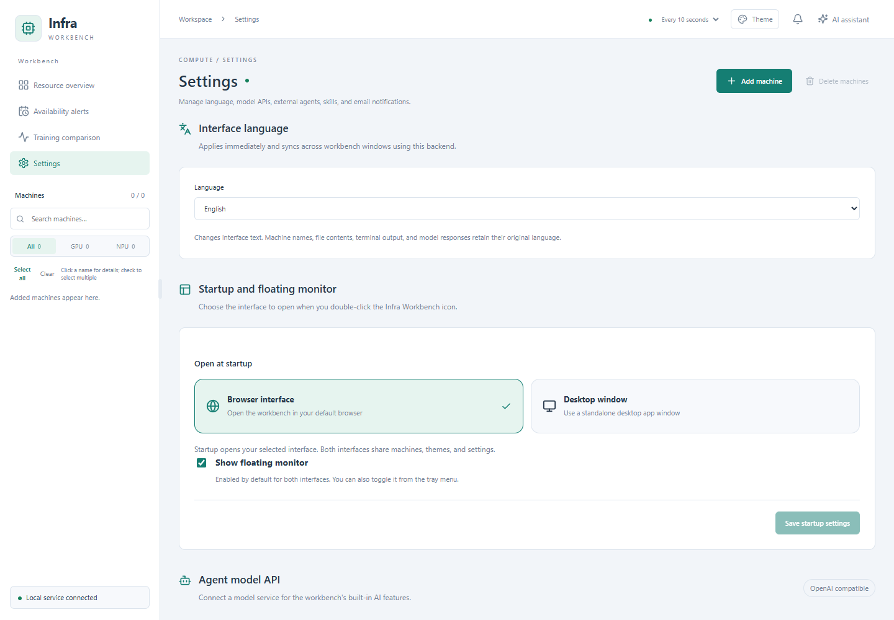
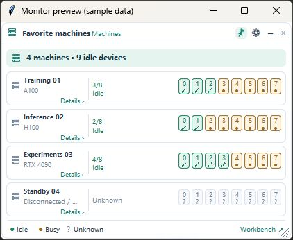
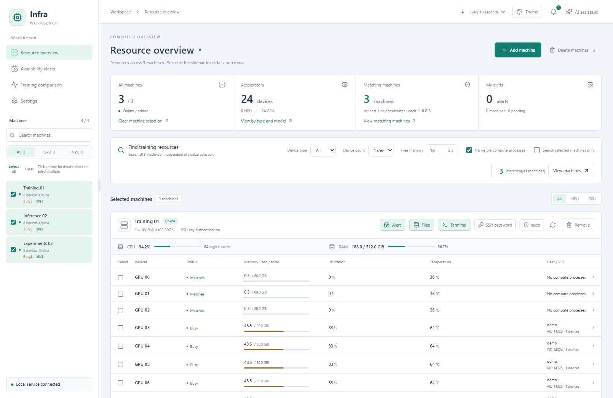
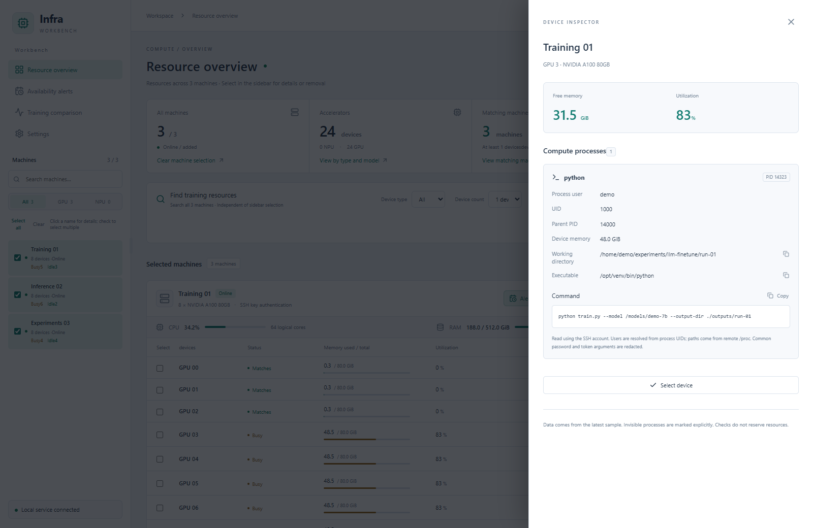
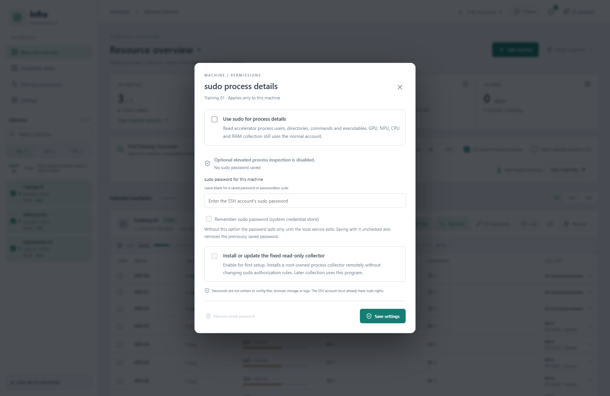
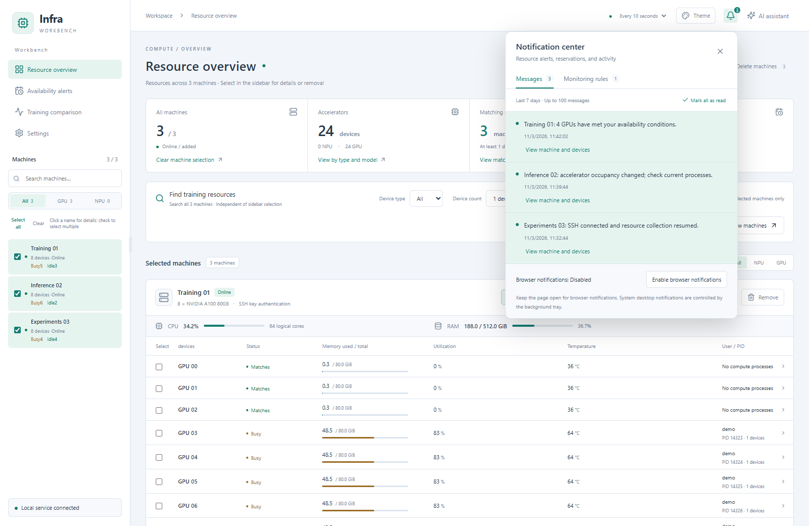

# User guide

[简体中文](GUIDE.md) | [English](GUIDE.en.md)

Infra Workbench is an AI-native server workbench for AI engineers. It runs locally on Windows and connects to Linux servers over SSH, bringing resource discovery, process inspection, availability alerts, terminals, files, and training comparison together. The assistant uses workbench tools and can turn confirmed workflows into reusable skills. No persistent remote agent is required.

The UI supports Simplified Chinese and English. Screenshots below show the English interface; Chinese button names are included in the instructions for reference. Screenshots contain fictional machines and sample data. macOS users should read the [platform notes in Chinese](MACOS.md); native Mac behavior still requires hardware verification.

## Start and exit

Installer users download the Windows package from the [latest Release](https://github.com/addsubmuldiv/infra-workbench/releases/latest), then use the **Infra Workbench** desktop shortcut; Neither Python nor Node.js needs to be installed separately for normal use. Source users run **`安装.cmd`** to prepare Python and dependencies and must retain the complete project directory.

Under **Settings → General → Startup and desktop monitor (设置 → 通用 → 启动与桌面浮窗)**, choose a browser or standalone desktop interface and toggle the floating monitor. Save the settings: monitor visibility changes immediately, while the interface choice applies the next time you open the app.

Closing the browser leaves the tray backend running, so monitoring, availability alerts, and notifications continue. Exit the entire app through the tray menu. Monitoring cannot observe remote resources while the computer is asleep, powered off, or disconnected.

## First use and getting-started guide

A new workspace with no hosts shows the guide after the backend state has loaded successfully. Completing it, skipping it, or pressing Escape saves the decision in the local workspace and synchronizes it across windows connected to that backend. Existing workspaces with hosts are not interrupted on upgrade.

Replay it under **Settings → About and help → Replay getting-started guide**. The guide does not connect to servers, run commands, or install CLIs. **Add machine** only opens the connection form. For a hands-on simulation, choose **Try the demo and guided tour (no server required)** separately; demo state and real-workspace guide completion remain independent.

| Step | What to do next | Details |
| --- | --- | --- |
| Connect hosts | Choose SSH configuration, manual entry, or Excel import; verify the target identity | [Import](IMPORT.md) |
| Inspect and organize resources | Search aliases, organize clusters, and filter by device count and memory | [Clusters](CLUSTERS.md) |
| Terminals, files, and remote development | Use tmux for long tasks; configure tunnels and VS Code when needed | [Terminals](TERMINAL.md), [Files](FILES.md), [SSH tunnels](SSH-TUNNELS.md) |
| AI assistant | Configure a model connection or install and authenticate a local engine; check host scope and tool records | [Model connections](AGENT.md), [Codex](CODEX.md), [Other engines](EXTERNAL-AGENTS.md) |
| Alerts, history, and comparison | Set availability alerts, collect history samples, and compare training logs | [Alerts](RESERVATIONS.md), [History](RESOURCE-HISTORY.md), [Precision](PRECISION.md) |
| Optional settings | Find language, Skills, automation, MCP, email, and help | [Automation](AUTOMATION.md), [Skills](USER-SKILLS.md), [MCP](MCP.md) |

Availability alerts do not lock hardware or start training, and history gaps remain unknown. Broadcast commands, terminals, and AI tools may modify remote machines; verify the target scope first. Some linked technical guides are currently in Chinese.

## Interface language

Open **Settings → General → Interface language (设置 → 通用 → 界面语言)** and choose **English** or **简体中文**. The change applies immediately without reconnecting machines, resetting editor drafts, or recreating terminal sessions. The local backend saves the choice for future launches and synchronizes it across workbench windows, the Windows desktop monitor, and tray menus. Machine names, files and logs, terminal output, model responses, and some original backend diagnostics retain their source language.

## Desktop resource monitor

Toggle **显示浮窗** in the Windows tray menu or use startup settings. The monitor works with either main interface. The OS title bar in these screenshots belongs to a preview host; the production monitor is borderless.

Click a machine or **详情 ›** for device details. Hover over a device to see memory, utilization, and collected process information. Use **选择机器** to search and select machines, **−** to collapse, and **展开** to expand. Drag the header to move, drag an edge to resize, use the pin for always-on-top, and open the gear for opacity settings. Layout and selections are saved, and the monitor follows the workbench theme.

Right-click a machine card, name, or device to open a standalone terminal (**打开终端**) or file window (**打开文件**). A file window can open a terminal in its current directory; terminal directory links can open a separate file window. Closing a normal SSH terminal may end foreground jobs, so use tmux for long tasks.

Unknown or stale data must not be treated as free resources. Availability alerts apply additional utilization, memory, and continuous-idle checks. See the [illustrated monitor guide](FLOATING-MONITOR.en.md).

## Connect and select machines

Click **Add machine (添加机器)** to select an entry from `~/.ssh/config` and its Include files, or enter an address, port, and account manually.

- Existing key authentication reuses local keys, SSH agent, and jump-host settings.
- Passwords can be used for the current run or explicitly remembered in the system credential store. Per-machine **SSH 密码** controls let you verify, save, or remove them.
- Optional automatic key setup creates a dedicated key, appends its public key remotely, and verifies key authentication.
- Verify and trust the server fingerprint before connecting to an unknown host.

For bulk import, open **添加机器 → Excel 批量导入** and upload `.xlsx` with the headers `IP`, `账号`, `密码`, and `端口`. The IP field may contain an SSH alias. The account overrides the alias user; an empty port inherits the alias port or defaults to 22 for plain addresses. An explicit port overrides it. Passwords are saved after verification. Existing machines are not duplicated; ambiguous address matches need a unique alias. See the [Chinese import reference](IMPORT.md).

In **Resource overview (算力总览)**, search the sidebar and filter by **全部 / GPU / NPU**. Click a name to show one machine, or use checkboxes for several. **全选** selects all and **清空** clears selection. These display choices do not stop background monitoring. Drag the sidebar divider to resize; double-click to reset it.

To remove a machine, hover over its sidebar row and click the trash icon, or use **移除** beside its heading. The confirmation explains that related monitoring, reservations, saved SSH / sudo passwords, and open tools are removed from the app. Remote files and local SSH configuration are retained.

## Inspect resources and processes

The top summary covers all added machines; sidebar selection controls the details below. Machine cards show connectivity, CPU usage and logical cores, RAM, and accelerator memory, utilization, temperature, and processes. CPU and RAM reflect the remote system view; container limits may differ.

Use **寻找训练资源** to set device type, count, free memory per device, and optionally **无可见计算进程** (no visible compute processes). Search covers all machines unless **仅在所选机器中寻找** is enabled. Click **查看机器** to display matches. Results use valid online samples; resource discovery does not allocate devices.

The top **全部机器** control selects all machines and clears search/type filters, or clears selection when all are selected. **加速设备** groups devices by type and model. **全局符合条件** counts matches across all machines using your resource criteria; **我的预约** opens availability alerts.

Click a device or process to inspect user, PID, program, working directory, executable, and command. Missing permissions or unavailable fields are shown explicitly.

### Optional sudo collection

Click **sudo** beside a machine heading to enable elevated process-detail collection for that machine. Verify the password and, when prompted, install the fixed read-only collector. The account must already have sudo rights. Later samples attempt to fill information unavailable to the normal account.

Remembering a password is optional; otherwise it lasts only for the current backend run. Saved passwords can be removed. This setting does not turn the interactive terminal or file manager into root.

## Readiness checks and monitoring

Select devices to reveal the action bar. Clicking an empty page or machine background clears device selection without changing selected machines, monitoring rules, or reservations.

| UI action | Purpose |
| --- | --- |
| 训练前检查 | Enter a training port and inspect selected device resources and port occupancy, with reasons for the result. |
| 监控所选 | Track resource changes for selected devices; manage rules in 通知中心 → 监控规则. |
| 预约所选 | Get an alert after selected devices meet continuous-idle conditions. |

Low utilization alone does not prove a device is free. Checks and searches do not reserve hardware.

## Availability alerts

Click **预约** on a machine to open a form with that machine and selected devices already filled in, or open **卡预约 → 新建预约**.

Choose either a device count, such as any four GPUs, or specific device IDs. The default idle period is **two minutes**, configurable from 0 to 1440 minutes, with a free-memory requirement per device. Zero means notify after the next valid sample confirms the conditions.

A qualifying device must have no visible compute process, utilization explicitly equal to zero, sufficient free memory, and no Alarm. Unknown utilization does not qualify; Warning does not block the alert. Occupancy, uncertain state, or interrupted collection resets the timer. For count-based alerts, changing eligible IDs does not reset it while enough devices remain continuously eligible.

The list shows status, progress, remaining time, and separate notification delivery states. **编辑预约** changes conditions and restarts the timer; **再次预约** creates a new alert with previous conditions. **查看机器和设备** locates the target resources. Backend restarts retain alerts but recheck continuous-idle time; completed alerts are not resent.

These are availability notifications: they do not lock devices or launch jobs. Acceptance by Windows or SMTP does not prove receipt. See the [Chinese reservation reference](RESERVATIONS.md).

## Windows and email notifications

The bell opens **通知中心**, showing seven days of events and monitoring rules. **全部已读** clears unread resource alerts for the current browser. SSH connection changes remain in history but do not count toward unread resource alerts or repeatedly trigger system notifications.

Windows tray notifications work while the backend runs, even with the page closed. The tray menu controls notifications, test messages, and Windows login startup. Browser notifications are a separate option; enabling both can produce two notifications. Old events are not replayed as a backlog.

For email, open **设置 → 集成服务 → 邮件**, enter SMTP host, port, encryption, sender, credentials, and recipient, then enable, save, send a test, and confirm receipt. Enable **使用邮箱通知** separately for each availability alert. New blank alerts default to email off; editing or repeating preserves their choice. Existing alerts are not automatically opted in when SMTP is configured.

SMTP acceptance is not confirmed inbox delivery. Failed or uncertain sends are not repeatedly retried automatically. See [email](MAIL.md) and [background behavior](BACKGROUND.md) in Chinese.

## SSH terminals and server files

Use **终端** or **文件** beside a machine heading to open tools in the workbench. Both can remain open together. The desktop monitor can also open separate native tool windows.

Terminals support tabs, font size, dragging, resizing, minimizing, maximizing, history suggestions, output search, command templates, completion alerts, and recoverable tmux sessions. Click a minimized card to restore it, or **+** to add a session. With text selected, `Ctrl+C` copies; otherwise it interrupts the foreground command. `Ctrl+V`, Windows clipboard history, and `Ctrl+Shift+C / V` are supported. Closing a session or refreshing can affect foreground work; use tmux for long-running jobs. See [terminal details in Chinese](TERMINAL.md).

In the file window:

- Browse the directory tree, enter a path and navigate, return home or up, refresh, and search filenames. Search can use a remote locate index with a find fallback; **实时搜索** skips the index.
- Single-click to select; double-click a text file or press Enter to edit. Save with the button or `Ctrl+S`. Closing unsaved content offers save, discard, or cancel. Remote version conflicts are not silently overwritten.
- Create files/directories, copy, cut, move, rename, copy paths, and paste into the destination. Existing targets are not overwritten.
- Upload files or folders to the current directory, review progress through remote confirmation, and cancel when needed. Folder uploads preserve the tree; empty-directory support depends on the browser picker and is reported when unavailable. Existing same-name folders are not merged or overwritten.
- Download individual files, or use the folder's three-dot menu → **下载文件夹** for a ZIP. Folder downloads skip symbolic links and special files and report skipped items.

File tools use the SSH account without sudo. Text editing is limited to 1 MiB; one copy operation to 64 MiB / 1000 items. A file, folder content total, or generated ZIP is limited to 512 MiB; folder transfers also have limits of 10000 items and 64 directory levels. See [files in Chinese](FILES.md) for permission, validation, cancellation, and transfer details.

## AI assistant and Skills

Configure a service URL, API key, and model under **Settings → AI assistant → Model configuration**, then save and test. Multiple profiles are supported. A text test alone does not validate function-tool support. Alternatively, select local Codex, Claude Code, or OpenCode in the assistant; install and sign in to the chosen CLI separately. See [local engines and validation limits](EXTERNAL-AGENTS.md).

Open **AI 助手** and describe a goal: find four free GPUs with 40 GiB each, identify accelerator users and working directories, read a specified training log, or create an alert with confirmed conditions. The assistant can query resources, processes, tmux, and files, and manage reservations, monitoring, and files as requested. Expand execution steps to inspect target machines, arguments, raw results, and errors.

By default, tools may access all added machines. To restrict a turn, expand the composer context controls and enable **仅允许操作所选的机器**. Selecting machines in the sidebar alone does not restrict assistant access.

Click **取消本轮** to stop further work. Completed actions are not rolled back. Collapsing the assistant, switching pages, or closing the display connection does not cancel background work. Replies support Markdown, tables, Mermaid, and math; review the underlying tool output when assessing conclusions.

The assistant docks on the right. Drag its header to float it; drag back to the right edge or click **停靠到右侧** to dock again. Resize or collapse it while retaining the conversation and input draft. Create or switch conversations as needed. Long conversations show context-compaction status while retaining local chat history.

### Create and import skills

Use skills to capture repeatable inspection steps, log-analysis instructions, or report requirements:

1. Open **Settings → AI assistant → Skills (设置 → AI 助手 → Skills)** and create a draft, paste `SKILL.md`, or import UTF-8 Markdown / ZIP. Imported content first becomes a draft for review.
2. Edit the instructions, validate the package, and install it. Drafts persist, so you can return later.
3. Type `@` in the chat composer to search and select a skill. Arrow keys and Enter / Tab select; Esc closes the picker. Without an explicit selection, the assistant can discover skills as needed.
4. Manage installed skills with enable/disable, copy, export, and version rollback. Changes apply on the next turn; a running turn retains its original skill snapshot.

You can also ask: **“Turn the inspection workflow we just confirmed into a skill named training-inspection and install it.”** The assistant can create, validate, and install it using skill-management tools. If you only request a design or discussion, it saves a draft. Reading a skill's instructions is not proof that its steps succeeded; inspect execution records.

Skills describe workflows and can include reference files. Stored scripts are not automatically executed, and skills do not install packages or grant new tool or machine permissions. See the [Chinese package reference](USER-SKILLS.md) for formats and limits.

Conversations and server content actually read by tools are sent to your configured model service. Do not ask it to read confidential files. Backend scope, path, and credential protections remain in force; model-generated conclusions may still be wrong.

## Compare training metrics

In **精度对比**, choose baseline and candidate machines and log files, load them, select rank / training segment and metrics, and set a step range.

Supported training JSON logs are aligned by actual step. Results include curves, mean absolute error (MAE), maximum absolute error, and per-step differences, with access to source log lines. Duplicate steps can raise an error or retain the first/last occurrence; data is not automatically interpolated or smoothed.

Save configurations, export all results as CSV, or download raw logs without metric parsing. Built-in examples help you explore the flow. See the [Chinese comparison reference](PRECISION.md).

## Themes, local data, and refresh

Choose a theme from **主题**. Keep passwords, private keys, and the local `data/` directory private. The app does not provide team accounts or a resource scheduler; do not expose its local service directly to a LAN or the internet. See [data and credentials in Chinese](../SECURITY.md).

Refresh intervals are 5, 10, 15, 20, or 30 seconds, defaulting to 15. The backend saves the choice for all windows and uses it for collection and display refresh. Legacy 60-second settings are reduced to 30 seconds.

Each host waits the configured interval after a collection finishes before starting its next round; rounds on the same host do not overlap. Failures use retry backoff. Single-host availability alerts and the overview allow at least 30 seconds of freshness, or the refresh interval plus a 15-second collection margin up to 45 seconds. Stale, failed, or unknown samples interrupt continuous-idle confirmation. Resource-change gaps longer than 45 seconds remain gaps rather than inferred activity. UI preferences are shared through the local backend; see [workspace state](WORKSPACE-STATE.md).
