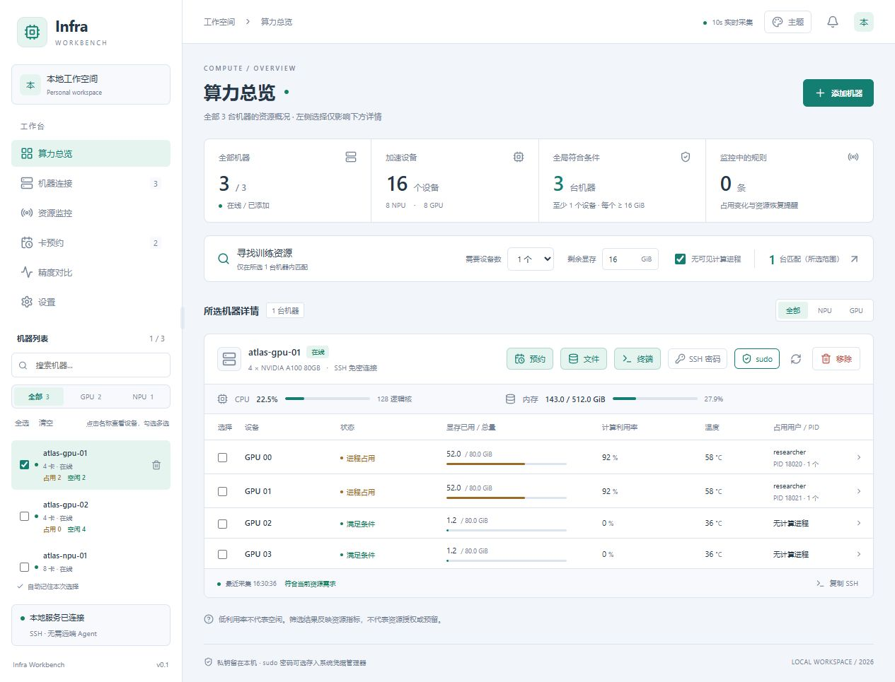
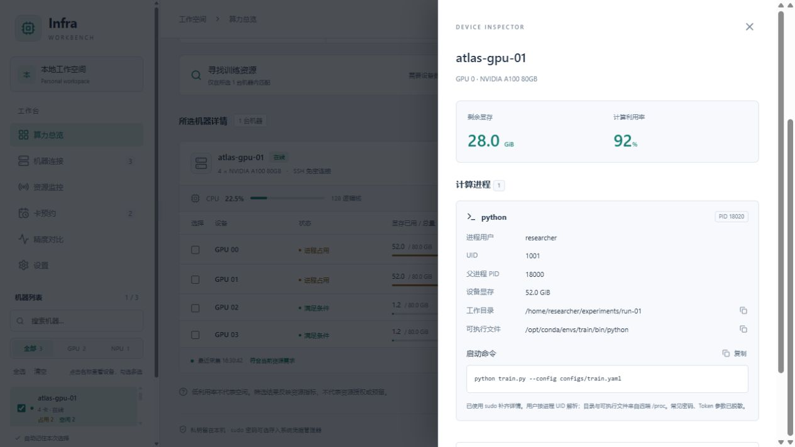
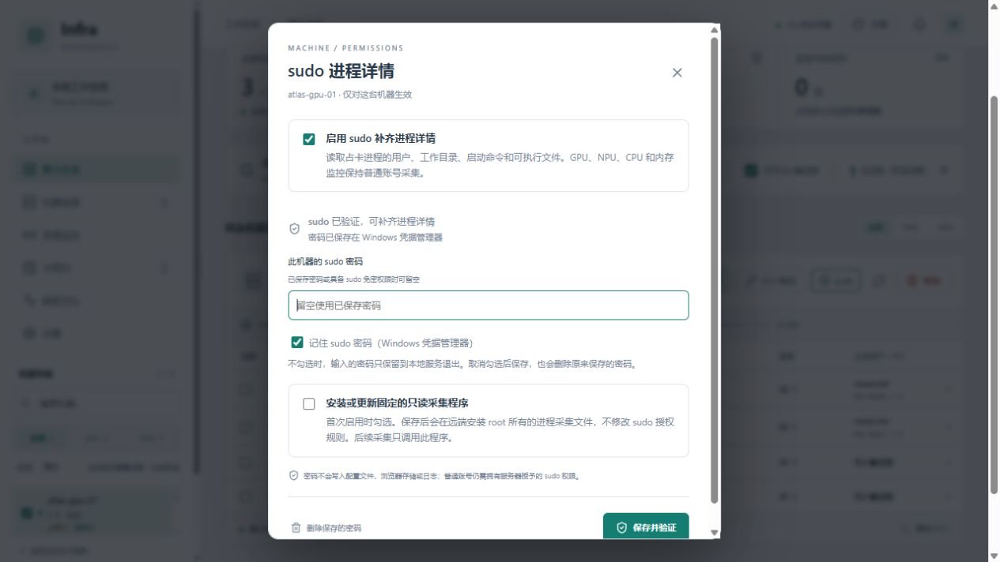

# 功能与使用指南

macOS 请先看 [安装与验证说明](MACOS.md)；以下网页操作通用。Mac 原生菜单栏、通知和钥匙串仍待实机验证。

Infra Workbench 在 Windows 本机运行，通过 SSH 连接 Linux 服务器。它把找卡、查看进程、等待空闲、执行命令、管理文件和对比训练日志放在一个界面中，远端不需要安装常驻 Agent。

> 本指南及分项文档中的操作图使用示例机器、账号、地址和日志，不包含真实凭据。

## 启动与退出

首次和日常使用都双击项目根目录的 **`运行.cmd`**。首次运行会准备环境和依赖，完成后在系统托盘运行并打开网页。普通用户不需要安装 Node.js。

关闭网页后，托盘和本地后台仍可继续监控、处理预约和发送通知。退出整个软件请使用托盘右键菜单。电脑睡眠、关机或网络断开期间不能持续观察远端资源。

安装失败、更新版本或迁移目录时，参见 [安装与排障](WINDOWS.md)。

## 连接与选择机器

点击「添加机器」，可从本机 `~/.ssh/config` 及其 Include 文件中选择已保存的机器，也可以手动填写地址、端口和账号。

- 已有 SSH 免密配置时直接连接，沿用本机密钥、SSH agent 和跳板配置。
- 需要密码时，在软件中输入；默认仅用于本次连接，也可主动勾选记住，或在每台机器的「SSH 密码」中验证保存和删除。
- 勾选自动配置免密后，软件会生成专用密钥、向远端追加公钥，再验证免密连接。
- 首次连接未知机器时，需要先核对并信任服务器指纹，具体步骤见安装文档。

「添加机器 → Excel 批量导入」可上传 `.xlsx`，表头为 IP、账号、密码、端口；也可在 IP 列填 SSH 别名。提供的密码验证后自动保存在系统凭据管理器。匹配到已有机器时只补存密码，不重复添加，也不修改原密钥或跳板；按地址匹配到多台时，请改填唯一 SSH 别名。账号列覆盖别名中的 User；端口留空时沿用别名配置，普通地址使用 22，显式填写端口则覆盖配置。完整步骤和结果说明见 [Excel 批量导入](IMPORT.md)。

拖动左栏右边缘的分隔线可调整宽度，右侧内容随之伸缩；宽度足够时，机器名称、卡数和占用状态排成一行。宽度会自动记住，双击分隔线恢复默认，也可用方向键微调。

左侧机器列表可按「全部 / GPU / NPU」分类，并按名称搜索。点击名称只看这一台；勾选可同时查看几台，也可以「全选」或「清空」。每行显示当前占用、空闲等设备数量；状态过期时不会把旧数据当成当前空闲。软件会在当前浏览器记住机器选择，下次打开时恢复。已添加的机器和预约保存在本机，显示筛选不会取消后台监控。

### 移除机器

鼠标移到左侧机器行上，点击右侧出现的垃圾桶；也可在机器标题旁点击「移除」。确认框会说明影响：移除本软件中的机器、相关监控与预约、已保存的 SSH / sudo 密码，并关闭该机器的终端和文件窗口。不会删除远端文件或本机 SSH 配置。

## 查看资源与占卡进程

「算力总览」顶部统计全部已添加机器，左侧选择只影响下方详情。每台机器显示在线状态、CPU 使用率、逻辑核数和内存，以及每个 GPU / NPU 的显存、计算利用率、温度和进程信息。

在「寻找训练资源」中设置需要的设备数、每个设备的剩余显存，并按需勾选「无可见计算进程」，即可筛选符合条件的机器。设备数按实际采集结果显示，不限于 8 个；多芯片 NPU 会展示对应的卡号和芯片信息。

点击设备或占用进程，可查看用户名、PID、程序名、工作目录、可执行文件和启动命令。能显示哪些字段取决于远端权限；读取不到的内容会标记为未知或权限不足。CPU 和内存来自远端系统视角，容器内的资源限额可能不同。设备详情栏从右侧滑入，关闭后回到列表。

### 按机器设置 sudo

机器标题旁点击 **sudo**，可为这台机器启用进程详情的提权采集。输入密码验证后，下一次采集会尝试补齐普通账号无法读取的信息；没有 sudo 权限的账号仍无法提权。

「记住密码」可选，保存到当前 Windows 用户的凭据管理器，也可以仅在本次后台运行期间使用。每台机器独立设置，并可删除保存的密码。此设置不会自动把网页终端或文件管理切换成 root。首次启用时按提示勾选安装固定的只读采集程序，保存并验证成功后弹窗会自动关闭。

## 训练前检查与资源监控

在设备表中勾选设备后，底部会出现操作栏。要一次取消所有已选卡，点击机器旁或页面背景的空白处；按钮、输入框、设备详情与弹窗操作不会触发清空。此操作不改变左侧选中的机器，也不删除已有规则或预约。

可用操作如下：

| 操作 | 用途 |
| --- | --- |
| 训练前检查 | 填写训练端口，检查所选设备的资源条件及端口占用，查看检查结果和原因。 |
| 监控所选 | 持续关注这组设备的资源状态变化，在「资源监控」中查看或删除规则。 |
| 预约所选 | 等指定设备连续空闲后提醒，适合现在被占用、准备稍后使用的情况。 |

监控规则持续观察变化；预约则在条件满足后提醒一次。低利用率本身不代表设备空闲，资源筛选和训练前检查也不会预留设备。

## 预约设备空闲提醒

点击机器工具栏的 **预约**，会进入「卡预约」并自动选好该机器；已勾选的卡会一并带入。也可在「卡预约」点击 **新建预约**，选择机器后有两种方式：

- **按数量预约**：例如需要任意 4 个 GPU，不绑定具体卡号。只要一直有足够数量的同类设备满足条件，就持续计时。
- **指定卡号**：选择固定的几张卡，支持全选、清空；必须全部持续满足条件。

默认连续空闲 **2 分钟** 后提醒，可调整为 0～1440 分钟，并设置每个设备的剩余显存要求。0 表示下一次有效采集确认条件满足后提醒。等待时间会记住，方便下次填写。

设备需没有可见计算进程、利用率明确为 0、剩余显存足够且无 Alarm；N/A 或无法读取的利用率不计为空闲，Warning 不阻止提醒。设备重新被占用、无法确认状态或采集中断时会重新计时。按数量预约时，具体可用卡号变化但数量始终足够，不会重新计时。

预约列表可查看状态、连续空闲进度和剩余时间。点击「编辑预约」可修改数量、卡号、显存要求、等待时间和邮件开关，保存后重新计时；已完成的记录可「再次预约」，会带入原条件新建记录。点击「查看机器和设备」可定位对应资源。

「条件已满足」与 Windows、邮件的发送状态分别显示；系统接受通知请求或 SMTP 接受邮件，都不代表你已收到。重启后台会保留预约，但重新确认空闲时间；已完成的预约不会重复提醒。

预约只提醒，不锁定设备或代替你启动任务。操作图和完整规则见 [卡预约](RESERVATIONS.md)。

## Windows 与邮件通知

默认使用 Windows 托盘通知，后台运行即可，不要求网页一直打开。托盘菜单可以关闭桌面通知、发送测试通知或设置登录 Windows 后启动。网页也可单独开启浏览器通知；两者同时开启时可能收到两种提醒。

SSH 断开、重连和采集恢复只更新页面状态，不反复弹系统通知。过期事件不补发，避免长时间离开后积压通知。

需要邮件提醒时：

1. 进入「设置 → 邮件通知」，填写 SMTP 服务器、端口、加密方式、发件账号、授权码及收件地址。收发可以是同一邮箱。
2. 启用并保存，发送测试邮件，再到收件箱确认收到。
3. 新建预约时，单独勾选 **使用邮箱通知**。邮箱配置不完整或授权码不可用时不能勾选。

从「新建预约」打开空白表单时，默认不勾选邮件；编辑或再次预约会沿用原选择。勾选后保留 Windows 通知，同时发送邮件，已有预约不会因配置邮箱而自动开启邮件。设置中可删除保存的授权码，预约列表可查看邮件发送状态。

SMTP 接受邮件不等于收件箱已收到；失败或结果不确定时不会自动反复重发。详细配置见 [邮件通知](MAIL.md)，后台行为见 [后台与通知](BACKGROUND.md)。

## SSH 终端与服务器文件

机器标题旁的 **终端** 和 **文件** 分别打开浮窗；两个窗口可以同时使用。

终端支持多标签、字号调整、拖动移动、四边与四角缩放、最小化和最大化，位置和尺寸会自动记住。最小化后点击右下角的小卡片恢复。标签栏加号可创建额外会话。`Ctrl+C` 在选中文字时复制，没有选中文字时中断远端前台命令；`Ctrl+V` 粘贴，也支持 Windows 的 `Win+V` 历史剪贴板和 `Ctrl+Shift+C / V`。关闭会话或刷新网页可能影响前台任务，长任务建议放在 tmux 中运行。详见 [SSH 终端](TERMINAL.md)。

文件浮窗可拖动标题栏移动、拖动右下角调整大小，也可最小化再恢复；目录和窗口大小会在本次打开期间保留。窗外可以直接点击终端输入命令。

- **浏览与下载**：展开目录树，输入路径跳转，返回主目录、上级目录或刷新；右键文件或点击下载图标下载原文件。
- **编辑文本**：单击文件只选中，双击文本文件或选中后按 Enter 打开编辑器，保存按钮或 `Ctrl+S` 写回远端。未保存时关闭会提示保存、放弃或取消；发现远端版本变化时不直接覆盖。
- **上传**：先确认当前目录，点击上传选择本地文件，观察传输和远端确认进度；支持取消。
- **文件操作**：新建文件或目录；右键复制、剪切、移动、重命名或复制路径，再在目标目录粘贴。已有同名目标不会被覆盖。

文件管理沿用当前 SSH 账号，不使用 sudo。文本编辑上限 1 MiB，单次复制上限 64 MiB / 1000 项，单个文件下载上限 512 MiB；不支持目录打包下载。具体限制见 [服务器文件](FILES.md)。

## 训练精度对比

在「精度对比」分别选择基准与待验证的机器、日志文件，读取后选择对应的 rank / 训练段和指标，设置 step 范围，再对比结果。

支持的训练 JSON 日志会按真实 step 对齐，展示曲线、平均绝对误差（MAE）、最大绝对误差和逐步差异；点击结果可定位双方日志原文。重复 step 可选择报错、保留首条或保留末条，不会自动插值或平滑。

可保存对比配置、导出全部 CSV，也可不解析指标直接下载完整原始日志。界面提供示例，首次可先载入示例熟悉操作。支持格式和计算规则见 [精度对比](PRECISION.md)。

## 主题与本机数据

右上角「主题」可选晴空、暖纸、午夜、石墨和花语旅途。主题与机器筛选偏好保存在当前浏览器；换浏览器或清理浏览器数据后可能需要重新选择。

机器、规则、预约等数据保存在本机 `data/`，密码和私钥不要随项目分享。软件没有团队账号或资源调度功能，不应直接暴露到局域网或公网。数据位置与凭据说明见 [数据与凭据](../SECURITY.md)。
