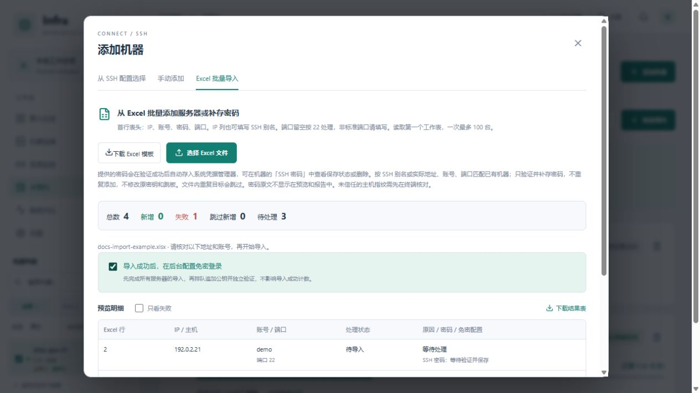
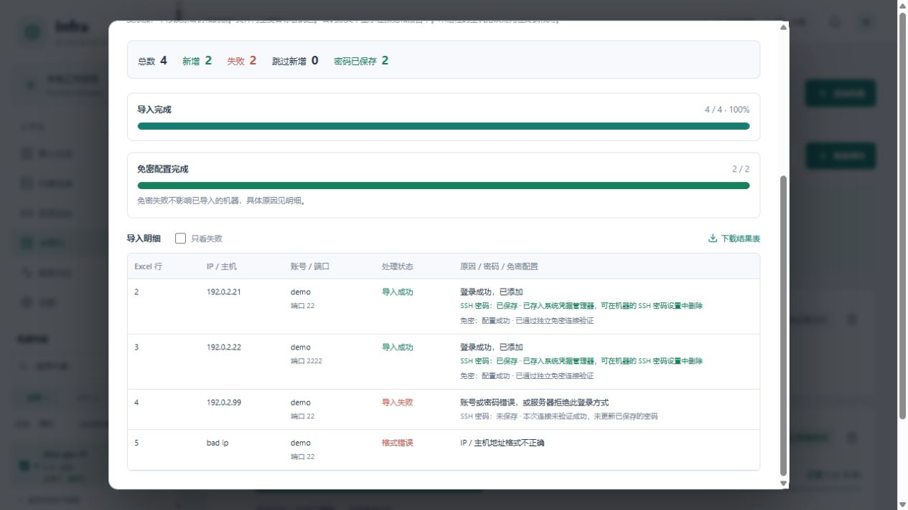

# Excel 批量导入服务器

适合一次添加多台服务器，或给已有机器补存 SSH 密码。入口是 **添加机器 → Excel 批量导入**。

本文截图使用示例地址与账号，连接和免密结果为演示数据。

## 1. 填写模板

点击 **下载 Excel 模板**，删除示例行，再填写自己的服务器信息：

| 列名 | 怎么填 |
| --- | --- |
| IP | IP、主机名，或本机 SSH 配置中已有的别名。 |
| 账号 | 远端登录用户名，必填。 |
| 密码 | SSH 登录密码；已有免密时可以留空。请将单元格设为文本，避免丢失前导零。 |
| 端口 | 留空默认为 22。使用其他端口时必须明确填写，包括通过 SSH 别名匹配已有机器的情况。 |

只读取第一个工作表，第一行为表头。支持 `.xlsx`，一次最多 100 条、文件不超过 2 MiB；旧版 `.xls` 请先另存为 `.xlsx`。不要使用公式填写密码等字段。

## 2. 上传并核对预览

点击 **选择 Excel 文件**，核对地址、账号、端口和预览中的提示。格式错误和文件内重复记录会提前标出；密码原文不会显示在预览或结果表中。

需要免密登录时，勾选 **导入成功后，在后台配置免密登录**，再点击 **开始处理**。软件先完成所有机器的导入，再单独排队追加公钥并验证，免密配置不会拖住导入进度。

## 3. 查看进度和结果

导入进度与后台免密进度分别显示。开始后可关闭弹窗，但要保持本地后台运行；重新进入批量导入可以查看最近结果。

| 显示结果 | 含义与处理方式 |
| --- | --- |
| 导入成功 | 已验证连接并添加机器，随后采集资源。 |
| 导入失败 / 格式错误 | 看该行原因，修正地址、端口、账号、密码或表格格式后重试。 |
| 密码已保存 / 已跳过 | 已有机器补存密码时会显示保存结果，不计为新增；未提供密码或重复记录会跳过，保留原配置。 |
| SSH 密码：已保存 | 验证过的登录密码已存入系统凭据管理器。 |
| SSH 密码：保存失败 | 机器仍可能已成功导入；可到机器的「SSH 密码」中重新验证保存。 |
| 免密配置失败 | 不影响机器已导入的结果；查看说明，再处理远端 `.ssh` 权限或公钥认证设置。 |

勾选 **只看失败** 可筛选导入、密码保存或免密配置失败的记录。点击 **下载结果表** 导出 CSV，包含 Excel 行号、机器、账号、端口及各阶段结果和原因，不包含密码原文。

## 已有机器补存密码

重新上传同一份表格即可。按目标、账号和端口唯一匹配到已有机器后，软件会用独立连接验证密码并保存，保留原有密钥、跳板和连接配置，不重复添加机器。密码验证失败时不更新原来的保存值。

同一 IP 下存在多个 SSH 别名、无法唯一确认时，请在 IP 列填写唯一别名。未提供密码的已有机器会跳过，保留原设置。

SSH 密码与 sudo 密码分别管理：批量导入不会自动配置 sudo。保存的 SSH 密码可在每台机器的 **SSH 密码** 设置中删除，也可由获准接入的 MCP 客户端显式读取，参见 [MCP 使用说明](MCP.md)。

## 常见问题

- **主机指纹未信任或变化**：先在终端核对服务器指纹，确认可信后再重试；导入不会自动信任新指纹。
- **表格里的数字密码不对**：将密码单元格设为文本，重新输入完整密码，特别留意前导零。
- **重启后结果不见了**：结果记录只在当前服务中保留约一小时，重启会清除；已成功添加的机器和已保存凭据保留。
- **导入后立即重启**：未完成的后台免密配置会中断，需要保持服务运行到完成。仅预览、未开始处理的临时密码约 10 分钟后过期；关闭预览会清除本次暂存数据。
