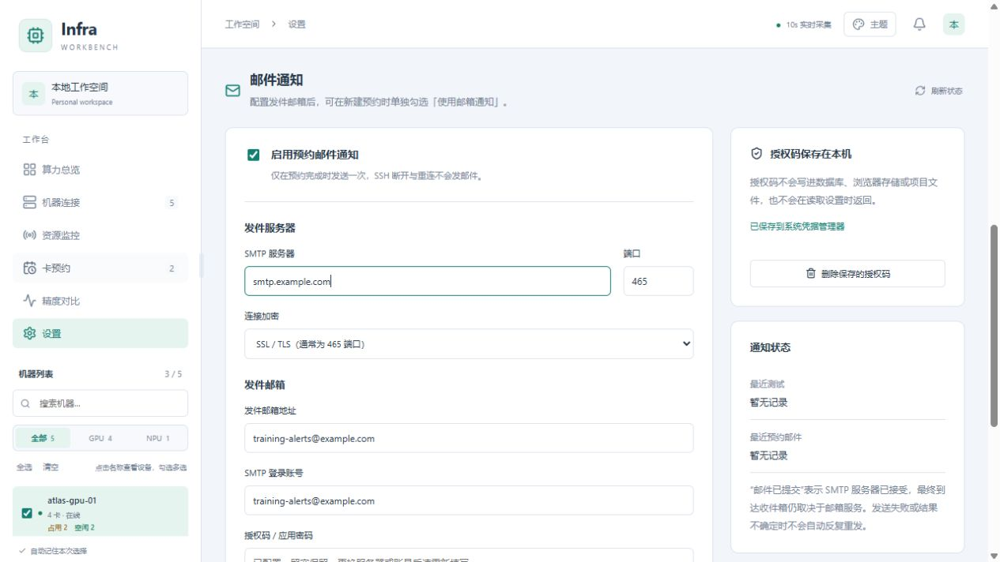
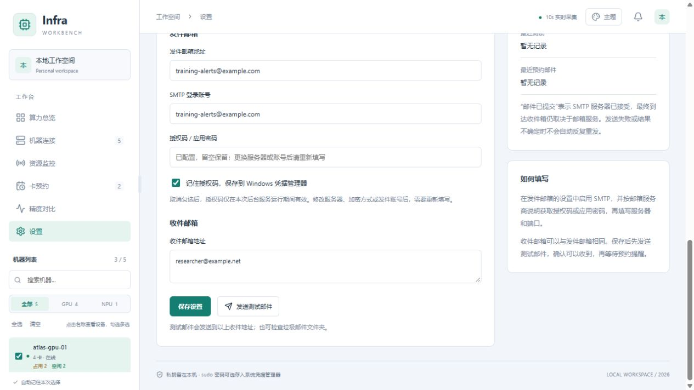

# 邮件通知

打开左侧 **设置 → 邮件通知**。先在邮箱服务商的设置中启用 SMTP，并取得授权码或应用专用密码，再填写：

1. 发件邮箱服务商提供的 SMTP 服务器、端口和加密方式，支持 SSL/TLS 或 STARTTLS。
2. 发件邮箱和登录账号。账号留空时使用发件邮箱。
3. 邮箱提供的 SMTP 授权码、应用密码或 SMTP 密码。
4. 收件邮箱。可填多个，用逗号、分号或换行分隔，也可发给自己。

勾选「启用预约邮件通知」，保存后点击「发送测试邮件」。测试成功表示 SMTP 服务器已接受邮件，请检查收件箱或垃圾邮件文件夹。

填写收件地址后，先点击「保存设置」，再点击「发送测试邮件」，最后到收件箱确认。

*图中的 `smtp.example.com` 和邮箱地址都是示例，不能直接照填。请使用自己的邮箱服务商提供的参数；截图未展示任何授权码。*

授权码默认可保存在当前 Windows 用户的系统凭据管理器；取消「记住」后仅在本次后台运行中有效。设置中可以删除授权码，删除后邮件通知也会关闭。更换 SMTP 服务器、端口、加密方式或发件账号后，需要重新输入授权码。

## 为预约开启邮件提醒

新建预约时默认只使用 Windows 通知。需要邮件提醒的预约，请单独勾选「使用邮箱通知」；只有设置中已启用邮件通知、保存完整邮箱配置且授权码可用时，才能勾选。勾选后保留 Windows 通知，同时发送邮件。历史预约不会自动开启邮件通知。

配置完成后，返回机器的「预约」或「卡预约 → 新建预约」，勾选「使用邮箱通知」再提交。预约界面示例见 [卡预约操作图](RESERVATIONS.md#操作示例)。

等待中的预约可通过「编辑预约」调整邮件开关；「再次预约」会带入原来的选择。邮箱配置失效时，需要明确关闭开关或先重新配置。

## 发送状态

勾选邮件通知的预约满足连续空闲条件时，后台把邮件加入持久队列，随后发送。关闭浏览器不影响发送，但后台服务需要保持运行。邮件状态显示在对应预约下，也可在设置查看最近一次发送情况。SSH 断开、采集恢复等状态不会触发邮件。

每条预约最多自动尝试发送一次。网络异常、收件人拒收、发送过程中退出等情况，结果可能不确定，软件不会反复重发；请先查看收件箱，再修正配置并发送测试邮件。排队超过 2 分钟、配置被修改、通知被关闭或预约被删除时，未发送的旧邮件会跳过，避免补发过期提醒。新配置仅用于之后完成的预约。

邮件包含机器名称、设备编号、显存要求、空闲确认时间和查看对应设备的本机链接，不包含 SSH / sudo 密码、进程启动命令或日志。请在运行本软件的电脑上打开链接；按数量预约会定位提醒时满足条件的卡号。邮件提醒不会锁定设备，启动训练前请再次检查占用。

SMTP 使用 Python 标准库并验证服务器证书，参考 [Python SMTP 文档](https://docs.python.org/3/library/smtplib.html)。
