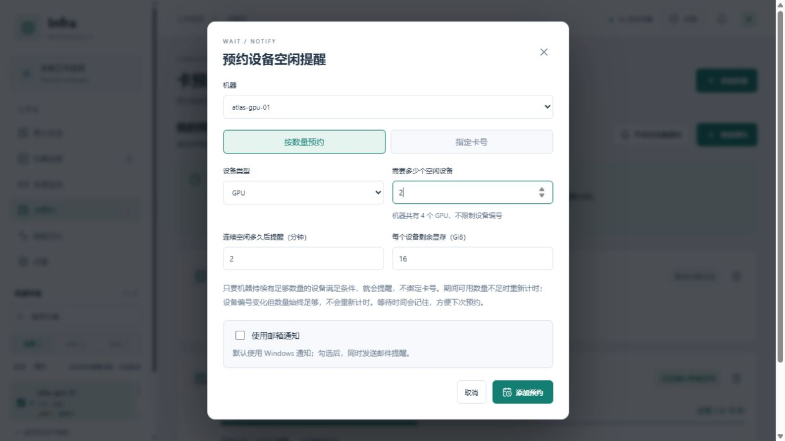
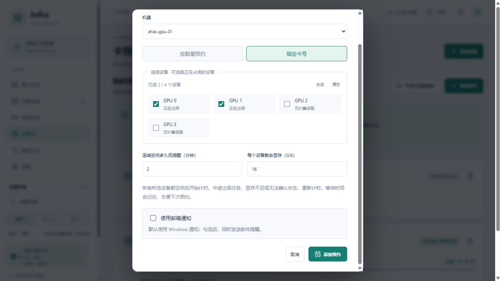
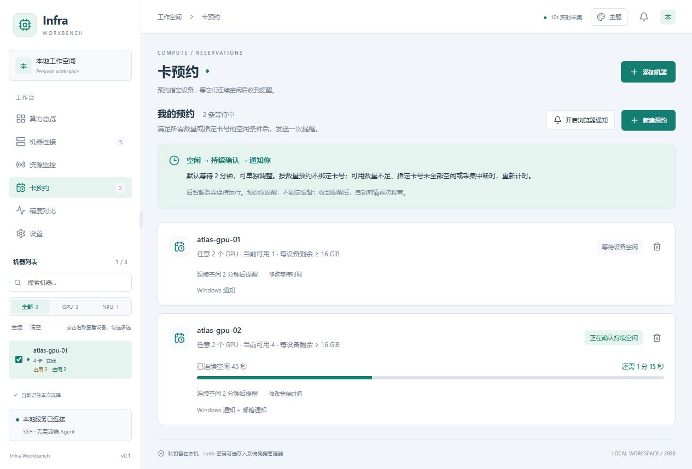
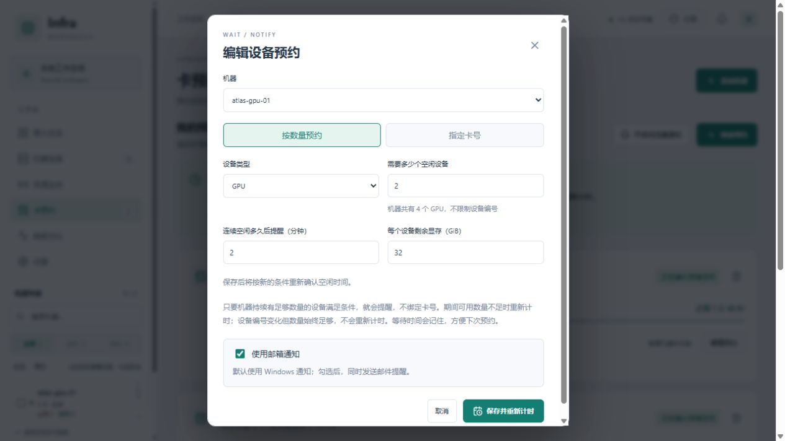
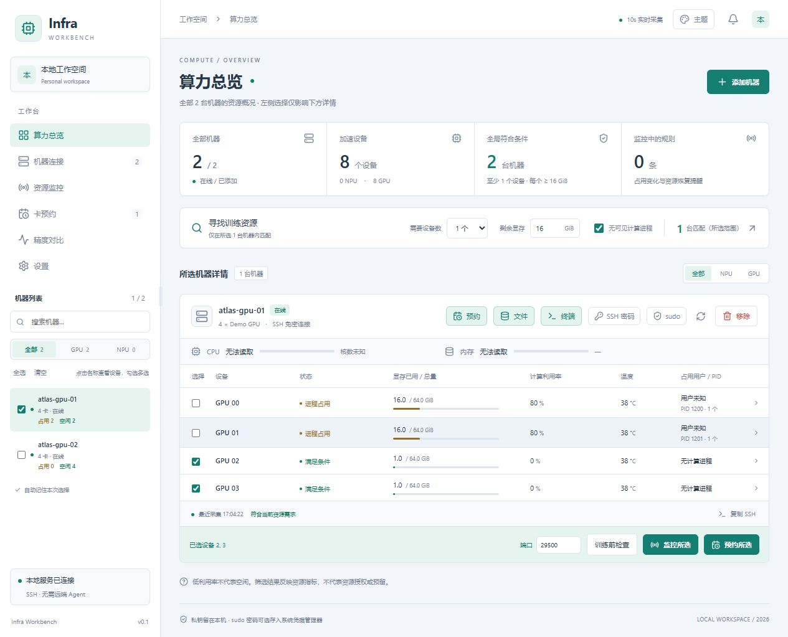

# 卡预约

预约用于等待设备空闲并提醒，不锁定设备，也不启动训练。先按下面的单机示例创建一条预约；跨机器等待见[多机与集群预约](#多机与集群预约)。

## 创建单机预约

在机器工具栏点击 **预约**，会在当前页面打开预约窗口并选好该机器；已勾选的卡也会带入。保存成功后窗口自动关闭，仍停留在原页面。也可以在左侧「卡预约」中新建，默认按数量预约：选择机器、设备类型和需要的设备数（例如任意 6 个 GPU），不绑定卡号。也可切换「指定卡号」，或在「算力总览」勾选设备后点击「预约所选」。已有预约仍按原先指定的卡号执行。

## 操作示例

1. 只需要任意两张空闲卡：选 **按数量预约**，设置 GPU / NPU 类型、数量、连续空闲时间和每个设备的剩余显存，再点击 **添加预约**。

2. 必须使用固定卡号：切换 **指定卡号**，勾选对应设备；可用「全选 / 清空」批量调整。正在占用的卡也可以预约。

3. 回到预约列表查看状态。「等待设备空闲」表示条件尚未满足；「正在确认持续空闲」会显示已等待和剩余时间，可编辑预约条件或取消预约。

以上截图为示例数据。默认使用 Windows 通知；只有先在设置保存完整邮箱配置，才可以为本条预约勾选邮件提醒。

## 多机与集群预约

点击「新建多机预约」，选择：

- **指定多台全部满足**：勾选至少两台机器，所有机器同时具备所需设备才开始确认。
- **集群内任意几台**：选择集群和候选机器，设置需要几台满足。匹配机器允许替换，只要仍有足够机器明确符合，就继续计时。

每台采用统一条件：设备类型、至少空闲设备数量、每设备最低剩余显存、连续满足时间。系统通知默认使用，可单独选择已配置的邮件通知。候选机当前繁忙也可预约，但创建前需至少有可确认容量的有效采样。

从集群菜单点击「预约资源」可预填集群；在总览勾选多台机器后可点击「预约所选机器」。

预约必须使用创建或编辑之后的新采样。失败或过期的样本不能确认空闲；指定模式任一机器未知会中断确认，任意模式只要仍有足够已确认机器就不受其他候选未知影响。重启后保留规则、重新确认，不能累加后台未运行的时间。

候选列表保存创建时的快照。集群增减成员不悄悄修改已有预约，页面会提示变化；编辑时可明确更新范围并重置计时。删除工作台机器后，若目标数量不再可能满足，会提示调整目标。

条件达到时只提醒一次，记录实际匹配机器及设备。系统/邮件投递结果分别显示；点击通知打开对应群组详情，再查看当前机器资源。已结束记录可再次预约生成新规则，不能把旧提醒当成当前资源保证。

## 编辑、再次预约与查看机器

等待中的记录可点击 **编辑预约**，调整机器、预约方式、数量或卡号、剩余显存、等待时间和邮件开关。点击 **保存并重新计时** 后，保留这条记录，并按新条件重新确认空闲时间。保存失败时弹窗保留，方便修改。原设备已不存在时，需要重新选择。

已完成的记录可点击 **再次预约**。弹窗会带入原来的条件，确认后新建预约，原完成记录仍保留。新建空白预约默认不启用邮件；编辑或再次预约会保留原来的邮件选择。邮箱配置已失效时，可明确关闭邮件开关，或先到设置中重新配置。

点击记录中的 **查看机器和设备**，会进入算力总览并选中对应机器和设备。按数量预约完成后，定位的是当时满足条件的卡号。单条 Windows 通知、浏览器通知和提醒邮件中的链接也可定位；邮件链接需要在运行本软件的电脑上打开。

多条提醒合并显示，或 Windows 气泡尚未关闭、系统无法确认点击的是哪一条时，会先打开「卡预约」，再点击对应记录查看机器。

## 如何看通知状态

**条件已满足** 表示采集确认预约条件达到要求。通知是否成功提交，单独显示在记录下方：

| 状态 | 含义 |
| --- | --- |
| Windows 通知等待托盘处理 | 提醒已排队，需要托盘运行。超过 2 分钟不再补发。 |
| 正在提交 Windows 通知 | 托盘已领取，正在调用 Windows。超过 30 秒无结果会标记待确认，不自动重发。 |
| 已提交 Windows 通知 | Windows API 接受了请求，不代表通知已显示或已阅读。 |
| 提交失败、结果待确认、桌面通知已关闭 | 查看对应原因；预约条件满足的记录仍保留。 |
| 邮件排队中、发送中、已提交、失败或未发送 | 单独展示 SMTP 发送结果；已提交不代表收件箱已收到。 |

旧完成记录如果没有保存过桌面回执，会显示「Windows 通知状态未记录」。

## 计时和通知规则

- 默认预约条件持续满足 2 分钟后，发送一次空闲提醒。可为每条预约设置 0～1440 分钟，0 表示下一次采集确认满足条件后立即提醒。
- 每个设备都要没有可见计算进程、计算利用率明确为 0、剩余显存达到设定值，并且没有 Alarm。N/A、缺失或无效利用率不计为空闲。Warning 不阻止预约提醒。
- 按数量预约：同一类型中满足条件的设备数始终不少于所需数量，即可持续计时；具体空闲卡号可以改变。数量不足时重新计时，提醒中会列出当时可用的卡号。GPU 与 NPU 不混算。
- 指定卡号：所有所选设备都必须满足条件，任意一张被占用或无法确认空闲时重新计时。两种模式在连接或采集失败、样本过期或相邻有效采集间隔超过允许窗口时，都会重新计时。该窗口取 30 秒与“刷新间隔 + 15 秒”中的较大值，当前刷新选项下最多 45 秒。
- 「卡预约」中可以查看等待状态和倒计时、编辑条件、取消预约。编辑保存后重新计时。
- 预约保存在本机数据库中。重启后保留预约，但重新确认空闲时间；软件关闭期间不累计空闲时间。已提醒的预约不会再次提醒。

通知使用现有 Windows 托盘通知，也可在页面开启浏览器通知。请保持后台服务运行；浏览器通知还需要保持页面打开。历史积压通知不会反复补发，已完成的提醒可在预约列表和最近事件中查看。

从「新建预约」打开空白表单时，默认只使用 Windows 通知。需要邮件时，先在「设置」启用邮件通知并保存完整邮箱配置和授权码，再在预约弹窗勾选 **使用邮箱通知**；配置不可用时不能勾选，可点击「前往邮箱设置」。每条预约独立选择，编辑或再次预约会沿用原选择，已有预约不会因配置邮箱而自动开启。勾选后会同时发送邮件，列表中显示通知方式及邮件发送状态。配置步骤见 [邮件通知](MAIL.md)。

预约用于等待提醒，不锁定设备、不替你启动任务，也不限制其他人使用。采集是定时检查，无法发现两次采集之间瞬间启动又退出的任务；启动训练前请再次检查资源。
