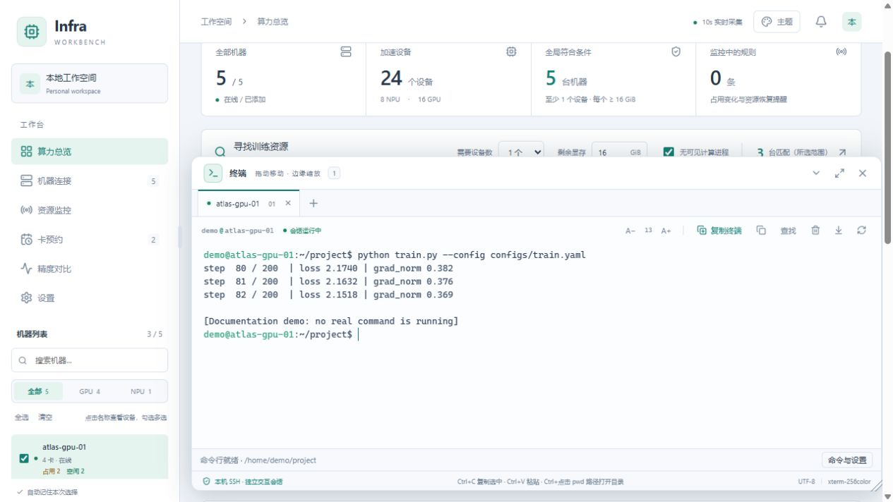
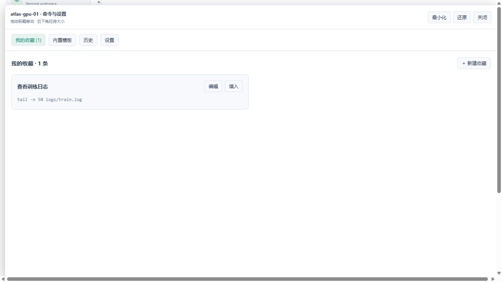

# 网页 SSH 终端

鼠标悬停在 `pwd` 输出的绝对路径上，按住 Ctrl 会显示下划线及链接光标，Ctrl+左键可在文件树打开该目录。鼠标不动时按下或松开 Ctrl，样式也会同步更新。

每台机器标题旁点击「终端」打开可拖动的终端浮窗。已有同机标签时切换到它；点击标签栏的加号可以创建额外会话。

拖动终端标题栏可以移动窗口，拖动四边或四角可以调整大小；位置和尺寸会自动记住。可最大化、还原，最小化后收到右下角的小卡片，显示会话数量及运行/断开状态；点击卡片恢复原来的位置和大小。最小化保持连接和输出，不结束任务。

*终端文字为演示输出，没有执行真实训练任务。*

可同时打开「文件」浮窗：将文件窗口拖到一边、缩小或最小化后，直接点击终端输入命令。文件窗口不会锁定整页焦点，最小化不会结束 SSH 会话。文件操作见 [服务器文件](FILES.md)。

- 多标签切换，最多同时 12 个会话，每台机器最多 4 个。
- 会话断开后保留旧输出，并显示「按任意键重新连接」。点击终端再按一个普通键即可重试；该键只触发重连，不发送给远端。重连时，新画面从空白显示区开始，旧输出可向上滚动查看，避免新旧会话叠在一起。连接中的输入不补发，复制所选文本、查找旧输出仍可使用。
- 工具栏「复制终端」新建同机器、同 SSH 账号的独立会话，进入 Shell 最近确认的当前目录。复制不会关闭原会话；持久会话会另建一个独立 tmux 会话，不共用同一会话画面。暂时无法获取目录时会提示，不会猜测目录。重连普通会话也优先进入最后确认的目录。
- 拖动四边或四角调整大小，也可最大化、还原或最小化。最小化和切换页面保持连接。
- 终端配色跟随工作台主题，可调整字号、清空显示、复制所选文本和重连。
- Ctrl+C 在选中文字时复制；未选中文字时发送给远端，用于中断前台命令。Ctrl+V 使用浏览器常规粘贴，Ctrl+Shift+C / V 也保留。
- 支持 Windows 的 **Win+V** 历史剪贴板：先让终端获得焦点，打开历史面板后点击文字条目，即可直接粘贴，无需再按 Ctrl+V。仅接收用户选中条目触发的粘贴，不读取或保存剪贴板历史。
- 单行粘贴采用纯文本兼容方式，避免部分 SSH / Shell 组合把 `ESC[200~`、`ESC[201~` 显示在命令两端；多行内容仍保留终端协商的括号粘贴行为。
- 在终端执行 `pwd`，按住 Ctrl 并用鼠标左键点击输出的完整绝对路径，即可在该终端对应机器的文件树中打开目录。普通点击不跳转；支持中文、空格和自动换行的常规路径。文件窗口最小化时会恢复；已有未保存的编辑时先提示处理。仅识别独立输出行中的绝对路径，Shell 提示符中的相对路径、URL 和全屏程序不自动识别。
- 支持交互 Shell、补全、中文输入和全屏程序。窗口与字号变化会同步远端 PTY 尺寸。
- 长文本粘贴自动分块发送，保留中文和 emoji；单次输入超限会提示并保留连接。
- 「滚动到底部」返回最新输出。连接失败会保留错误状态，重连后重新显示连接状态。

免密机器由 Windows ConPTY 承载本机 OpenSSH，继续使用原有密钥、SSH agent 与跳板配置。已有密码会话通过 AsyncSSH 建立独立 PTY 通道，不重新索要或保存密码。指纹校验和已有的本地配置限制继续生效。

## 命令提示、查找和模板

远端有 Python 3 和 Bash 4.4+ 时，会启用当前会话的增强功能，不修改 `.bashrc` 等启动文件。登录 Shell 名称为 `sh`、实际链接到 Bash 时也支持；其他 Shell 保留普通终端。

- 输入历史命令前缀后，底部显示灰色候选，按 **右方向键**填入剩余内容，再自行按回车执行。Tab 继续交给远端 Shell。复杂编辑、历史翻找和多行输入时暂停提示。
- **Ctrl+F** 查找当前终端的输出缓冲区，支持前后跳转、大小写和正则；Enter 下一个，Shift+Enter 上一个，Escape 关闭。最多高亮 1000 个结果。
- 「命令与设置」默认显示「我的收藏」，直接展示名称和命令内容，并提供「填入」「编辑」按钮；内置模板单独列出。保存成功后返回收藏列表。窗口可拖动、拉伸、最大化或最小化，并记住位置和尺寸，最小化保留正在编辑的草稿。历史页可查看、关闭或清空历史，并将常用命令转为收藏。训练、日志和 Conda 模板提供 `{{script}}` 等变量，参数按单个 Shell 参数转义。预览后点击「填入命令行」，不会自动执行；当前命令行须为空。
- 软件中的历史提示按机器和解析后的 SSH 账号/目标隔离，多个标签共用，最多 200 条；只记录命令边界，不记录程序内部输入或终端输出。常见密码、令牌字段会过滤，但不能识别所有秘密；敏感命令以空格开头，或关闭历史。

在增强 Bash 会话中，回到提示符时会追加当前会话的新命令，并读取同账号其他会话追加到原有 `HISTFILE` 的记录。新建副本可直接用 ↑/↓ 调取历史；已经打开的空闲会话，按一次回车回到新提示符后可读到其他会话的新记录。尊重 Bash 原有的历史禁用设置和过滤规则，不修改 `.bashrc`；Bash 自身的历史文件与软件过滤后的 200 条提示记录分别管理。此行为需要更新后台后新建或重连会话，既有 tmux Shell 需另建会话才能采用新钩子。

## sudo 快捷填入

先在机器的 sudo 设置中保存密码，再进入终端「命令与设置 → 设置」，为此机器开启「允许终端使用已保存的 sudo 密码」。

执行 `sudo` 后，只有确认它正在等待密码时，才会出现填入按钮。点击按钮或按 **Alt+Enter**，后台将已绑定该 SSH 目标和账号的密码写入当前会话，密码不返回网页。普通 Enter 仍按原逻辑工作。每条命令只尝试一次，失败后可手动输入；显式指定自定义 sudo 提示符或绕过 Shell 包装函数时，保留手动输入。

## 命令结束提醒

默认只提醒执行至少 **60 秒**的前台命令。在此机器的终端设置中可关闭提醒或调整秒数。提醒包含耗时和退出码，底部也显示上次命令结果。后台通过 Shell 的开始/结束事件判断，不根据日志猜测，也不提醒 SSH 断开和重连。使用现有 Windows 托盘或已允许的浏览器通知通道。

普通会话需要保持连接才能判断命令结束；`nohup ... &` 这类后台任务不在前台命令完成提醒的范围内。

## tmux 持久会话

点击标签栏 **＋ → 对应机器 → 新建持久会话**。需要远端安装 tmux、Python 3 和 Bash 4.4+。缺少 tmux 时显示安装提示，由用户自行安装。

- 关闭持久标签、刷新页面或退出浏览器，只断开显示连接，任务继续在服务器上运行。
- 再次从 **＋** 菜单点击「恢复」接入原会话。恢复后回到空命令行按一次回车，重新启用历史提示等命令行交互功能。
- 后台仍运行且 SSH 可连接时，约每 15 秒检查持久会话的完成状态，断开显示连接也能收到长任务结束提醒。重复接入不重复提醒，软件关闭期间的过旧结果不会补发。
- 「结束会话」会停止此会话及其中的任务，需明确确认；它与关闭标签分开。每台机器最多保存 12 个持久会话；已经结束的会话也可从菜单移除。
- 软件使用独立的 `infra-workbench` tmux socket 和 `iwb-` 会话名，不接管已有 tmux 会话。每个持久会话同时只允许一个网页终端接入。服务器重启或主动结束远端 Shell 后，任务无法恢复。

普通 SSH 标签仍会在关闭或刷新前提醒；确认后其前台任务可能结束。终端与监控使用独立通道，关闭终端不会关闭监控传输。后台服务重启后需要重新连接标签，持久会话可以继续恢复。

连接使用本机 OpenSSH/ConPTY 或已有 AsyncSSH 密码认证通道。会话票据 30 秒有效且单次使用，HTTP 和 WebSocket 校验页面来源；本地服务仅监听 127.0.0.1。输出确认机制限制缓冲；原始输入输出和密码不写数据库，历史与收藏按上述规则单独保存。
