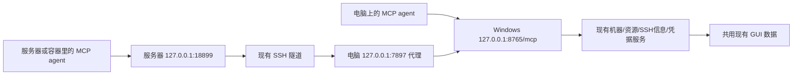

# Infra Workbench MCP 方案

状态：实现、隔离环境验收与正式后台启用均已完成，本机和远端 MCP 已复验。日期：2026-10-31。

## 1. 建议结论

以 HTTP MCP 作为本机和远端 agent 的统一入口。CLI 对本机人工操作、Shell 自动化和不支持 MCP 的客户端有价值，但不是当前主要需求的必要组件。MCP 验收成功后撤掉 CLI 产品入口和专属维护内容，保留并复用其背后的查询、筛选、连接描述和凭据管理能力。

本地 agent 只要支持 HTTP MCP，就可直连同机服务，无需执行 CLI。远端 agent 通过已有代理通路连接同一个 MCP 地址；接口选择与 agent 所在位置是两个问题。

继续遵守已有决策：
- Workbench 维护机器、资源快照、SSH 配置和可选保存的 SSH 密码。
- agent 取得信息后自行 SSH 连接目标，不由 Workbench 转发它的操作。
- 首版不增加用户账号、令牌平台或客户端权限体系，沿用既有电脑/代理访问方式。
- 密码仅由显式取密码工具返回，不混进普通查询、工具说明和日志。

## 2. 两种接入方式，共用一个服务



本地客户端直接访问 MCP；远端客户端显式经服务器侧代理访问目标 URL `http://127.0.0.1:8765/mcp`，由电脑上的代理发起到电脑回环服务的连接。

上述代理路径依据用户刚提供的实际验证结果：本机代理及远端现有转发均已成功访问 Workbench 健康/能力接口。本轮没有重新连接真实远端复测。HTTP API 通路已验证，不等于 MCP 客户端发现/调用工具已验证。

采用 Streamable HTTP；不要求远端安装 Python CLI、执行电脑上的程序，或额外建立一个 SSH 转发。短查询优先使用协议支持的 JSON 响应，避免不必要的长连接。实际 MCP SDK/协议兼容范围以本地和远端客户端的实测为准，不自行实现一套只模仿工具调用的私有 JSON API。

本地也可采用 stdio MCP，但当前 Workbench 已有常驻后台；首版统一 HTTP，不再增加仅为本地客户端服务的一套进程启动方式。

## 3. 第一版提供六个工具

以下为拟定 MCP 工具名，不代表当前已经注册。

| 工具 | 参数与用途 |
| --- | --- |
| `list_hosts` | 可选 name；列出所有已添加机器及紧凑状态，包含稳定 host_id |
| `search_hosts` | name、kind、model、count、min_free_gib、idle、refresh、max_age；查满足资源要求的机器 |
| `get_host` | host_id；查看机器配置概况与资源摘要 |
| `get_resources` | 可选 host_id、refresh；单机给详细设备/占卡进程，多机返回紧凑资源概况 |
| `get_ssh_info` | host_id；实际地址、账号、端口、跳板链、认证材料是否可取，以及配置适用环境 |
| `get_ssh_password` | host_id；显式取得该机器已保存且身份匹配的 SSH 登录密码 |

客户端通过 MCP 的 tools/list 发现工具，工具定义包含完整 description、inputSchema、outputSchema 与边界说明。参数默认值由服务端落实，不能只写在 schema 的 default 中却假定客户端自动补齐。

搜索默认建议：count=1、min_free_gib=0、idle=true、refresh=false、max_age=30 秒。idle=true 是此次 MCP 提案的选择，区别于原 CLI 的默认 false，贴合主要“找空闲卡”的需求；只看硬件/已占用资源时可传 false 或使用列表/资源工具。GPU/NPU 分组统计，不跨机器或跨种类凑数。

返回机器和全部匹配设备 ID、显存、count_unit 及物理卡/芯片关系。Warning 沿用可用逻辑，Alarm/未知进程/过期采样按条件排除。未知和部分失败保留明确原因，不当作没有机器或空闲。

工具使用说明覆盖这些内容：
- 推荐步骤：list/search → 选稳定 ID → get_ssh_info → 按需 get_ssh_password → 自己 SSH。
- 任意数量、每卡显存、物理卡/die、数据年龄和部分失败的含义。
- 保存密码、密钥认证、内存会话和“独立 SSH 尚未测试”的区别。
- 本机路径不能自动用于容器；跳板可能需要独立认证。

公共流程放入 MCP server instructions；每个工具自己的说明足以解释其参数和返回值，不要求先调用一个额外帮助工具。参数、输出 schema 和实际服务校验仍使用同一份工具定义。

## 4. 返回与错误

保留 schema_version、ok、partial、data、warnings、error 等现有业务语义，用 MCP structuredContent 返回，并按照目标协议/SDK要求提供兼容的工具结果表示。

工具调用失败映射到 MCP 工具错误，而不是伪装成正常空结果；部分失败仍保留有效 data。无匹配但查询完整属于正常结果。资源筛选不会锁定或预留设备。

错误恢复动作改为 MCP 工具操作，例如：

```json
{
  "code": "STALE_SNAPSHOT",
  "message": "机器资源采样已过期",
  "next_action": {
    "tool": "get_resources",
    "arguments": {"host_id": "example_host", "refresh": true}
  }
}
```

不再让错误消息要求远端 agent 执行电脑上的 infra-cli。没有密码时说明需要在 GUI 的 SSH 密码设置中保存，不能用 sudo 密码替代，也不能从已有会话推导出密码。

MCP 只提供信息与明确要求的凭据。agent 所在环境是否能连到目标/跳板、是否具备可用密钥或服务器允许的密码认证，仍由它自己的 SSH 工具验证；MCP 可访问不意味着所有目标服务器都可从该环境直连。

## 5. 当前代码如何复用和调整

源码核对确认，后台当前已经使用 infra_cli 包里的 query、catalog、errors，CLIService 还引用 CLI main 中的 capabilities。因此不能只删除 infra_cli 目录。

先提取与命令行无关的共用能力到后台 agent 服务模块：
- 保留资源筛选、机器 ID 解析、快照年龄、排除原因和有界刷新；改为工具名与结构化参数，不再依赖字符串命令路径。
- 保留 backend/cli_connections.py 的 SSH 描述逻辑，迁移为与接口无关的连接描述模块。
- 保留 backend/ssh_passwords.py、Windows 凭据适配、GUI 保存/删除入口，以及身份绑定检查。
- 把命令目录改成 MCP 工具注册表，去掉 argparse 参数、CLI 示例及 shell 形式 next_action。
- MCP 直接调用同一个服务实例，不逐次启动 CLI 子进程，不另开机器库和采集器。

在现有后台挂载 `/mcp`，不新增公共监听端口。现有 GUI 的 API、静态页面和本机监听继续工作。接入标准 MCP 客户端时需单独适配当前强制 X-IWB 请求头的中间件：MCP 路径使用标准协议要求，原 GUI 路径保持原规则；不能让标准客户端被这个私有头拦住。

保留本机 Host/Origin 校验，不引入账号/令牌流程。此版信任既有电脑和代理通道的使用者，不宣称提供共享服务器上的按用户隔离。

## 6. 验收成功后移除的 CLI 内容

- infra-cli.cmd、POSIX 启动脚本、命令行解析/HTTP 客户端和独立 CLI 打包入口。
- 只服务 CLI 的 `/cli/v1` 路由；不是删除 GUI 所需的资源或机器接口。
- CLI 安装提示、README 入口和 CLI 专属帮助文档，替换为 MCP 接入说明。
- CLI 专属测试替换为工具 schema、服务行为与 MCP 客户端集成测试，保留原有核心行为覆盖。

在新 MCP 可发现并能调用工具之前，先不删除现在能工作的 CLI。最终不把两套入口作为长期维护目标。

## 7. 实施顺序与验收条件

1. 抽出共用 agent 服务与六个工具定义，保留现有行为测试。
2. 挂载 HTTP MCP，验证当前电脑上的实际 agent 能发现全部六个工具，并完成机器搜索、连接信息查询。
3. 从真实远端 agent 客户端走既有 18899 → 7897 代理路线调用同一入口；验证客户端确实使用代理，不被 NO_PROXY/localhost 绕过规则留在远端回环。
4. 完整走通“任意 6 个空闲 NPU、每个 40 GiB → 正确机器 ID → SSH 信息 → 必要时取测试密码 → 独立 SSH 客户端操作”；密码验证使用专属虚构凭据或明确的测试目标，不在日志/文档中保存真实密码。
5. 验证重连、请求超时、逐机失败、密码缺失/删除/身份变化，以及 GUI 原功能回归。
6. 清理 CLI 产品层与文档，将 MCP 和 GUI 作为保留入口。

网络验收不止 curl 的 HTTP 200：必须有真实 MCP 客户端的工具发现、schema 解析和工具调用结果。若客户端无法按要求强制走现有代理，应明确该限制，再评估专用反向端口转发，不能静默声称复用代理成功。

实现已完成，验收记录见对应实施计划与 docs/MCP.md。未修改代理、SSH 隧道、全局客户端配置或监听范围；用户从托盘正常退出旧后台后，已通过标准启动器启用主程序并复验。

## 参考

- [MCP 官方传输说明](https://modelcontextprotocol.io/specification/2026-07-28/basic/transports)：stdio 和 Streamable HTTP。
- [MCP 官方工具说明](https://modelcontextprotocol.io/specification/2026-07-28/server/tools)：工具发现、参数 schema、调用与结构化结果。
