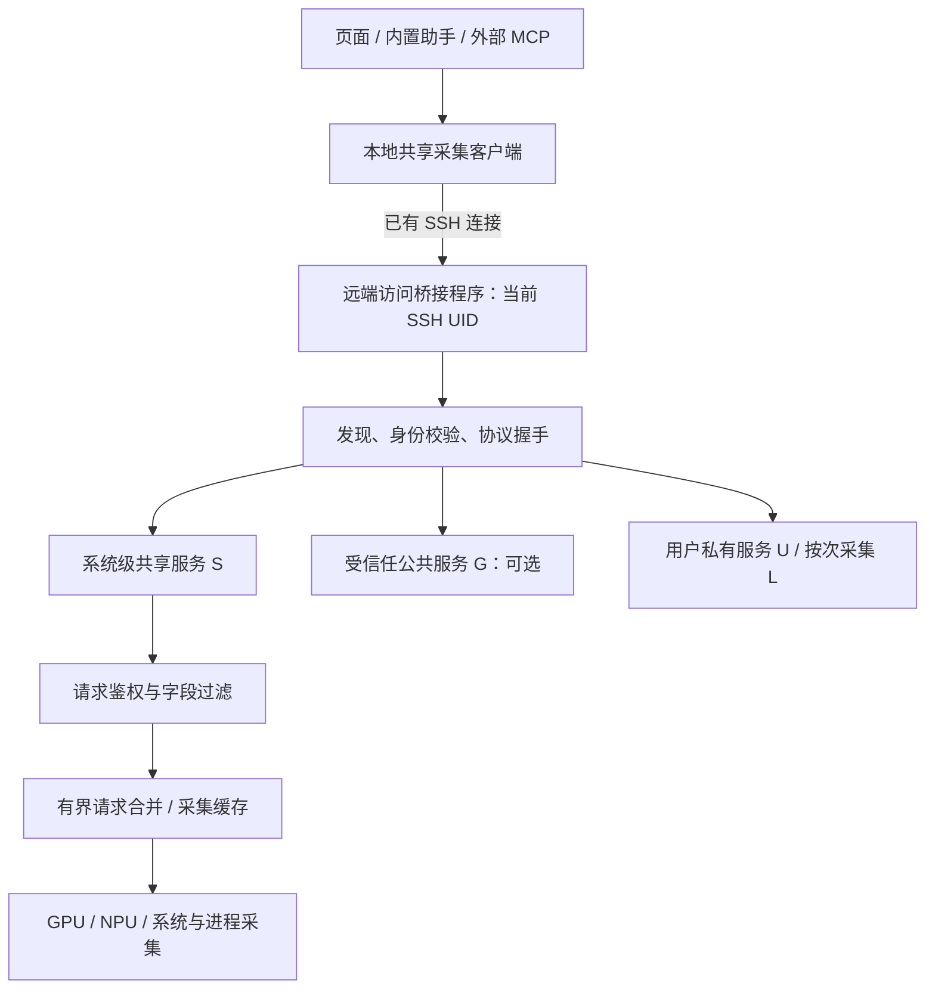
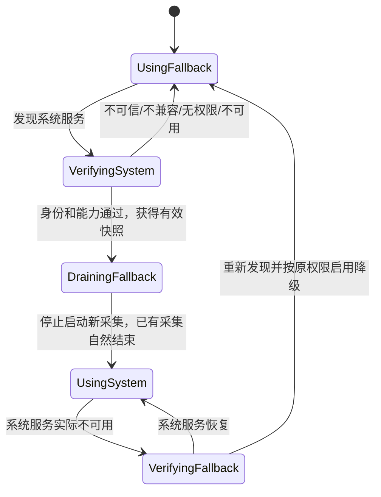

# 远端共享采集服务设计草案

日期：2026-11-07。状态：待评审，尚未实施。本文用于规划，不代表当前软件已经支持常驻服务、跨账号共享或自动迁移。

## 1. 目标与讨论结论

多个人各自运行工作台、连接同一台服务器时，应尽量复用一次资源采集，避免每个客户端分别执行设备查询。使用者通过自己的 SSH 账号连接，不要求提前手工安装服务器程序，也不要求直接登录 root。

本次讨论提出的需求：

- 首次连接时发现已有服务；服务不存在时，由客户端完成必要的代码上传和部署。
- 有相应 sudo 授权时，可以部署系统级服务；没有 sudo 时仍能降级使用。
- 不同 SSH 账号的权限不同，不能把某个人的 sudo 权限或其能读取的全部数据共享给其他人。
- 每个客户端自己计时、决定多久请求一次；服务器负责缓存、实际采集和并发请求合并。
- 系统级服务脱离客户端和 SSH 会话运行；后续其他客户端直接复用。
- 后来出现可信、可访问的系统级服务时，自动切换并停止重复采集。
- 迁移、采集和暂停都不能停止训练、关闭终端或影响文件操作。

本文进一步提出的模块划分、状态名、超时和发布阶段均为设计建议，尚未作为产品默认值确认。所有示意路径、接口和配置都不是当前可调用协议。

## 2. 当前实现与问题边界

当前源码依据，路径均相对于仓库根目录。本文在独立文档分支发布；本地另外已有的单机暂停原型及其他功能改动不包含在本次文档提交中。

| 位置 | 当前行为 |
| --- | --- |
| `backend/app.py` | 本地后台调度采集；同一后台内合并同机请求，限制采集并发 |
| `backend/probe_cache.py` | 按内容哈希把探针缓存到远端登录用户目录，校验文件安全后按次执行；尚无共享结果服务 |
| `backend/remote_probe.py` | 读取设备、系统、端口及进程信息；GPU/NPU 使用各自的查询命令 |
| `backend/sudo.py` | 通过固定、root 所有的只读辅助程序补齐进程详情，校验当前连接身份及 sudo 授权 |
| `backend/agent_service.py` | HTTP、助手和 MCP 共用资源查询及刷新路径 |

同一后台的多个窗口已经复用采集；多个独立后台之间没有远端采集合并。现有缓存保存程序文件，不等于缓存采集结果。

已有小样本训练对照没有稳定复现最初观察到的减速，不能据此承诺单客户端或多人并发没有性能影响。真实机器、路径和日志仅保存在本地验证记录中，不随本设计提交。后续仍需独立进行多人采集测试。

## 3. 服务模式与信任边界

| 模式 | 运行身份与管理者 | 默认使用范围 | 能力与限制 |
| --- | --- | --- | --- |
| 系统级共享服务 S | 管理员部署，系统服务管理器维护 | 被策略允许的本机账号 | 可经授权采集特权信息，逐请求鉴权后返回数据 |
| 用户私有服务 U | 当前 SSH UID 部署和运行 | 同一 UID 的客户端 | 只使用该 UID 的权限，不默认向其他账号开放 |
| 受信任的用户级公共服务 G | 明确被选定的普通账号运行 | 明确接受该服务身份的账号 | 仅共享经约定的公共字段；不提供其他账号的私有进程详情 |
| 按次采集 L | 当前 SSH UID，必要时沿用已有受限 sudo helper | 当前连接 | 用于环境不支持常驻运行、服务不可用等兼容场景；没有跨账号去重保证 |

优先级建议：可信且可访问的 S，其次已明确受信任的 G，其次 U，最后 L。这是客户端选择顺序，不意味着一个进程可以未经授权终止其他模式。

G 是可选能力，不作为“所有人都是普通用户”时的默认答案。普通账号可以提供一个跨账号可访问的服务，但连接者仍需认可其归属、数据范围和可信程度。发现端点或核验 UID 只能证明身份，不能证明该账号提供的数据真实可信。未经约定，不采用“谁先启动就信任谁”的全机服务。

没有管理员授权、没有公共数据范围约定，也没有共同认可的服务账号时，允许不同 UID 各自运行 U。此时承认仍有重复采集，通过同 UID 去重、限频和错峰减轻负担，不声称已经实现全机单实例。

## 4. 总体结构与集成位置

远端服务处理固定的只读监控请求，不成为任意命令、文件读取或进程终止的通用 root 入口。终端、文件、远端命令等业务继续走现有校验和 SSH 调用链，不能因为已经建立采集服务而绕过原权限。

本地建议增加一个共享采集客户端层，统一处理发现、模式选择、版本协商、快照查询、暂停和降级。接入 `AgentService` 与现有采集入口，HTTP、内置助手、外部 MCP 不各建一套实现。部署、服务状态和权限管理也应复用后端业务层；是否披露为 MCP 工具在实施前单独确定。

第一期服务与桥接程序优先沿用 Python 标准库，复用现有解析与脱敏逻辑，不在服务器上安装训练环境依赖，不调用模型。远端解释器的最低版本和 GPU/NPU 驱动支持矩阵由实现者根据现有兼容范围确定并写入握手，不静默修改系统 Python。

## 5. 首次连接、发现与自动部署

### 5.1 发现与身份校验

SSH 认证通过后，在当前实际登录上下文中检查服务。不能只凭 IP、本地机器别名或一个 PID 判定目标相同；容器、PID namespace 和设备可见范围不同，也不能直接合并为同一采集实例。

服务握手至少说明：协议主版本、实现版本、服务实例 ID、运行模式、启动标识、采集范围、设备可见范围、支持的字段和当前账号获准使用的能力。客户端先核验端点归属及可信来源，再读取受限数据。

- S 的程序、服务配置、策略和端点目录必须由管理员控制，普通用户不能替换。
- U 的程序、端点和锁绑定实际 UID，不能使用其他用户可替换的脚本或不受保护的全局 PID 文件。
- G 的预期服务 UID 和公共字段范围必须通过受信任的配置或明确选择建立，不能仅根据自报元数据接受。
- 身份、版本、能力或访问权限不满足时，区分原因，不把“拒绝访问”当作“服务不存在”反复尝试部署。

### 5.2 部署流程

1. 优先探测并复用兼容、可信、可访问的 S/G/U。
2. 没有适用服务时，展示将采用的模式、权限和持续运行行为。普通用户代码上传可以自动完成；首次部署特权系统服务需要明确授权，不能把原来仅用于进程详情的 sudo 设置自动扩展为系统安装许可。
3. 部署 S 时，检查当前账号是否获准执行具体安装操作；sudo 密码正确不代表该操作获准。已有窄范围 helper 授权也不代表可以安装服务。
4. 通过已有 SSH 上传与本地版本匹配的发布文件，校验摘要及受信任的发布来源。摘要只能检查文件一致性，不能单独证明来源可信。特权执行不得指向普通账号可修改的程序、配置、解释器搜索路径或符号链接。
5. 在相应权限范围内取得安装/启动锁，锁内再次探测已有实例，再决定安装和启动。多个同时连接的客户端只能有一个实际完成同一模式、同一作用域的启动。
6. 启动后进行真实健康检查、能力检查和首个快照检查；确认成功才切换。响应超时且结果不明时先读回状态，不能立即重复安装或重复启动。
7. 无 sudo、授权被拒绝或用户选择不部署 S 时，使用 U；不能支持常驻运行时使用 L，并明确显示限制。

U 的代码放在用户所有的缓存/数据目录；S 安装到管理员控制的版本目录。服务名、磁盘布局、锁实现和安装原子性由实现者定稿，必须满足上述所有权、并发和回滚约束。

## 6. 生命周期：断开连接、重启与退出

S 在支持的 Linux 上优先使用 systemd **系统服务**管理。部署可包含开机启动和有界异常重启；SSH 断开、客户端退出不停止 S。开机启动必须作为首次部署说明的一部分；升级不能悄悄改变此设置。

U 优先探测可用的用户服务管理机制。能否退出登录后继续运行、能否开机启动受服务器策略影响；不能自动修改 lingering、会话清理或系统策略来制造“永不退出”。不支持长期运行时，允许会话结束后退出，下次连接重新发现并拉起，必要时降级为 L。单纯后台化不作为跨环境存活保证。

服务保持运行不代表持续采集。建议采用按请求更新的模式：无请求、无采集任务时不启动新采集；不因浏览器消失立即停止进程，也不依赖网络断连事件来决定缓存是否可信。

用户级实例空闲后可以自行退出；具体空闲期限为待定默认值。系统级服务由管理员显式停用或卸载。自动清理只处理本产品核验过归属的运行资源，不清理训练文件、用户数据或任意 Python 进程。

## 7. 权限管理与 sudo

### 7.1 两类权限分别管理

采集进程需要什么权限，决定它能采到哪些数据；请求者被授予什么只读能力，决定服务能把哪些数据交给他。二者不能混为一谈。

S 可在必要时以 root 运行，后续也可将特权采集部分拆为更小的固定 helper。运行权限的缩减需要按实际驱动和 procfs 行为验证，不能用“只读”作为不存在信息泄露风险的理由。

普通账号获准读取某些监控详情，不等于获得任意 sudo 权限。安装/升级服务、修改授权规则、读取全机进程详情分别授权；首次安装者不自动获得为所有用户放权的产品权限。

### 7.2 请求身份与策略

通信优先通过 SSH 启动当前 UID 的访问桥接程序，再连接 Unix socket，不新开对外监听端口。S/G 使用操作系统提供的连接者凭据核验身份；桥接程序不能先整体 sudo 成 root，再把所有调用者都识别成 root。不能信任客户端传入的账号、角色、UID 或 sudo 成功声明。

服务器策略由管理员维护，建议采用显式允许、默认拒绝；优先提供用户组授权，并支持按 UID 的补充规则。策略读取失败时拒绝受限数据，不退化为全量返回。分组变更和策略变更需要有界地刷新；特权权限不能无限缓存。

以下是能力划分示例，不代表最终配置格式：

| 能力 | 可返回内容 |
| --- | --- |
| `read_basic` | 管理员允许共享的设备、CPU、内存等字段 |
| `read_own_processes` | 经实例身份核验、属于请求者 UID 的进程详情 |
| `read_all_processes` | 获准范围内的全机进程详情，仍进行敏感参数脱敏 |
| `manage_service` | 经单独授权的部署、升级、停用和策略管理，不属于普通查询接口 |

“公共指标”必须有明确字段清单；其他用户 PID、启动命令、目录和端口关联不因位于设备查询输出中就自动成为公共字段。S/U/G 可以采集不同范围，必须在能力和字段状态中保留差异。

`SO_PEERCRED` 提供身份，不直接回答该 UID 当前能否执行某条 sudo 命令。S 使用明确的应用访问策略，不通过猜测 sudo 用户组或解析完整 sudoers 来模拟所有系统权限。

### 7.3 特权缓存与降级

完整特权缓存只保存在受保护的服务内存或管理员控制的存储中。鉴权、权限过滤和脱敏在返回前完成，不能把完整数据交给客户端再隐藏。普通用户不能通过缓存文件、调试接口或日志旁路读取。

U 以当前 UID 读取，不能承诺复现所有 Linux 访问规则的“自身进程详情”；实际读不到的字段保留 `permission_denied` 或 `unknown`。若降级到现有窄范围 sudo helper，只能使用原有独立授权，并明确显示当前来自 L/helper，不能伪装成已完成统一特权共享。

策略撤销后，后续查询不再返回被撤销的字段；本地停止展示相应受限视图。已经交付的数据无法收回。每次返回都重新应用策略，不能复用上一个用户已过滤的完整响应。

## 8. 多用户去重与频率

### 8.1 客户端自己计时

每个独立工作台后台保留自己的刷新间隔，同一后台的多个窗口仍共享偏好。这里的“客户端”不等于每一个浏览器窗口。

客户端请求快照时带可接受的数据年龄及所需的有界字段范围。刷新间隔和新鲜度要求是两个概念；产品可以建议二者相同，但不能承诺每次刷新都会获得不同的采样。

### 8.2 服务端按请求检查缓存

1. 先核验调用者及字段权限，拒绝未授权请求，避免其触发高成本采集。
2. 在满足采集作用域和能力的缓存中查找快照；年龄满足要求就直接返回。
3. 数据过期且允许启动采集时，对同一采集作用域使用 single-flight：一个任务执行实际设备查询，其他请求有界等待或共享它的结果。
4. 管理员设置最短采集间隔、采集并发上限、查询超时、返回预算和按 UID 的请求限流。跨账号不同可见设备范围、不同 namespace 或不同权限上下文不能简单共用缓存。
5. 客户端要求比服务允许的间隔更短时，明确返回限制；不能悄悄修改时间戳或声称已经满足。

示例：甲每 5 秒、乙每 20 秒、丙每 30 秒读取。三人共享同一可信采集作用域时，可复用足够新的快照；多人的过期请求合并为一次查询。服务并非为每个人各建一个设备查询定时器。

建议快照包含：服务实例与采集作用域、`sample_id`、各字段组采样开始/完成时间、字段状态、服务计算的数据年龄、新鲜度要求是否满足，以及采集是否正在进行。内部使用单调时钟计算年龄与限流，墙钟时间用于展示；不直接比较客户端和服务器的墙钟来判断缓存年龄。

没有可用新数据时，返回已标注的过期结果或明确错误，不补零，不刷新旧快照时间。设备、系统、进程等分段允许各有采样时间和权限状态；部分失败不能让其他分段冒充同一时刻的完整成功。

### 8.3 持续过期、慢查询与客户端取消

失败时保留原采样时间，使用有界退避，并向客户端返回可重试时间。不能由每个等待者分别触发新采集。单个客户端取消等待，只取消自己的请求，不取消其他客户端正在等待的同一次采集。

普通用户之间只有共享作用域真的一致、字段确实允许共享时才合并。无法共享的 U 仍按 UID 去重，错峰只减少瞬时拥挤，不声称减少了总采集次数。

## 9. 单机暂停与共享服务的关系

本地单机暂停原型（不随本文发布）只影响当前工作台后台选择的机器。接入共享服务后，建议继续保持这个语义：停止当前后台对该机器的监控请求及主动刷新，不停止远端服务，不阻止其他用户采集。

已经启动的共享采集可自然结束。暂停前的数据保留真实时间并正常过期，不能因为别人在更新服务端缓存，就自动更新本客户端的暂停视图。终端、文件等非监控操作不受影响。

管理员的“全机停止服务/全局暂停”是另一项管理操作，不与普通客户端的暂停按钮混用；若首期不实现，就明确不提供。

## 10. 从 U/G 切换到系统级服务 S

### 10.1 切换条件与顺序

U/G 在有客户端请求时，以有界频率发现系统级服务；也可由本地后台在查询中触发重检。不能每个轻量缓存读取都执行昂贵的部署探测。

建议状态流如下：

先验证 S，再获得满足当前授权和新鲜度要求的快照，才切换。旧服务停止发起新查询，已有一次采集自然结束，不关闭承载终端的 SSH 连接，不发送训练进程信号。短暂交接允许一次有限重叠，不承诺在跨账号、跨模式交接瞬间绝对没有重复查询。

系统级服务拒绝当前账号时，不反复试图部署另一份 S；是否允许继续 U 由明确策略决定。对于已经识别出的可信系统服务，应由握手提供降级策略：服务拒绝/策略不可读取时，停止本产品对该账号的自动降级并提示管理员；不把拒绝当故障绕过去。普通用户本身的 Linux 访问权限并不会因此被本产品全局撤销。

### 10.2 怎样停止重复采集

本产品新版 U/G 应具有退出/退居空闲协议：每次准备启动采集前，检查已经建立的 S 迁移状态；客户端从 S 取到可用快照后不再向旧实例请求采集。旧实例维护有期限的请求/会话租约，迁移完成且没有仍依赖它的合法请求时自行退出或进入不采集状态。

同一 UID 的多个客户端必须共享迁移状态，不能一个客户端切换后就强停仍被其他客户端使用的私有实例。G 的所有者同样不能因某一个访问者迁移就中断其他仍获准使用 G 的访问者；系统级策略应说明是否允许继续公共回退，以及服务可访问范围的迁移情况。

跨账号清理优先由各旧实例自行退让，不凭进程名批量终止。对于不支持退让的旧版本，只能停止本客户端继续调用；残余常驻采集需要管理员通过核验过的服务单位或进程实例身份清理。必须报告残余，不能宣称所有历史实例已自动清除。

失效客户端的租约会到期，不能永久阻止清理。为避免 S 短暂抖动导致反复启停，切换成功后的故障回退使用有界重试、退避和最短驻留策略，具体参数由实现者通过故障测试确定。

### 10.3 全普通用户场景

只有 U 时，每个 UID 最多一份实际采集器；多个工作台、不同本地机器或不同 SSH 别名不能在同一 UID、同一实际作用域下反复启动。

启用 G 时，明确指定服务账号/端点和共享字段。连接者核验身份并明确接受该来源；不能在公共临时目录中自动信任最早出现的程序、可替换缓存或自报 root 的元数据。若 G 不可用，可根据访问策略退回 U，继续标明没有全机去重保证。

“无管理员、无信任配置、不同账号绝对隔离、全机只有一个可信采集器”不作为可同时满足的承诺。

## 11. 协议、版本与升级

客户端和服务端通过协议能力协商复用，不要求所有人安装同一个客户端版本。补充字段可保持兼容；协议主版本不兼容时明确提示。

系统服务升级必须具有对应管理权限并取得独立升级锁。普通旧客户端不能为了匹配自己的版本覆盖或降级现有系统服务，不能在不同客户端版本之间反复重装。服务发布文件与权限策略分离，升级保留管理员授权设置。

升级先安装到新的受保护版本目录，校验后再激活，失败保持或回滚到可工作的旧版本。不能以删除原服务作为第一步。U/G 的升级也只能修改其所有者有权管理的实例。

卸载应分别说明程序、服务配置、策略、缓存和日志的处理，不删除原有工作台数据、训练日志、SSH 配置或用户文件。凭据不写入远端发布包、配置、命令行、日志或共享缓存。

## 12. 客户端状态与用户体验

建议在机器的采集统计附近显示当前来源和受限原因，沿用中英文机制，同一后台的窗口与浮窗共用状态：

| 中文 | English | 含义 |
| --- | --- | --- |
| 系统共享采集 | System shared collector | 已通过身份、访问和协议校验的 S |
| 受信任公共采集 | Trusted public collector | 明确选择的 G，能力范围受限 |
| 当前账号采集 | Current-user collector | U，仅当前 UID 的权限 |
| 按次采集 | Per-request collector | L，常驻服务不可用时的兼容路径 |
| 需要管理员部署 | Administrator deployment required | 当前账号不能完成 S 部署，仍可按策略降级 |
| 无权限查看详情 | Process details not permitted | 基础数据可用，某些字段未获授权 |
| 正在切换采集来源 | Switching collector | 先验证新来源，再结束旧采集 |
| 采集已暂停 | Collection paused | 仅当前后台暂停，不代表全机服务停止 |

持久化的非敏感偏好可包含期望刷新间隔、可信服务选择和模式偏好，沿用共享工作区状态机制。SSH 会话、socket、锁、请求控制器和 sudo 密码不写入界面偏好。主机/账号/路由改变时，重新校验绑定，不继承旧主机的信任或特权状态。

演示模式仅模拟发现、降级、切换和权限状态，不能上传代码、连接真实 socket、执行 sudo 或写入真实服务器。

## 13. 分阶段实施建议

| 阶段 | 交付范围 | 应验证的关键点 |
| --- | --- | --- |
| 一 | 抽出统一协议、U 与 L；同 UID 自动发现、部署、去重；按请求缓存 | 并发首次连接只启动一次，未知数据语义与现有权限不变 |
| 二 | S 的显式 sudo 部署、系统服务、策略与安全缓存 | 跨 UID 身份和字段过滤、断线存活、开机启动、部署失败回读 |
| 三 | U/G 到 S 的迁移与旧实例退让、版本兼容、回退 | 不停止训练/终端；不同客户端逐步迁移，无长期重复采集 |
| 四 | 可选 G、多客户端容量测试和运维完善 | 明确信任的普通用户跨账号共享；准确展示残余重复采集 |

阶段一不冒充解决跨账号全机去重。阶段二可先给管理员提供清晰的安装入口；自动部署是客户端代为执行受授权的步骤，不替代服务器的管理授权。

## 14. 验证与验收条件

### 功能与故障

- 同 UID 以不同工作台/SSH 别名同时首次连接，只启动一份同作用域实例；安装中断、启动结果不明、陈旧锁、陈旧端点和崩溃均能有界恢复。
- 无 sudo、sudo 密码错误、仅获准运行旧 helper、拒绝安装、缺少服务管理器等情况正确降级，不反复提示或自动扩大授权。
- S 在 SSH 断开后继续运行；配置开机启动后实测服务器重启恢复。U 分别验证支持与不支持长期用户服务的环境，显示真实限制。
- 不同 UID、不同组、无权限用户、组权限变更与策略撤销逐一验证；伪造用户名、替换端点、可写程序和跨 UID 私有缓存访问不能取得受限信息。
- 验证 public 字段白名单、敏感参数脱敏、PID 重用、权限缺失、设备分区、容器/namespace 和 sudo 身份变化；不能将“同一 IP”当作同一采集作用域。
- 刷新 5/20/30 秒的混合客户端、并发手动刷新、慢驱动、超时和取消时，验证实际查询次数、有界等待、失败退避、数据年龄和分段状态。
- 本地暂停不终止共享服务，不影响其他人；其他人更新远端缓存也不更新本客户端的暂停视图。
- 部署 S 时已有多个 U/G：先验证新来源，再排空旧采集；仍有请求的实例不被误停；旧版本残余可观测；撤销访问时不经自动回退绕过策略。
- 升级/回滚、版本不兼容和服务抖动不会反复覆盖、无限启动或误停训练、终端、隧道和任务。

### 性能与容量

对 1、5、10 个独立客户端分别测试正常错峰与同时触发，覆盖同 UID 和不同 UID。记录实际设备查询次数、采集耗时、等待时间、CPU/内存、SSH/跳板流量和错误率；另做同一训练内的受控对照，区分 step 耗时与变长批次吞吐量。

同一共享作用域的并发过期请求，应合并为一次实际采集；服务端最短采集间隔应可验证，不因客户端数量线性提高设备查询频率。未经共享的 U 只承诺同 UID 去重。不能把探针运行耗时直接当作训练损失，也不能把小样本“未见稳定减速”写成零影响。

### 项目验证约定

实现时先读 [统一 MCP](../../UNIFIED-MCP.md)、[工作区状态](../../WORKSPACE-STATE.md)、[演示模式](../../DEMO.md) 和 [测试规则](../../TESTING.md)。测试使用隔离数据和合成服务器，真实 Linux/sudo/SSH 验证另行标注范围。共享入口变更按项目规则运行相关或全量检查；修改前端必须同步构建产物。UI 实测使用内置浏览器新标签页和空白助手对话，原生界面未测则如实记录。

本次仅编写设计文档，不部署服务、不修改 sudoers、不重启服务器或训练，也不增加真实网络入口。

## 15. 待确认的产品选择

下列事项不阻碍阅读和评审，但在对应阶段实施前应确定：

1. 首期是否包含可选 G，还是先交付 U + S。本文建议 G 后置，避免把普通用户服务的来源信任隐藏在自动发现中。
2. S 首次部署的初始访问规则。本文建议部署者明确选择允许访问的账号/组，默认不向所有 SSH 账号开放；若要默认开放某些公共字段，必须逐字段确认。
3. S 首次部署是否默认启用开机启动。本文建议在部署说明中显式展示并允许选择，不改变客户端关闭时 S 继续运行的基本约定。
4. 默认最短采集间隔、请求等待上限、空闲退出时间和服务故障回退阈值。本文不给出未经容量实测的固定数字。
5. 对 U/G 的跨账号迁移发现频率、租约期限和旧实例清理入口。应以“不误停其他合法使用者”和“能报告长期重复采集”为验收条件。

这些选择由后续评审确定，不能将本文建议写成已经批准或已发布的行为。实现者可自行选择满足上述边界的模块命名、锁技术、磁盘布局及协议编码。

## 16. 文档存放与 GitHub 协作

本仓库已有 `docs/superpowers/specs/` 保存设计草案，因此本文沿用该目录，不另建第二份相同内容。仓库 Markdown 是方案正文的唯一维护位置；状态、日期、约束和变更随代码版本一起评审。

- **设计正文**：当前文件，供评审、修改和后续实现引用。提交并推送后可直接在 GitHub 仓库中阅读；文档 PR 可用于逐段评审。
- **Issue**：方案进入待办后，用一个总 Issue 链接正文，列出分阶段任务和验收条件。不要把完整方案再复制一份到 Issue 中长期分别维护。
- **Discussion**：如果仓库已启用，可用于征求开放意见；结论更新回正文，已明确的工作转成 Issue。本文未检查或启用仓库 Discussions。
- **ADR**：重要架构决策获确认后，可按需要增加简短决策记录，说明选择和替代方案；它不能代替完整设计，也不必为本草案立即再建一份。
- **用户指南**：功能实现并验证后再更新；草案不应写成当前版本使用说明。

本文用于方案评审与后续实施跟踪；发布文档和创建跟踪 Issue 不代表开始功能开发。相关 GitHub 功能说明见 [Issues 与规划](https://docs.github.com/en/issues/tracking-your-work-with-issues/learning-about-issues/planning-and-tracking-work-for-your-team-or-project)、[Discussions](https://docs.github.com/en/discussions)。

## 17. 外部机制参考

- [Unix socket 与 SO_PEERCRED](https://man7.org/linux/man-pages/man7/unix.7.html)：本地连接身份和端点权限，不等于应用访问授权。
- [Linux kill 权限](https://man7.org/linux/man-pages/man2/kill.2.html)：普通用户不能随意终止其他 UID 的进程；迁移不依赖批量终止。
- [systemd 服务](https://freedesktop.org/software/systemd/man/latest/systemd.service.html)、[systemctl](https://freedesktop.org/software/systemd/man/latest/systemctl.html)：系统服务生命周期、启动与启用。
- [用户 lingering](https://freedesktop.org/software/systemd/man/latest/loginctl.html)：用户服务退出登录及开机行为受服务器配置影响。
- [sudoers](https://github.com/sudo-project/sudo/blob/main/docs/sudoers.man.in)：命令授权与认证边界；已有 sudo 使用能力不等于任意安装权限。
